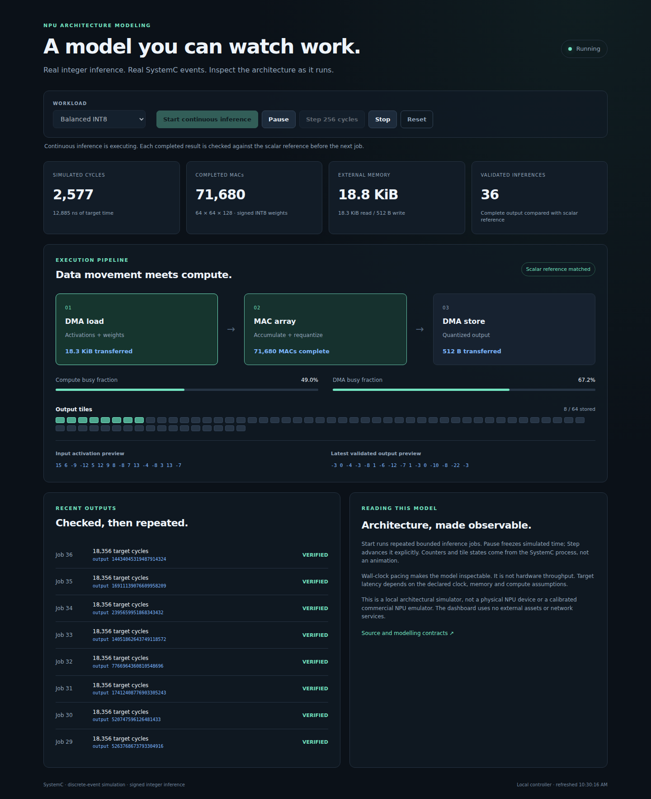

# NPU architecture modeling



A working C++17/SystemC architectural simulator for quantized neural inference, with executable graph workloads and explicit compute, SRAM and external-memory assumptions. It models signed INT8 activations, INT8 or packed INT4 weights, per-channel quantization, reduction tiling, an optional systolic-array timing model, bounded buffers, DMA arbitration and weight reuse.

The C++ engine compares every complete accumulator and output with a scalar reference. A local browser dashboard controls actual live SystemC execution, with pause, resume, stepping and repeated validated inferences. A separate persistent TLM-2.0 platform implements host MMIO, byte-addressed DRAM, DMA, clock/reset and completion interrupts. A Python graph frontend runs dense layers, convolutions and depthwise convolutions through the tiled engine, and executes explicitly identified pooling, residual and activation fallbacks on the host.

This is a generic architectural model. It is not a commercial NPU ISA emulator or an independently calibrated RTL/silicon timing model. Supported operations and remaining limits are listed in the [feature matrix](docs/FEATURE-MATRIX.md); [production NPU research](docs/PRODUCTION-NPU-RESEARCH.md) explains the design priorities with primary sources.

## Build and launch the live model

Requirements: a C++17 compiler, CMake 3.24 or newer, a build tool, and Python 3.10 or newer. CMake fetches hash-verified [SystemC 3.0.2](https://github.com/accellera-official/systemc/releases/tag/3.0.2), so initial configuration needs internet access. An installed package can be selected with `-DNPU_FETCH_SYSTEMC=OFF -DCMAKE_PREFIX_PATH=/path/to/systemc`.

```sh
cmake -S . -B build -DCMAKE_BUILD_TYPE=Release
cmake --build build -j2
python3 scripts/live_dashboard.py --binary build/npu-sim
```

Open **http://127.0.0.1:8765** and press **Start continuous inference**. The dashboard shows actual kernel progress, MAC/DMA activity, tile completion, input/output previews and validation. Pause freezes simulated time; Step advances the paused model. Each completed inference is checked before continuous mode launches the next deterministic input in a fresh simulator process. Nothing is animated as a substitute for computation. See [live controls and local API](docs/LIVE.md).

The dashboard uses only Python's standard library and binds to loopback. It is a running virtual NPU model, with no requirement for physical NPU hardware. Its host pacing makes the simulation inspectable; it is not a hardware throughput measurement.

## Batch inference, waveforms and streaming progress

```sh
ctest --test-dir build --output-on-failure
build/npu-sim --help
build/npu-sim --m 16 --n 16 --k 32 --timing event
```

The executable writes one JSON object to stdout and diagnostics to stderr. Generated fixtures are deterministic. Real tensors use the documented `NPU1` text format; channel parameters use `NPUQ1`. See [examples](examples/README.md) and [quantization](docs/QUANTIZATION.md).

Run a tiled INT4 workload with analytical array timing, reduction panels, burst overhead and a bounded weight cache:

```sh
mkdir -p results
build/npu-sim --m 17 --n 13 --k 31 \
  --tile-m 8 --tile-n 8 --tile-k 8 --weight-bits 4 \
  --array-rows 4 --array-cols 4 --dma-burst-bytes 64 \
  --weight-cache-bytes 1024 --rounding even \
  --trace results/panels.csv --vcd results/run.vcd \
  --progress-jsonl results/progress.jsonl --slice-cycles 64 > results/panels.json
```

The CSV identifies each output tile and reduction block. The native SystemC VCD exposes 21 actual signals, including resource ownership, occupancy, bytes, MACs and completion. JSONL progress reports the same running model while stdout remains one final result object. A passive `SC_METHOD` checks resource invariants without adding architecture cycles. Cache capacity is included in the SRAM reservation. Explicit array geometry and `--macs-per-cycle` are alternative compute configurations. See [SystemC tracing, snapshots and the live stdio protocol](docs/SYSTEMC.md).

## Persistent TLM-2.0 coprocessor

```sh
build/npu-tlm-demo --jobs 2 --dump-output --vcd results/tlm
```

The host sends real tensor bytes through TLM memory transactions, programs MMIO and waits for an interrupt. An independent engine reads those bytes, computes tiled inference and writes both accumulators and outputs back to memory. The host reads and validates every result, acknowledges completion, changes the input and submits the next job in the **same SystemC kernel**. The model has an actual SystemC clock, startup reset, IRQ masking, bounded DRAM accesses and shared-memory arbitration. Its fixed small workload and loosely timed serial contract are documented in [the TLM platform](docs/TLM-PLATFORM.md).

This platform and the overlapped `npu-sim` accelerator answer different questions: platform transactions and persistent-job control versus configurable tiled-pipeline architecture. Their timing contracts are explicit and their elapsed cycles should not be treated as interchangeable.

## Execute neural graphs

```sh
python3 scripts/graph_runtime.py examples/cnn.json --binary build/npu-sim
python3 scripts/graph_runtime.py examples/residual_mlp.json --binary build/npu-sim
python3 scripts/mlp_demo.py --binary build/npu-sim
```

The custom graph format carries tensor shapes, scales, zero points, dependencies and explicit quantization. It supports dense/matrix multiplication, Conv2D and depthwise Conv2D with padding, stride and dilation. Convolution is materialized lowering to the dense engine, rather than a direct-convolution line-buffer model. Add, ReLU, pooling and Flatten are labelled host fallbacks. Graph reports include tensor liveness, lowering workspace and per-node placement; host fallback work is excluded from NPU cycles.

Layer invocations are sequential, with complete off-chip outputs between layers. There is no cross-layer overlap or retained SRAM. See [graph runtime](docs/GRAPH-RUNTIME.md) for layouts, scale validation and supported operators. The optional [ONNX importer](docs/ONNX.md) accepts a strict signed-INT8 subset: rank-two `QLinearMatMul`, and static `QLinearConv` with ordinary or depthwise grouping. It requires exactly representable scale ratios, uses nearest-even rounding, and converts convolution layouts explicitly. Unsupported graphs fail rather than being approximated.

## Import a supported ONNX model

Optional packages are isolated from the core simulator:

```sh
python3 -m venv .venv-onnx
.venv-onnx/bin/python -m pip install -r requirements-onnx.txt
.venv-onnx/bin/python scripts/onnx_import.py model.onnx \
  --inputs input-values.json --output imported-graph.json --run --binary build/npu-sim
```

The input JSON maps external ONNX input names to typed tensor objects with explicit `dtype`, `shape` and flat signed INT8 `data` in their original layout. The importer writes a new graph file and does not overwrite existing output. ONNX Runtime is an independent numerical backend for optional tests, not the simulator's inference engine. See the import documentation for exact shapes, scale restrictions and rejection behavior.

## Explore architecture choices

```sh
python3 scripts/sweep.py --binary build/npu-sim --output-dir results/sweep
python3 scripts/compare_modes.py --binary build/npu-sim --output-dir results/modes
python3 scripts/autotune.py --binary build/npu-sim --m 17 --n 13 --k 31 \
  --tile-m-options 2,4,8 --tile-n-options 2,4,8 \
  --tile-k-options 0,8,16 --slot-options 1,2 \
  --sram-bytes 4096 --output-dir results/search
```

The mapping search enumerates a bounded candidate set, rejects SRAM-infeasible mappings, preserves numerical identity, and reports a best candidate and latency/SRAM Pareto set. Its optimum applies to the enumerated choices under this timing contract. Architecture sweeps compare modeled target cycles. Timing-mode experiments separately compare host simulator runtime; a faster simulator does not imply faster target hardware.

Energy analysis requires declared coefficients, without invented default silicon costs:

```sh
build/npu-sim --m 16 --n 16 --k 32 > results/layer.json
python3 scripts/energy_report.py --result results/layer.json \
  --mac-pj "$MAC_PJ" --dram-byte-pj "$DRAM_BYTE_PJ" --static-mw "$STATIC_MW"
```

Set these variables from measurements or clearly stated experimental assumptions. The report separates MAC, external-read/write and constant static components, and lists excluded effects. See [energy assumptions and units](docs/ENERGY.md).

## Model controls

| Options | Meaning |
| --- | --- |
| `--m`, `--n`, `--k`, `--input` | Deterministic workload dimensions or real input tensors. |
| `--tile-m`, `--tile-n`, `--tile-k` | Output tiling and reduction panels; zero reduction tile means full reduction. |
| `--weight-bits 4\|8` | Signed weight range and packed weight traffic; activations remain INT8. |
| `--macs-per-cycle` | Aggregate vector MAC budget. |
| `--array-rows`, `--array-cols` | Alternative analytical systolic geometry, including folds and fill/drain. |
| `--pipeline-cycles` | Compute overhead charged for every reduction panel. |
| `--memory-bytes-per-cycle`, `--memory-latency` | Shared DMA bandwidth and startup latency. |
| `--dma-burst-bytes` | Burst size limit; each burst pays latency, with whole-request arbitration. |
| `--weight-cache-bytes` | Optional fully associative LRU weight-panel cache. |
| `--buffer-slots`, `--sram-bytes` | End-to-end tile slots and total accelerator SRAM capacity. |
| `--input-zero`, `--weight-zero`, `--output-zero` | Scalar integer zero points. |
| `--multiplier`, `--shift`, `--quantization-file` | Scalar or output-channel integer rescaling. |
| `--rounding away\|even`, `--relu` | Nearest rounding tie policy and optional fused ReLU. |
| `--timing event\|cycle` | Whole-stage jumps or single-cycle waits under the same contract. |
| `--frequency-mhz`, `--seed` | Target-time reporting and deterministic generated fixtures. |
| `--trace`, `--dump-output` | Stage CSV and full accumulator/output JSON arrays. |
| `--vcd PATH.vcd` | Native SystemC signal waveforms, including delta-cycle transitions. |
| `--progress-jsonl`, `--slice-cycles` | Running snapshots at a bounded observation cadence. |
| `--live-stdio` | Paused kernel controlled through `advance N`, `snapshot` and `stop`. |

Read [architecture](docs/ARCHITECTURE.md), the [implementation contract](docs/IMPLEMENTATION-CONTRACT.md), [validation method](docs/VALIDATION.md), and [verified results](docs/VALIDATED-RESULTS.md) before interpreting performance claims. Floating-point datapaths, sparse execution, attention, physical SRAM/DRAM/NoC contention, proprietary command streams and hardware calibration are separate features, not implied by matrix multiplication support.
