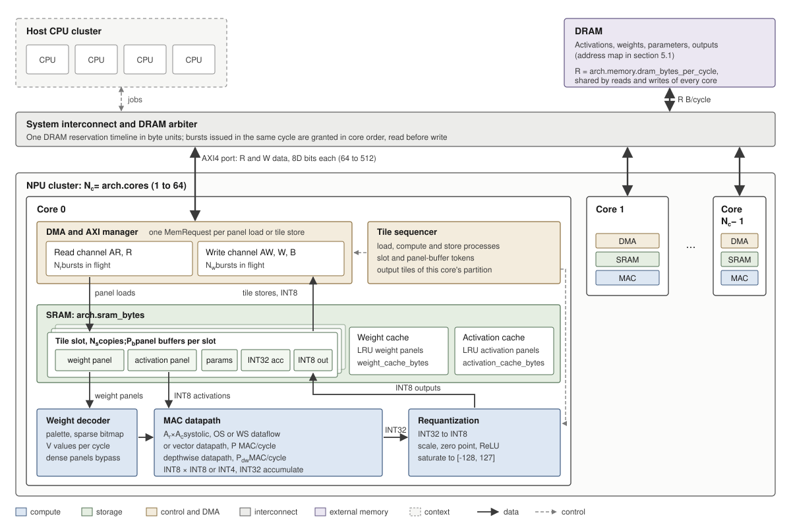
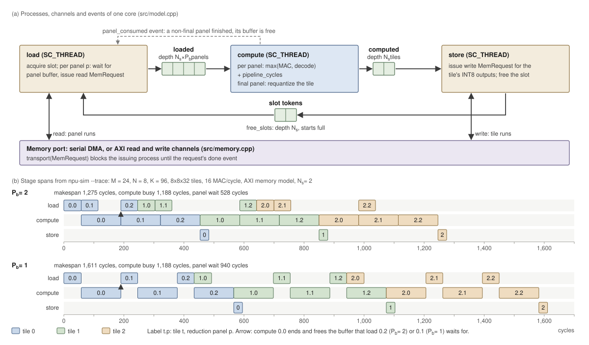

# Architecture

This document specifies the microarchitecture that `npu-sim` models: the compute datapath, the
tiling and loop nest, the on-chip storage, the memory system, the multi-core cluster, the SystemC
scheduling that couples them, and the observation points the simulator exposes. Each mechanism
names its defining source file; [methodology](methodology.md#model-fidelity) section 3 gives
its fidelity. Arithmetic and the compressed weight formats are specified in
[numerics](numerics.md); command-line use and the result schema in [usage](usage.md).

| Mechanism | Defining source |
|---|---|
| Configuration structure, enumerations | `include/npu/config.hpp` |
| Option table: flags, JSON paths, defaults | `src/options.cpp` |
| Validation, panel timing, traffic, address map, AXI bursts, DRAM timeline, cluster plan | `src/core.cpp`, `include/npu/core.hpp` |
| Convolution geometry, input footprints, im2col view | `src/conv.cpp` |
| Serial DMA and AXI memory models | `src/memory.cpp`, `include/npu/memory.hpp` |
| Core pipeline, weight cache, cluster, observer | `src/model.cpp`, `include/npu/model.hpp` |
| Result, snapshot and live protocol | `src/main.cpp` |

## 1 Overview

### 1.1 Block diagram



*Figure 1. NPU cluster. Solid arrows carry data, dashed arrows control. The host CPU cluster is
outside the model: `npu-sim` receives one job, a grouped GEMM, and runs it to completion.*

An NPU cluster holds $N_c$ identical cores. Each core holds a tile sequencer, a DMA engine with
one memory port (serial DMA, or AXI read and write channels), an SRAM partitioned into tile
slots and panel caches, a weight decoder, a MAC datapath with a depthwise datapath, and a
requantization unit. All cores share one DRAM through the system interconnect.

### 1.2 Unit of work

One job is a grouped GEMM: $G$ independent products that share $M$ output rows, with INT8
activations, INT8 or INT4 weights and INT32 bias.

$$Y_g = X_g W_g + b_g, \qquad X_g \in \mathbb{Z}^{M \times K},\; W_g \in \mathbb{Z}^{K \times N},\; g = 0, \dots, G-1$$

Activations are stored as one $M \times GK$ matrix, weights as $G$ blocks of $K \times N$, and
outputs as one $M \times GN$ matrix (`ShapeConfig`, `include/npu/config.hpp`). A dense layer
is $G = 1$. A grouped convolution lowered to GEMM has $M = H_{\mathrm{out}} W_{\mathrm{out}}$,
$K = k_h k_w C_{\mathrm{in}}/G$ and $N = C_{\mathrm{out}}/G$; depthwise convolution is $G = C$,
$N = 1$, $K = k_h k_w$. With `shape.conv` set, the activation matrix is the im2col view of an
NHWC input tensor held in DRAM, and panel loads read the input footprint of each tile
(section 4.4).

The output is cut into tiles of $T_m \times T_n$ elements within one group, and the reduction
dimension into panels of depth $K_\pi$. A core moves each tile through three stages: load (one
DMA read per reduction panel), compute (one MAC pass per reduction panel), and store (one DMA
write of the INT8 output tile). Tile slots and panel buffers let the three stages of different
panels and tiles overlap. A cluster splits the tiles among its cores.

### 1.3 Notation

| Symbol | Meaning | Configuration |
|---|---|---|
| $M, N, K, G$ | Output rows; output channels and reduction depth per group; groups | `shape.m`, `shape.n`, `shape.k`, `shape.groups` |
| $T_m, T_n$ | Tile rows and columns | `mapping.tile_m`, `mapping.tile_n` |
| $M_t, N_t$ | Extents of one tile, clipped at the matrix edge | |
| $C_t$ | Channels of a depthwise-datapath tile, clipped at the last channel | `mapping.tile_n` |
| $H, W, C$ | Height, width and channels of the NHWC input of a convolution | `shape.conv.input_h`, `input_w`, `input_c` |
| $k_h, k_w$; $C_g$ | Kernel extents; input channels per group, $C / G$ | `shape.conv.kernel_h`, `kernel_w` |
| $K_\pi$ | Panel depth: `mapping.tile_k`, or $K$ when it is 0 | `mapping.tile_k` |
| $n_k$ | Reduction panels per tile, $\lceil K / K_\pi \rceil$ | |
| $K_p$ | Depth of panel $p$: $K_\pi$, or the remainder for the last panel | |
| $N_s$ | Tile slots per core | `mapping.buffer_slots` |
| $P_b$ | Panel buffers per slot: `mapping.panel_buffers`, at most $n_k$ | `mapping.panel_buffers` |
| $P$ | Vector-datapath MACs per cycle | `arch.compute.macs_per_cycle` |
| $A_r, A_c$ | Systolic array rows and columns | `arch.compute.array_rows`, `array_cols` |
| $P_{\mathrm{dw}}$ | Depthwise-datapath MACs per cycle | `arch.compute.depthwise_macs_per_cycle` |
| $C_{\mathrm{pipe}}$ | Fixed cycles per reduction panel | `arch.compute.pipeline_cycles` |
| $V$ | Weight-decoder values per cycle | `arch.compute.weight_decode_values_per_cycle` |
| $b_w$ | Weight bits | `weights.bits` |
| $b_p$ | Palette index bits | `weights.palette_bits` |
| $B_s$ | Sparse bitmap block length | `weights.sparse_block` |
| $\mu_c, S_c$ | Requantization multiplier and right shift of output channel $c$ | `quant.multiplier`, `shift`, `multipliers`, `shifts` |
| $z_a, z_{w,c}, z_o$ | Activation, weight and output zero points | `quant.input_zero`, `weight_zero`, `weight_zero_points`, `output_zero` |
| $Q$ | Per-channel parameter vectors present, 0 to 3 | `quant.weight_zero_points`, `multipliers`, `shifts` |
| $R_{\mathrm{dma}}, L, \Lambda$ | Serial DMA bytes per cycle, latency per burst, burst bytes | `arch.memory.bytes_per_cycle`, `latency`, `burst_bytes` |
| $D$ | AXI bytes per beat | `arch.memory.axi.data_bytes` |
| $b_{\max}$ | Longest AXI burst in beats | `arch.memory.axi.max_burst_beats` |
| $N_r, N_w$ | AXI read and write bursts in flight | `arch.memory.axi.read_outstanding`, `write_outstanding` |
| $L_r, L_w$ | AXI read latency (AR to first R beat), write latency (last W beat to B) | `arch.memory.axi.read_latency`, `write_latency` |
| $R$ | DRAM bytes per cycle shared by every port; 0 is unlimited | `arch.memory.dram_bytes_per_cycle` |
| $C_w, C_a$ | Weight-cache and activation-cache bytes per core | `arch.weight_cache_bytes`, `arch.activation_cache_bytes` |
| $N_c$ | Cores | `arch.cores` |

### 1.4 Abbreviations

| Term | Meaning |
|---|---|
| GEMV | Matrix-vector product, a GEMM with $M = 1$ |
| LUT | Lookup table of a palette-encoded weight panel ([numerics](numerics.md) section 4.2) |
| OPP | Operating performance point, a voltage and frequency pair ([SoC integration](soc-integration.md) section 2.6) |
| OS | Output-stationary (section 3.3) |
| PE | Processing element of the systolic array |
| TPOT | Time per output token |
| TTFT | Time to first token |
| WS | Weight-stationary (section 3.4) |

## 2 Design parameters

### 2.1 Parameter table

The option table in `src/options.cpp` is the single list of configuration fields. It drives the
command line, `--help`, `--config` files and the `config` object echoed in every result. The
architectural rows follow; shape (`shape.*`) is described in section 4.1, the convolution
geometry (`shape.conv.*`) in section 4.4, quantization (`quant.*`) in [numerics](numerics.md)
section 2, and simulation options (`sim.*`) in section 7.4. Ranges are the checks of
`validate` in `src/core.cpp`.

| Parameter | Flag | Unit | Range | Default | Meaning |
|---|---|---|---|---:|---|
| `arch.compute.macs_per_cycle` | `--macs-per-cycle` | MAC/cycle | 1 to $10^9$ | 64 | Vector datapath throughput $P$; unused when an array is configured |
| `arch.compute.array_rows` | `--array-rows` | PE rows | 0, or 1 to 256 | 0 | Array rows $A_r$; 0 together with `array_cols` 0 selects the vector datapath |
| `arch.compute.array_cols` | `--array-cols` | PE columns | 0, or 1 to 256 | 0 | Array columns $A_c$ |
| `arch.compute.dataflow` | `--dataflow` | enumeration | `os`, `ws` | `os` | Array dataflow, sections 3.3 and 3.4 |
| `arch.compute.pipeline_cycles` | `--pipeline-cycles` | cycles | 0 to $10^9$ | 4 | $C_{\mathrm{pipe}}$, charged once per reduction panel |
| `arch.compute.weight_decode_values_per_cycle` | `--weight-decode-values-per-cycle` | values/cycle | 1 to $10^9$ | 16 | Decoder throughput $V$ |
| `arch.compute.depthwise_macs_per_cycle` | `--depthwise-macs-per-cycle` | MAC/cycle | 0 to $10^9$ | 0 | Depthwise datapath throughput $P_{\mathrm{dw}}$, section 3.5; 0 runs depthwise problems as grouped GEMMs |
| `arch.memory.model` | `--memory-model` | enumeration | `serial`, `axi` | `serial` | Memory model, sections 5.3 and 5.4 |
| `arch.memory.bytes_per_cycle` | `--memory-bytes-per-cycle` | B/cycle | 1 to $10^9$ | 16 | Serial DMA rate $R_{\mathrm{dma}}$ |
| `arch.memory.latency` | `--memory-latency` | cycles | 0 to $10^9$ | 12 | Serial DMA latency $L$, charged per burst |
| `arch.memory.burst_bytes` | `--dma-burst-bytes` | bytes | 0 to $10^9$ | 0 | Serial burst size $\Lambda$; 0 moves each request as one burst |
| `arch.memory.dram_bytes_per_cycle` | `--dram-bytes-per-cycle` | B/cycle | 0 to $10^9$ | 0 | DRAM rate $R$ shared by all AXI channels; 0 is unlimited |
| `arch.memory.axi.data_bytes` | `--axi-data-bytes` | B/beat | 8, 16, 32, 64 | 16 | Beat width $D$; each channel moves one beat per cycle |
| `arch.memory.axi.max_burst_beats` | `--axi-burst-beats` | beats | 1 to 256 | 16 | Longest INCR burst $b_{\max}$ |
| `arch.memory.axi.read_outstanding` | `--axi-read-outstanding` | bursts | 1 to 64 | 4 | Read bursts in flight $N_r$ |
| `arch.memory.axi.write_outstanding` | `--axi-write-outstanding` | bursts | 1 to 64 | 4 | Write bursts in flight $N_w$ |
| `arch.memory.axi.read_latency` | `--axi-read-latency` | cycles | 0 to $10^9$ | 12 | $L_r$, AR issue to first R beat |
| `arch.memory.axi.write_latency` | `--axi-write-latency` | cycles | 0 to $10^9$ | 12 | $L_w$, last W beat to B response |
| `arch.sram_bytes` | `--sram-bytes` | bytes | at least the budget of section 4.6 | 262,144 | SRAM per core |
| `arch.weight_cache_bytes` | `--weight-cache-bytes` | bytes | 0 to $10^9$ | 0 | Weight-panel cache $C_w$ per core, section 4.7; 0 disables it |
| `arch.activation_cache_bytes` | `--activation-cache-bytes` | bytes | 0 to $10^9$ | 0 | Activation-panel cache $C_a$ per core, section 4.8; 0 disables it |
| `arch.frequency_mhz` | `--frequency-mhz` | MHz | $10^{-6}$ to $10^9$ | 200 | Converts cycles to time in reports |
| `arch.cores` | `--cores` | cores | 1 to 64 | 1 | Cores $N_c$ |
| `mapping.tile_m` | `--tile-m` | rows | 1 to 1,048,576 | 8 | Tile rows $T_m$ |
| `mapping.tile_n` | `--tile-n` | columns | 1 to 1,048,576 | 8 | Tile columns $T_n$ |
| `mapping.tile_k` | `--tile-k` | elements | 0, or 1 to 1,048,576 | 0 | Panel depth $K_\pi$; 0 is one panel of depth $K$ |
| `mapping.buffer_slots` | `--buffer-slots` | tiles | 1 to 64 | 2 | Tile slots $N_s$ |
| `mapping.panel_buffers` | `--panel-buffers` | buffers per slot | 1, 2 | 2 | Reduction-panel buffers per slot |
| `mapping.partition` | `--partition` | enumeration | `m`, `n`, `auto` | `auto` | Cluster work split, section 6.2 |
| `weights.bits` | `--weight-bits` | bits | 4, 8 | 8 | Signed weight precision $b_w$ |
| `weights.encoding` | `--weight-encoding` | enumeration | `dense`, `palette`, `sparse` | `dense` | Weight storage format, section 3.7 |
| `weights.palette_bits` | `--palette-bits` | bits | 1, 2, 4, 8 | 4 | Palette index width $b_p$ |
| `weights.sparse_block` | `--sparse-block` | values | 1 to 4096 | 8 | Zero-skipping bitmap block length $B_s$ |

### 2.2 Cross-parameter rules

| Rule | Checked in |
|---|---|
| `array_rows` and `array_cols` are both 0 or both in 1 to 256 | `validate_mapping`, `src/core.cpp` |
| `dataflow ws` requires an array | `validate_mapping` |
| `--macs-per-cycle` with `--array-rows` or `--array-cols`, and `--dataflow` without an array, are rejected on the command line | `parse`, `src/main.cpp` |
| `weights.encoding sparse` requires the vector datapath | `validate_mapping` |
| A problem on the depthwise datapath requires dense weights | `validate_mapping` |
| `shape.conv` sets all three input extents; $C$ is a multiple of $G$; $M = H_o W_o$ and $K = k_h k_w C_g$ (section 4.4); the kernel reach fits the padded input | `conv_geometry`, `src/conv.cpp` |
| With `shape.conv`, `mapping.tile_k` is 0 or a multiple of $k_w C_g$ | `validate_mapping` |
| `arch.cores` above 1 requires `arch.memory.model axi` | `validate` |
| Serial-only flags are rejected under `axi` and AXI flags under `serial`; config files may carry both groups | `parse` |
| `arch.sram_bytes` is at least the SRAM budget of section 4.6 | `validate` |
| INT4 weight zero points lie in $-8$ to $7$ | `validate` |
| $M, N, K, G$ lie in 1 to 1,048,576, and so do $GN$ and $GK$ | `validate_shape` |
| $GMNK \le 4 \cdot 10^9$ for a bit-exact run, $\le 10^{13}$ with `--timing-only` | `validate_shape` |
| `--timing-only` requires dense weights | `validate` |
| The serial work bound (every stage of every tile back to back) is below $2^{53}$ cycles, and at most $10^7$ cycles in cycle mode | `validate` |

## 3 Compute datapath

### 3.1 Organization

The MAC datapath is one of three engines, selected per job (`mac_cycles`, `src/core.cpp`):

| Engine | Selected by | Peak MAC/cycle per core |
|---|---|---|
| Vector datapath | `array_rows` = `array_cols` = 0 | $P$ |
| Systolic array, output-stationary or weight-stationary | `array_rows`, `array_cols` in 1 to 256 | $A_r A_c$ |
| Depthwise datapath | $P_{\mathrm{dw}} > 0$, $G > 1$ and $N = 1$ (`channel_wise`) | $P_{\mathrm{dw}}$ |

The engine computes one reduction panel at a time: an $M_t \times K_p$ activation panel against a
$K_p \times N_t$ weight panel, accumulating into the tile's INT32 partial sums. Every panel costs

$$C_p = \max\left(C_{\mathrm{MAC}}(M_t, N_t, K_p),\; C_{\mathrm{dec}}\right) + C_{\mathrm{pipe}} \tag{3.1}$$

where $C_{\mathrm{dec}} = 0$ for dense weights (section 3.7). `effective_macs_per_cycle` in the
result is $N_c$ times the peak of the configured engine (`peak_macs_per_cycle`).

### 3.2 Vector datapath

$P$ MAC units take any $P$ products of the panel per cycle:

$$C_{\mathrm{MAC}}^{\mathrm{vec}} = \left\lceil \frac{M_t N_t K_p}{P} \right\rceil \tag{3.2}$$

### 3.3 Output-stationary array

Each PE holds one output element. The array covers an $A_r \times A_c$ block of the tile and
streams the $K_p$ reduction elements through it; the tile takes
$\lceil M_t / A_r \rceil \lceil N_t / A_c \rceil$ such output waves. Waves issue back to back, so
the skew fill and drain of $A_r + A_c - 2$ cycles is exposed once per panel:

$$C_{\mathrm{MAC}}^{\mathrm{OS}} = \left\lceil \frac{M_t}{A_r} \right\rceil \left\lceil \frac{N_t}{A_c} \right\rceil K_p + (A_r + A_c - 2) \tag{3.3}$$

A wave whose rows or columns fall short of the array occupies the full array for $K_p$ cycles.

### 3.4 Weight-stationary array

Each PE holds one weight. The array covers an $A_r \times A_c$ block of the weight panel and
streams the tile's $M_t$ activation rows through it; the panel takes
$F = \lceil K_p / A_r \rceil \lceil N_t / A_c \rceil$ weight folds, and partial sums accumulate
across folds in the accumulator buffer. The first fold's $A_r$-cycle weight preload is exposed.
Each later preload shifts in while the previous fold streams, so a fold occupies
$\max(M_t, A_r)$ cycles and the last fold $M_t$ cycles; the skew is exposed once:

$$C_{\mathrm{MAC}}^{\mathrm{WS}} = A_r + (F - 1)\max(M_t, A_r) + M_t + (A_r + A_c - 2) \tag{3.4}$$

Output-stationary pays $K_p$ cycles per wave and idles PEs when $M_t$ or $N_t$ is not a multiple
of the array. Weight-stationary pays $\max(M_t, A_r)$ cycles per fold, idles PEs when $K_p$ or
$N_t$ is not a multiple of the array, and idles cycles when $M_t < A_r$. Study S5 in
[results](results.md) compares the two on every MobileNetV2 and ResNet-50 layer that runs on
the array.

| Panel, $M_t = N_t = 32$, $K_p = 64$, $C_{\mathrm{pipe}} = 4$ | Equation | $C_p$ | `compute_busy_cycles` from `npu-sim` |
|---|---|---:|---:|
| Vector, $P = 256$ | $65536/256 + 4$ | 260 | 260 |
| $16 \times 16$ output-stationary | $2 \cdot 2 \cdot 64 + 30 + 4$ | 290 | 290 |
| $16 \times 16$ weight-stationary, $F = 8$ | $16 + 7 \cdot 32 + 32 + 30 + 4$ | 306 | 306 |

The rows come from `npu-sim --m 32 --n 32 --k 64 --tile-m 32 --tile-n 32` with
`--macs-per-cycle 256`, or `--array-rows 16 --array-cols 16 --dataflow os|ws`.

### 3.5 Depthwise datapath

A depthwise layer as a grouped GEMM has $N = 1$ and $K = k_h k_w$: every group is a
matrix-vector product, and a tile confined to one group is one column wide, so an array runs
it on one of its $A_c$ columns and each tile pays a request of its own. With
$P_{\mathrm{dw}} > 0$, $G > 1$ and $N = 1$ (`channel_wise`, `src/core.cpp`) the core runs the
problem on the depthwise datapath instead; $P_{\mathrm{dw}} = 0$, the default, keeps the
grouped GEMM on the configured engine.

| Property | Depthwise datapath |
|---|---|
| Tile grid | One group of $G$ columns: a tile is $T_m$ rows by $T_n$ consecutive channels, $C_t = \min(T_n, G - jT_n)$ (`grid_groups`, `grid_columns`) |
| Panel work | $M_t C_t K_p$ MACs; each channel reduces its own $K_p$ activations against its own weights |
| Panel loads | Activations of the $C_t$ channels, one weight panel of $K_p C_t$ values, on the first panel $C_t$ parameter records (section 5.1) |
| Weights | Dense only; palette and sparse encodings are rejected |
| Peak | $P_{\mathrm{dw}}$ per core; `effective_macs_per_cycle` is $N_c P_{\mathrm{dw}}$ |
| Statistics | `depthwise_macs`, `depthwise_peak_macs_per_cycle` ($N_c P_{\mathrm{dw}}$), `depthwise_mac_utilization` |

A reduction panel takes

$$C_p^{\mathrm{dw}} = \left\lceil \frac{M_t C_t K_p}{P_{\mathrm{dw}}} \right\rceil + C_{\mathrm{pipe}} \tag{3.5}$$

The rows below come from `npu-sim --m 16 --n 1 --k 9 --groups 32 --tile-m 8 --tile-n 8`, a
3x3 depthwise layer of 32 channels on the default vector datapath and serial DMA:

| `--depthwise-macs-per-cycle` | Tiles | Panel $C_p$ | `compute_busy_cycles` | `dma_requests` | `read_bytes` | `cycles` |
|---:|---:|---|---:|---:|---:|---:|
| 0, grouped GEMM | 64 of $8 \times 1$ | $\lceil 72/64 \rceil + 4 = 6$ | 384 | 128 | 5,440 | 1,984 |
| 16 | 8 of $8 \times 8$ channels | $\lceil 576/16 \rceil + 4 = 40$ | 320 | 16 | 5,440 | 592 |

Both mappings move the same bytes. The channel tiles move them in 16 requests where the
one-column tiles issue 128, and the serial DMA charges its latency once per request
(section 5.3).

### 3.6 Pipeline overhead

$C_{\mathrm{pipe}}$ is a fixed charge per reduction panel, added to the MAC and decode time of every
engine. A tile of $n_k$ panels pays it $n_k$ times, so a small $K_\pi$ trades SRAM (section 4.6)
against $n_k C_{\mathrm{pipe}}$ cycles per tile.

### 3.7 Weight decoder

Weights are stored in one of three formats (`weights.encoding`); the format sets the bytes a
panel load moves and the decoder work per panel. [Numerics](numerics.md) section 4 specifies
the byte formats and their encoded sizes $B_W(E)$ for a panel of $E = K_p N_t$ elements.

| Format | Decoder cycles $C_{\mathrm{dec}}$ | MAC cycles |
|---|---|---|
| `dense` | 0, the decoder is bypassed | Equations 3.2 to 3.4 |
| `palette` | $\lceil E / V \rceil$ | Equations 3.2 to 3.4 |
| `sparse` | $\lceil \beta / V \rceil + \lceil E_r / V \rceil$ | $\lceil M_t \nu / P \rceil$, vector datapath only |

Here $\beta = \lceil E / B_s \rceil$ is the number of bitmap blocks, $E_r$ the elements of
retained blocks, and $\nu$ the elements that differ from their channel's weight zero point. The
decoder runs ahead of the MAC datapath and streams decoded values into it, so equation 3.1 takes
the larger of the two terms (`encoded_panel_compute_cycles`,
`src/core.cpp`). Decode work repeats for every output-row tile that uses a panel, including tiles
whose panel hits the weight cache. `executed_macs` counts $M_t \nu$ per sparse panel and the full
panel otherwise; `skipped_macs` is the difference to $GMNK$.

INT4 weights travel packed two per byte; each panel rounds its own byte count up, so a panel with
an odd element count carries one padding nibble.

### 3.8 Accumulation and requantization

The datapath accumulates

$$a_{r,c} = b_c + \sum_{k=0}^{K-1} (x_{r,k} - z_a)(w_{k,c} - z_{w,c}) \tag{3.6}$$

exactly and requires the final value to fit INT32. Partial sums stay in the slot's INT32
accumulator across the tile's $n_k$ panels; the bias enters once. The requantization unit runs on
the final panel only and maps each accumulator to INT8:

$$q_{r,c} = \operatorname{clamp}_{[-128,\,127]}\big(\max(z_o + \rho(a_{r,c}; \mu_c, S_c),\; \zeta)\big), \qquad \zeta = \begin{cases} z_o & \text{ReLU} \\ -\infty & \text{otherwise} \end{cases} \tag{3.7}$$

| `quant.rescale` | Rescale $\rho(a; \mu, S)$ | Shift range |
|---|---|---|
| `native` | $\operatorname{sgn}(a\mu)\,\operatorname{round}_t\left(\lvert a\mu \rvert / 2^S\right)$, ties away from zero or to even (`quant.rounding`) | 0 to 31 |
| `tosa-single` | $\lfloor (a\mu + 2^{S-1}) / 2^S \rfloor$, TOSA 1.0.2 `apply_scale_32` without double rounding; $a$ outside $[-2^{S-1}, 2^{S-1})$ is rejected | 2 to 62 |
| `tosa-double` | As `tosa-single`, with the rounding term moved $2^{30}$ away from zero when $S > 31$ | 2 to 62 |

$\mu_c$, $S_c$ and $z_{w,c}$ are per-channel when the vectors are present ($Q > 0$). The
requantization unit has no timing term of its own: the final panel's duration is $C_p$.
[Numerics](numerics.md) sections 1 and 2 give the complete arithmetic, the equivalences of the
TOSA modes with TFLite, gemmlowp and CMSIS-NN, and the golden vectors.

## 4 Tiling and loop nest

### 4.1 Tiles and panels

The output of group $g$ is cut into $\lceil M / T_m \rceil \times \lceil N / T_n \rceil$ tiles.
Tile $(g, i, j)$ covers rows $iT_m$ to $iT_m + M_t - 1$ and columns $jT_n$ to $jT_n + N_t - 1$ of
group $g$, with $M_t = \min(T_m, M - iT_m)$ and $N_t = \min(T_n, N - jT_n)$. A tile never spans
two groups. Tile identifiers (`tile_id` in traces) run group-major, then row, then column
(`for_each_tile`, `src/core.cpp`):

$$\operatorname{id}(g, i, j) = \left(g \left\lceil \frac{M}{T_m} \right\rceil + i\right) \left\lceil \frac{N}{T_n} \right\rceil + j$$

On the depthwise datapath (section 3.5) the grid is one group of $G$ columns, one per channel:
tile $(i, j)$ covers rows $iT_m$ to $iT_m + M_t - 1$ and channels $jT_n$ to $jT_n + C_t - 1$,
and its identifier is $i \lceil G / T_n \rceil + j$.

Every tile has the same $n_k$ reduction panels; panel $p$ covers reduction indexes $pK_\pi$ to
$pK_\pi + K_p - 1$, with $K_p = \min(K_\pi, K - pK_\pi)$.

### 4.2 Loop nest

One core executes its tile list in identifier order. The loop nest below shows the order of
issue; the three stages run as concurrent processes (section 7), so the load of a later panel
overlaps the compute of an earlier one.

```text
for g in groups of this core:                      # group-major
  for i in row tiles:                               # T_m rows
    for j in column tiles:                          # T_n columns
      acquire a tile slot                           # blocks when N_s tiles are in flight
      for p in 0 .. n_k-1:                          # reduction panels of depth K_pi
        wait for panel buffer p mod P_b             # freed when panel p-P_b is computed
        load  A[g, rows i, panel p]                 # M_t runs of K_p bytes, skipped on an
                                                    # activation-cache hit
              W[g, panel p, columns j]              # skipped on a weight-cache hit
              params[g, columns j]   if p == 0      # bias and per-channel vectors
        compute C_p cycles; accumulate INT32
      requantize the tile                           # with the final panel
      store Y[g, rows i, columns j]                 # M_t runs of N_t bytes
      release the slot
```

Within a group, consecutive tiles share the activation rows of row tile $i$, and tiles of the
same column $j$ recur once per row tile, $\lceil N / T_n \rceil n_k$ panel loads apart.

### 4.3 Traffic and reuse

A load of panel $p$ of a tile moves

$$B_{\mathrm{load}}(p) = \underbrace{B_A(p)}_{\text{activations, unless cached}} + \underbrace{B_W(K_p N_t)}_{\text{weights, unless cached}} + \underbrace{[p = 0]\; 4 N_t (1 + Q)}_{\text{bias and per-channel records}} \tag{4.1}$$

where $B_W(E)$ is the encoded size of section 3.7 and $B_A(p)$ the activation bytes: $M_t K_p$
for a GEMM tile, $M_t C_t K_p$ for a depthwise-datapath tile, and the input footprint of
section 4.4 under `shape.conv`. A depthwise-datapath tile has $N_t = C_t$ in the weight and
record terms. A tile store moves $M_t N_t$ bytes of INT8 outputs. INT32 accumulators never
leave the core. Without caches and without `shape.conv`, the job's DRAM traffic is

| Operand | Bytes per job | Use of each loaded element |
|---|---|---|
| Activations | $G M K \lceil N / T_n \rceil$ | $N_t$ MACs |
| Weights, dense | $G \lceil M / T_m \rceil \sum_{j,p} \lceil K_p N_t b_w / 8 \rceil$ | $M_t$ MACs |
| Bias and per-channel records | $G \lceil M / T_m \rceil \cdot 4 N (1 + Q)$ | $M_t$ outputs |
| Outputs | $G M N$ | |

$T_n$ sets activation reuse and $T_m$ weight reuse. The weight cache (section 4.7) removes the
$\lceil M / T_m \rceil$ factor on the weights when a group's column panels fit it, and the
activation cache (section 4.8) removes the $\lceil N / T_n \rceil$ factor on the activations
when a row tile's panels fit it. On the depthwise datapath each activation byte is read once,
$GMK$ bytes in all, and the weights once per row tile. The panel depth $K_\pi$ leaves the
activation and INT8 weight bytes of a GEMM unchanged and sets the SRAM per panel buffer. The
default run, $M = N = 16$ and $K = 32$ in four $8 \times 8$ tiles of one panel, reads
$4 \cdot (8 \cdot 32 + 32 \cdot 8 + 4 \cdot 8) = 2176$ bytes, the `read_bytes` it reports.

### 4.4 Implicit convolution

With `shape.conv` set (`ConvConfig`, `include/npu/config.hpp`), the activation operand of a
convolution stays in DRAM as its NHWC input tensor of $H \times W \times C$ INT8 values, and
each panel load reads the part of it that the tile's output pixels touch. Setting `input_h`,
`input_w` and `input_c` enables the mode; the other keys default to a 1x1 kernel, unit stride
and dilation, and no padding.

| Config key | Symbol | Meaning |
|---|---|---|
| `shape.conv.input_h`, `input_w`, `input_c` | $H, W, C$ | Input extents; $C$ is a multiple of $G$, $C_g = C / G$ |
| `shape.conv.kernel_h`, `kernel_w` | $k_h, k_w$ | Kernel extents |
| `shape.conv.stride_h`, `stride_w` | $s_h, s_w$ | Strides |
| `shape.conv.dilation_h`, `dilation_w` | $d_h, d_w$ | Dilations |
| `shape.conv.pad_top`, `pad_left`, `pad_bottom`, `pad_right` | $p_t, p_l, p_b, p_r$ | Rows and columns of activation zero point around the input |

The geometry fixes the GEMM shape (`conv_geometry`, `src/conv.cpp`):

$$H_o = \left\lfloor \frac{H + p_t + p_b - d_h(k_h - 1) - 1}{s_h} \right\rfloor + 1, \qquad W_o = \left\lfloor \frac{W + p_l + p_r - d_w(k_w - 1) - 1}{s_w} \right\rfloor + 1 \tag{4.2}$$

with $M = H_o W_o$ and $K = k_h k_w C_g$. GEMM row $m$ is output pixel
$(o_y, o_x) = (\lfloor m / W_o \rfloor, m \bmod W_o)$, and reduction index
$(k_y k_w + k_x) C_g + c$ of group $g$ is input channel $g C_g + c$ at input row
$o_y s_h + k_y d_h - p_t$ and column $o_x s_w + k_x d_w - p_l$. A position outside the input
reads the activation zero point, which contributes nothing to equation 3.6, so the arithmetic is
that of the GEMM on the im2col matrix (`im2col`, `src/conv.cpp`). A kernel row is $k_w C_g$
consecutive reduction indexes; `mapping.tile_k` is 0 or a multiple of $k_w C_g$, so every
panel covers whole kernel rows.

The footprint of a panel is a list of input-row spans (`conv_input_spans`, `src/conv.cpp`):

1. The input rows are those that the tile's output rows reach through the panel's kernel rows,
   clipped to $[0, H)$.
2. Per input row, the span runs from the leftmost to the rightmost input column that any of the
   tile's output pixels needs from that row, clipped to $[0, W)$. A stride wider than the
   kernel's reach leaves skipped columns inside the span, and they are read.
3. Padding positions are not read.

The panel's activation bytes are the summed span widths times the panel's channels: $C_g$ for
a GEMM tile, $C_t C_g$ for a depthwise-datapath tile. A panel over every input channel
($G = 1$, or a depthwise-datapath tile over all $G$ channels) reads one address run per input
row; any other panel reads one run of its channels per pixel of each span (section 5.1). An
input pixel is read once per panel whose kernel rows touch it; the im2col matrix holds it once
per kernel tap.

The rows below come from a 3x3 convolution with unit stride and one pixel of padding on an
$8 \times 8 \times 16$ input, $N = 16$, in tiles of two output rows: `npu-sim --m 64 --n 16
--k 144 --tile-m 16 --tile-n 16 --memory-model axi`, with `--conv-input-h 8 --conv-input-w 8
--conv-input-c 16 --conv-kernel-h 3 --conv-kernel-w 3` and 1 for each `--conv-pad-*` flag in
the footprint rows.

| Operand | `tile_k` | `activation_read_bytes` | `read_bytes` | Read bursts | `scratchpad_bytes` |
|---|---:|---:|---:|---:|---:|
| im2col matrix, $M = 64$, $K = 144$ | 0 | 9,216 | 18,688 | 106 | 11,904 |
| Input footprint, `shape.conv` | 0 | 1,792 | 11,264 | 54 | 8,320 |
| Input footprint, `shape.conv` | 48, one kernel row | 2,816 | 12,288 | 62 | 6,784 |

With one panel per tile the four row tiles read 3, 4, 4 and 3 input rows of 128 bytes. With one
kernel row per panel they read 22 input rows: a row that three kernel rows touch is read three
times.

### 4.5 Groups

Groups are independent: a group's tiles read only its $K$ activation columns, its $K \times N$
weights and its $N$ parameter records, and write its $N$ output columns. Per-channel vectors
hold $GN$ entries indexed by the global output channel $gN + n$. Grouped layers raise the tile
count by $G$ and shrink every tile's reduction to $K$. Depthwise layers ($N = 1$) produce
one-column tiles on the GEMM engines; the depthwise datapath of section 3.5 tiles them by
channel, and each channel still reduces only its own group.

### 4.6 SRAM budget

Each slot reserves, for its whole lifetime, its tile's parameter records, $P_b$ panel buffers
sized for the largest panel, and the INT32 accumulators plus INT8 outputs of a full tile. With
$\hat M = \min(T_m, M)$, $\hat N = \min(T_n, N)$ ($\min(T_n, G)$ on the depthwise datapath) and
$\hat K = \min(K_\pi, K)$ (`scratchpad_bytes`, `src/core.cpp`):

$$B_{\mathrm{SRAM}} = N_s\Big(4\hat N(1 + Q) + P_b\big(\hat B_A + \bar B_W(\hat K \hat N)\big) + 5 \hat M \hat N\Big) + C_w + C_a \tag{4.3}$$

| Operand | Activation panel bound $\hat B_A$ |
|---|---|
| GEMM | $\hat M \hat K$ |
| Depthwise datapath | $\hat M \hat N \hat K$ |
| `shape.conv` | The largest span-width sum of any panel of any row tile, times $C_g$, or $\hat N C_g$ on the depthwise datapath |

$\bar B_W(E)$ is the worst-case panel size of the weight format ([numerics](numerics.md)
section 4.6); for dense weights it equals $B_W(E) = \lceil E b_w / 8 \rceil$. The factor 5 is
four accumulator bytes and one output byte per element. $B_{\mathrm{SRAM}}$ must not exceed
`arch.sram_bytes`; a configuration that exceeds it is rejected, and the model has no spill path.
The result reports $B_{\mathrm{SRAM}}$ per core as `scratchpad_bytes`.

For `client-16c` ([design points](design-points.md) section 4)
($T_m = T_n = 64$, $K_\pi = 256$, $N_s = P_b = 2$, $Q = 0$, dense INT8, $C_w = 89{,}600$,
$C_a = 0$):

$$2\big(256 + 2(16{,}384 + 16{,}384) + 20{,}480\big) + 89{,}600 = 262{,}144$$

which is its `arch.sram_bytes`; `npu-sim --config configs/client-16c.json` reports
`scratchpad_bytes` 262,144 for $M, N \ge 64$ and $K > 256$. At $K = 256$ a tile has one panel,
$P_b = 1$, and the reservation is 196,608 bytes. The design points derive their tile and cache
sizes from this equation.

### 4.7 Weight cache

Each core owns an LRU cache of weight panels, $C_w$ bytes, fully associative (`PanelCache` and
`Core::transfer`, `src/model.cpp`).

| Property | Behavior |
|---|---|
| Line | One weight panel: group $g$, column panel $j$ (a channel tile on the depthwise datapath), reduction panel $p$, at its encoded byte length |
| Lookup | Every panel load when $C_w > 0$ |
| Hit | The load omits the weight run; the line moves to most recently used; `weight_bytes_saved` grows by the panel bytes |
| Miss | The weight run is loaded; the panel is inserted after evicting least recently used lines until it fits |
| Panel larger than $C_w$ | Loaded and not inserted |
| Timing | Lookup and replacement add no cycles |
| Statistics | `weight_cache_hits`, `weight_cache_misses`, `weight_bytes_saved`, `peak_cached_weight_bytes` |

The loop nest of section 4.2 visits a group's column panels as one cyclic sequence repeated once
per row tile. Under LRU replacement the panels of that sequence that fit the cache individually
either fit together and hit on every pass after the first, or exceed the capacity together and
miss on every access. The cluster estimate of section 6.3 relies on this property.

### 4.8 Activation cache

Each core also owns an LRU cache of activation panels, $C_a$ bytes, with the lookup,
replacement, oversize and timing rules of the weight cache (`PanelCache`, `src/model.cpp`;
`activation_cache_key`, `src/core.cpp`).

| Property | Behavior |
|---|---|
| Line | One activation panel: group $g$ (a channel tile on the depthwise datapath), row tile $i$, reduction panel $p$ |
| Line bytes | $B_A(p)$ of equation 4.1: $M_t K_p$, or the input footprint under `shape.conv` |
| Hit | The load omits the panel's activation runs; `activation_bytes_saved` grows by the line bytes |
| Statistics | `activation_read_bytes` (activation bytes loaded after hits), `activation_cache_hits`, `activation_cache_misses`, `activation_bytes_saved`, `peak_cached_activation_bytes` |

In the loop nest of section 4.2 the $n_k$ activation panels of one row tile recur for every
column tile of the group, $n_k$ panel loads apart. When they fit $C_a$ together, every column
tile after the first hits, and the activation bytes fall by the factor $\lceil N / T_n \rceil$.
The convolution of section 4.4 with $N = 32$, two column tiles, reads 3,584 activation bytes;
with $C_a = 512$ bytes, its largest footprint, it reads 1,792, with four hits and four misses.
On the depthwise datapath a line belongs to one channel tile, which no other tile reads, so the
cache records misses and no hits. $C_a$ enters the SRAM budget of equation 4.3.

## 5 Memory system

### 5.1 Address map

Tensors sit in external memory as an offline compiler places them (`include/npu/core.hpp`).
Addresses are 64-bit; they place burst boundaries and carry no data.

| Region | Base | Content | Layout |
|---|---|---|---|
| Activations | `0x8000_0000` | INT8, $M \times GK$; with `shape.conv` the $H \times W \times C$ input | Row-major; row stride $GK$ bytes; group $g$ at column $gK$. With `shape.conv`, NHWC: channel $c$ of pixel $(y, x)$ at $(yW + x)C + c$ |
| Weights | `0x9000_0000` | Packed or encoded weight panels | One contiguous panel per (group, column panel, reduction panel), packed back to back in the order the loader first reads them |
| Parameters | `0xA000_0000` | One record per output channel | INT32 bias, then each present per-channel vector (weight zero point, multiplier, shift) as INT32: $4(1 + Q)$ bytes; channel $gN + n$ |
| Outputs | `0xB000_0000` | INT8, $M \times GN$ | Row-major; row stride $GN$ bytes; group $g$ at column $gN$ |

A request is a list of address runs (`panel_read_runs`, `activation_runs`, `tile_store_runs`,
`src/core.cpp`). A load issues its activation runs, then the weight panel at
`0x9000_0000` $+\,\omega$ unless the weight cache holds it, then on $p = 0$ the parameter run.
A depthwise-datapath tile $(i, j)$ covers groups $g_0 = jT_n$ to $g_0 + C_t - 1$.

| Request | Runs, in issue order |
|---|---|
| Activations of panel $p$, GEMM tile $(g, i, j)$ | For each tile row $r$: base `0x8000_0000` $+\, rGK + gK + pK_\pi$, length $K_p$ |
| Activations of panel $p$, depthwise-datapath tile | For each tile row $r$: one run of $C_t K$ bytes at $rGK + g_0 K$ when $K_\pi = K$; otherwise one run of $K_p$ bytes per channel $g$, at $rGK + gK + pK_\pi$ |
| Activations of panel $p$ under `shape.conv` | For each input-row span $(y, x_0, x_1)$ of section 4.4: one run of $(x_1 - x_0 + 1)C$ bytes at $(yW + x_0)C$ when the panel covers all $C$ channels; otherwise, per pixel $x$ of the span, one run of the panel's channels at $(yW + x)C + g_0 C_g$ |
| Activations on an activation-cache hit | None |
| Parameters, $p = 0$ | Base `0xA000_0000` $+\, 4(1+Q)(gN + jT_n)$, length $4(1+Q)N_t$; on the depthwise datapath channel $g_0$ onward, length $4(1+Q)C_t$ |
| Store of tile $(g, i, j)$ | For each tile row $r$: base `0xB000_0000` $+\, rGN + gN + jT_n$, length $N_t$ |

For dense weights the panel offset is closed-form (`dense_weight_offset`). With
$\Omega(c) = (n_k - 1)\lceil K_\pi c\, b_w / 8 \rceil + \lceil K_{n_k-1} c\, b_w / 8 \rceil$, the
bytes of one column panel of width $c$:

$$\omega(g, j, p) = g\left(\left\lfloor \frac{N}{T_n} \right\rfloor \Omega(T_n) + \Omega(N \bmod T_n)\right) + j\,\Omega(T_n) + p\left\lceil \frac{K_\pi N_t b_w}{8} \right\rceil \tag{5.1}$$

with $\Omega(0) = 0$; on the depthwise datapath $g = 0$ and $G$ takes the place of $N$, the
grid of section 4.1. Encoded panels are packed back to back in the same order, each at its own
byte length. Every base is 4 KiB aligned, so a tensor larger than its 256 MiB window in a
`--timing-only` run splits into bursts as it would in a disjoint window.

### 5.2 Memory interface

The core issues one `MemRequest` per panel load or tile store and blocks until it completes
(`MemoryPort::transport`, `include/npu/memory.hpp`). A request carries its direction, its address
runs, its tile and block identifiers and its requester (the core index). The memory model fills
in the payload bytes, the arrival, start and completion cycles, and the bursts, beats and data
cycles the request used. `arch.memory.model` selects one of two models behind this
interface.

### 5.3 Serial DMA model

One non-preemptive DMA server moves reads and writes, one request at a time (`SerialDma`,
`src/memory.cpp`). A request of $x$ bytes splits into bursts of $\Lambda$ bytes and a remainder,
or one burst when $\Lambda = 0$; each burst pays the latency and its data cycles:

$$C_{\mathrm{DMA}}(x) = \sum_{\text{bursts } i} \left(L + \left\lceil \frac{x_i}{R_{\mathrm{dma}}} \right\rceil\right) \tag{5.2}$$

The request completes $C_{\mathrm{DMA}}(x)$ cycles after the server starts it. Address runs do
not affect the serial model; it counts bytes.

| Arbitration rule | Behavior |
|---|---|
| Queues | One FIFO queue per direction |
| Choice | With both queues non-empty the server takes the direction opposite to the request it served last, a read first; otherwise it serves the non-empty queue |
| Same-cycle arrivals | After waking, the server waits two delta cycles before choosing, so a load and a store issued in the same cycle are both visible |
| Preemption | None: a multi-burst request holds the server until its last burst |

In the default run, a panel load of 544 bytes takes $12 + 544/16 = 46$ cycles and a tile store of
64 bytes $12 + 64/16 = 16$ cycles; the trace in [usage](usage.md) section 6.1 shows both.

### 5.4 AXI model

Under `arch.memory.model axi` each core has one AXI4 port with an independent read channel
(AR and R) and write channel (AW, W and B); each channel moves one $D$-byte beat per cycle
(`AxiMemory`, `src/memory.cpp`). The load process uses the read channel and the store process
the write channel, so a core's loads and stores overlap.

#### 5.4.1 Bursts

Each address run splits into INCR bursts at $b_{\max}$ beats and at 4 KiB boundaries, as AXI
requires of every burst ([AMBA AXI protocol specification, IHI 0022](https://developer.arm.com/documentation/ihi0022/latest)).
Beats are the $D$-aligned slots a burst touches, so a misaligned first or last beat is a partial
beat that occupies a full bus cycle. A burst starting at address $a$ of a run ending at $e$ ends
at (`next_burst`, `src/core.cpp`)

$$a' = \min\left(e,\; 4096\left(\left\lfloor \frac{a}{4096} \right\rfloor + 1\right),\; D\left(\left\lfloor \frac{a}{D} \right\rfloor + b_{\max}\right)\right), \qquad \text{beats} = \left\lceil \frac{a'}{D} \right\rceil - \left\lfloor \frac{a}{D} \right\rfloor \tag{5.3}$$

and the next burst starts at $a'$. Burst efficiency is payload bytes over beats times $D$. With
$D = 16$ and $b_{\max} = 16$, a 4,032-byte activation row at `0x8000_0FC0` splits into a 4-beat
burst up to `0x8000_1000`, 15 bursts of 16 beats and one of 8 beats.
`npu-sim --m 2 --n 1 --k 4032 --tile-m 2 --tile-n 1 --memory-model axi` reports 50 read bursts and
757 beats for its load: 16 and 17 bursts for the two activation rows, 16 for the weights and one
for the bias.

#### 5.4.2 Issue, start and completion

A channel serves its requests in arrival order and issues the bursts of the front request in run
order, at most one per cycle. Burst $i$ of a channel, with $N$ its outstanding limit ($N_r$ or
$N_w$), $a_i$ the arrival cycle of its request and $f$ the cycle the channel's data phase is
free:

$$
\begin{aligned}
\text{issue}_i &= \max\left(a_i,\; \text{issue}_{i-1} + 1,\; \text{done}_{i-N}\right) \\
e_i &= \max\left(\text{issue}_i + \ell,\; f_{i-1}\right), \qquad \ell = L_r \text{ for reads, } 0 \text{ for writes} \\
s_i &= e_i, \qquad f_i = s_i + b_i \qquad (R = 0) \\
\text{done}_i &= f_i + t, \qquad t = 0 \text{ for reads, } L_w \text{ for writes}
\end{aligned} \tag{5.4}
$$

$b_i$ is the burst's beat count, $s_i$ its first data cycle and $\text{done}_i$ its completion
(the last R beat, or the B response). A request completes with its last burst, and the next
request of the channel starts issuing in the cycle after its predecessor's last issue, so
consecutive requests pipeline through the outstanding window. A request of zero bytes completes
at once.

With $R = 0$, a channel streaming $b$-beat bursts reaches a steady rate of

$$\text{beats per cycle} = \min\left(1,\; \frac{N b}{\lambda + b}\right), \qquad \lambda = L_r \text{ or } L_w \tag{5.5}$$

so the channel saturates exactly when $(N - 1)\, b \ge \lambda$. The table shows equation 5.4 on
one load of a 1,024-byte activation run, a 1,024-byte weight run and a 4-byte bias run: eight
16-beat bursts and one 1-beat burst, with $D = 16$, $L_r = 12$
(`npu-sim --m 1 --n 1 --k 1024 --tile-m 1 --tile-n 1 --memory-model axi`).

| $N_r$ | $R$ (B/cycle) | Load cycles from equations 5.4 and 5.6 | `load` span in the `npu-sim` trace |
|---:|---:|---|---:|
| 1 | 0 | $8(12 + 16) + (12 + 1)$ | 237 |
| 2 | 0 | $12 + 129$ beats | 141 |
| 4 | 8 | $12 + 8 \cdot 256/8 + 16/8$ | 270 |

With $N_r = 2$ the channel already saturates: $(2 - 1) \cdot 16 \ge 12$. Study S3 in
[results](results.md) sweeps the outstanding limits on the design points.

#### 5.4.3 Shared DRAM

With $R > 0$ every beat crosses DRAM at full width, $D$ bytes, whether or not the beat is full.
DRAM is one reservation timeline in integer byte units shared by both channels of every core:
cycle $c$ begins at byte $cR$, so fractional cycles stay exact (`DramTimeline`,
`src/core.cpp`). A burst reserves its $b_i D$ bytes in the earliest gap that starts at or after
byte $e_i R$ and holds all of them; with $\phi_i$ the reserved start,

$$s_i = \left\lceil \frac{\phi_i}{R} \right\rceil, \qquad f_i = \max\left(s_i + b_i,\; \left\lceil \frac{\phi_i + b_i D}{R} \right\rceil\right) \tag{5.6}$$

replacing the $R = 0$ line of equation 5.4. When DRAM is slower than the bus ($R < D$), the data
phase stretches to the time DRAM needs. Reservations that end by the current cycle are
released; touching reservations merge, so a saturated DRAM is one interval. The `dram` object of
a result reports the bytes moved ($D$ times all beats) and their share of $R$ times the cycles.

#### 5.4.4 Grant order

One arbiter process grants every channel of every core and owns the DRAM timeline. In each cycle
it waits until no other process has activity pending at that time, so every request issued in
the cycle is queued, and then issues one burst on each channel whose next issue cycle is now, in
a fixed order: core 0 read, core 0 write, core 1 read, and so on. Grant order, and with it the
DRAM gap each burst takes, depends only on core index and direction.

## 6 Cluster

### 6.1 Organization

`arch.cores` instantiates $N_c$ core pipelines (`Accelerator`, `src/model.cpp`). Each core owns
its tile slots, panel buffers, weight and activation caches, SRAM budget (equation 4.3 applies
per core) and AXI port with the configured outstanding limits. All ports share the DRAM timeline
of section 5.4.3, so more than one core requires the AXI model. The cores write disjoint tiles of
one output tensor, which the simulator verifies once against the scalar reference.

### 6.2 Partition

The tiles are split in contiguous units of the tile grid of section 4.1 (`cluster_plan`,
`src/core.cpp`). $G'$ is the grid's group count: $G$, or 1 on the depthwise datapath, whose
column tiles are channel tiles.

| Condition | Split | Unit | Units $U$ | Operand re-read by several cores |
|---|---|---|---|---|
| $G' \ge N_c$ | `groups` | One group | $G'$ | None |
| $G' < N_c$, partition `m` | `rows` | One row tile of a group | $G' \lceil M / T_m \rceil$ | Weights of each group, by every core that holds its row tiles |
| $G' < N_c$, partition `n` | `columns` | One column tile of a group | $G \lceil N / T_n \rceil$, or $\lceil G / T_n \rceil$ on the depthwise datapath | Activations of each group, by every core that holds its column tiles; none on the depthwise datapath |

Core $c$ takes the units

$$u_0(c) = c\left\lfloor \frac{U}{N_c} \right\rfloor + \min(c, U \bmod N_c), \qquad |u(c)| = \left\lfloor \frac{U}{N_c} \right\rfloor + [c < U \bmod N_c] \tag{6.1}$$

and runs their tiles in the single-core order of section 4.2. Cores beyond $U$ receive no work.
`mapping.partition auto` evaluates both splits with the estimate of section 6.3 and takes the one
with the smaller makespan bound, then the one with fewer DRAM bytes, then `n`.

### 6.3 Estimate

`estimate_cluster` predicts each split in closed form. Per core it sums the compute cycles of its
tiles (equation 3.1, so they equal the core's `compute_busy_cycles`) and its read and write
bytes, applying the cyclic-LRU property of section 4.7 to the weight cache. The makespan bound is

$$C_{\mathrm{bound}} = \max\left(\max_c C^{\mathrm{comp}}_c,\; \max_c C^{\mathrm{port}}_c,\; \left\lceil \frac{\sum_c (B^{\mathrm{rd}}_c + B^{\mathrm{wr}}_c)}{R} \right\rceil\right) \tag{6.2}$$

with $C^{\mathrm{port}}_c = \max(\lceil B^{\mathrm{rd}}_c / D \rceil, \lceil B^{\mathrm{wr}}_c / D \rceil)$
under AXI and $\lceil (B^{\mathrm{rd}}_c + B^{\mathrm{wr}}_c) / R_{\mathrm{dma}} \rceil$ under the
serial model; the DRAM term applies when $R > 0$. The result echoes both predictions under
`cluster.predicted`.

### 6.4 Aggregate semantics

The top level of a result describes the cluster; `cores` lists every core (`report`,
`cluster_json`, `src/main.cpp`; `sum_statistics`, `src/model.cpp`).

| Field class | Aggregate |
|---|---|
| `cycles` | Makespan: the last core's completion |
| Counters: MACs, bytes, busy cycles, wait cycles, requests, bursts, cache hits and misses, panels, tiles | Sum over cores |
| `peak_inflight_tiles`, `peak_cached_weight_bytes`, `peak_cached_activation_bytes` | Largest core, since slots and caches are per core |
| `compute_utilization`, `memory_utilization` | Busy cycles over $N_c \cdot$ `cycles`: the mean over cores |
| `effective_macs_per_cycle` | $N_c$ times the per-core peak of the engine the job runs on |
| `depthwise_peak_macs_per_cycle` | $N_c P_{\mathrm{dw}}$ |
| `mac_utilization` | `executed_macs` over `effective_macs_per_cycle` $\cdot$ `cycles` |
| `peak_memory_bytes_per_cycle` | AXI: $\min(2 N_c D, R)$, or $2 N_c D$ when $R = 0$; serial: $R_{\mathrm{dma}}$ |
| `resource_lower_bound_cycles` | Largest of the per-core compute busy cycles, the per-core memory busy cycles and, under AXI with $R > 0$, $\lceil$DRAM bytes$/R\rceil$ |
| `memory` channel statistics | Counters add; maximum latency and peak outstanding take the largest port; mean latency is total latency over requests |
| `scratchpad_bytes` | Per core |
| `cluster.imbalance` | Largest core MACs times $N_c$ over total MACs |
| `cluster.dram_bound_cycles` | $\lceil$DRAM bytes$/R\rceil$, 0 when $R = 0$ |
| `cluster.makespan_cycles` | Equal to `cycles` |

## 7 Scheduling and backpressure

### 7.1 Processes

Every stage is a SystemC process; the processes are created in this order: each core's load,
compute and store threads, then the memory model's thread, then the observer.

| Process | Kind | Instance | Role | Blocks on |
|---|---|---|---|---|
| `load` | `SC_THREAD` | One per core | Acquires slots, waits for panel buffers, issues panel reads | `free_slots` read, `panel_consumed`, read transport, `loaded` write |
| `compute` | `SC_THREAD` | One per core | Runs each panel for $C_p$ cycles; requantizes on the final panel | `loaded` read, panel duration, `computed` write |
| `store` | `SC_THREAD` | One per core | Issues tile writes, releases slots | `computed` read, write transport |
| `serve` | `SC_THREAD` | Serial model | The DMA server of section 5.3 | `ready` event, transfer duration |
| `arbitrate` | `SC_THREAD` | AXI model | Grants bursts and reserves DRAM (section 5.4) | `wake` event or next issue cycle |
| `observe` | `SC_METHOD` | One per cluster | Checks invariants, drives signals | Sensitive to `state_changed` |

### 7.2 Channels and events

| Channel | Type | Depth | Token | Producer, consumer |
|---|---|---|---|---|
| `free_slots` | `sc_fifo` | $N_s$, initially full | Slot | `store`, `load` |
| `loaded` | `sc_fifo` | $N_s P_b$ | Panel job $t\,n_k + p$ | `load`, `compute` |
| `computed` | `sc_fifo` | $N_s$ | Tile | `compute`, `store` |

| Event | Notified by | Wakes |
|---|---|---|
| `panel_consumed` | `compute`, after a non-final panel, at zero delay | `load` waiting for a panel buffer |
| `MemRequest::done` | Memory model, at the request's completion cycle | The issuing `load` or `store` |
| `ready` (serial), `wake` (AXI) | `transport`, at zero delay | The memory thread |
| `state_changed` | Any process that changes observable state, at zero delay | `observe` |

### 7.3 Slot and panel-buffer protocol



*Figure 2. (a) Processes, FIFO channels and events of one core. (b) Stage spans from
`npu-sim --m 24 --n 8 --k 96 --tile-m 8 --tile-n 8 --tile-k 32 --macs-per-cycle 16
--memory-model axi --trace` with `--panel-buffers 2` and `1`.*

1. `load` reads a slot token from `free_slots`; while none is free it waits, and the wait adds to
   `slot_wait_cycles`.
2. For panel $p \ge P_b$, `load` waits until the compute of panel $p - P_b$ of the same tile has
   finished, since panel $p$ reuses its buffer; the wait adds to `panel_wait_cycles`. Compute
   takes panels in load order, so the condition is a count of computed panels.
3. `load` issues the read request, then writes the panel job to `loaded`.
4. `compute` takes the job, runs for $C_p$ cycles and counts the panel. A non-final panel notifies
   `panel_consumed`; the final panel requantizes the tile and writes it to `computed`.
5. `store` takes the tile, issues the write request, and on completion returns the slot token.
   The final panel's buffer is released with the slot.

`load` walks tiles in order and finishes issuing one tile's panels before it acquires the next
slot. With $P_b = 2$ the load of panel $p + 1$ overlaps the compute of panel $p$; with $P_b = 1$
each panel load within a tile waits for the previous panel's compute. In figure 2 the compute
stage of the $P_b = 2$ run is busy from the end of the first load to the last panel, and the
makespan is the first load, the 1,188 compute cycles and the last store: 1,275 cycles. With
$P_b = 1$ the same job takes 1,611 cycles. Each slot reserves $P_b$ panel buffers in the SRAM
budget, so the choice trades SRAM for overlap.

Backpressure propagates through the fixed-depth channels: a full `loaded` stops `load`, a full
`computed` stops `compute`, and an empty `free_slots` stops `load` until a store completes. The
simulation has no free-running clock and no `sc_stop`; it ends when every process has finished or
blocks with no pending event. A core's `cycles` is the completion of its last store.

### 7.4 Timing modes

One SystemC time unit is one cycle; the kernel resolution is 1 ns
(`sc_set_time_resolution(1, SC_NS)`). `sim.timing` selects how processes wait:

| Mode | Stage wait | Use |
|---|---|---|
| `event` | One `wait` of the stage duration | Default; host run time grows with the number of stage events |
| `cycle` | One `wait` of one cycle per cycle of the stage; the AXI arbiter also advances one cycle at a time | Cross-check of the event schedule; limited to $10^7$ cycles of serial work |

Both modes produce identical cycle counts, statistics and traces (`tests/architecture_tests.py`).
Frequency enters only the reported `modeled_latency_ns`: $1000\,C / f$ for $C$ cycles at
$f$ MHz.

`sim.timing_only` times the schedule without tensors: no numerics, no reference, dense weights
only, up to $10^{13}$ MACs. It reports `"numerics": "skipped"`.

### 7.5 Determinism

Two rules make every run independent of the SystemC scheduler's evaluation order: the AXI
arbiter grants after all same-time activity, in a fixed core and direction order (section 5.4.4),
and the serial server waits two delta cycles before choosing between a read and a write
(section 5.3). The synthetic tensors come from a fixed linear congruential generator seeded by
`shape.seed` ([numerics](numerics.md) section 1.5).

## 8 Observability

[Usage](usage.md) sections 5 to 7 define every field of the result, the stage trace, the
waveforms and the live snapshots.

### 8.1 Result statistics

| Fields | Mechanism |
|---|---|
| `cycles`, `resource_lower_bound_cycles`, `cluster`, `cores` | Makespan and cluster aggregation, section 6.4 |
| `macs`, `executed_macs`, `skipped_macs`, `compute_busy_cycles` | Panel compute, equation 3.1; sparse zero skipping, section 3.7 |
| `weight_decode_cycles`, `decoded_weight_values`, `encoded_weight_storage_bytes`, `dense_weight_storage_bytes` | Weight decoder, section 3.7 |
| `depthwise_macs`, `depthwise_peak_macs_per_cycle`, `depthwise_mac_utilization` | Depthwise datapath, section 3.5 |
| `reduction_blocks`, `scratchpad_bytes` | $n_k$ of section 4.1; $B_{\mathrm{SRAM}}$ of equation 4.3 |
| `read_bytes`, `write_bytes`, `weight_read_bytes`, `activation_read_bytes` | Traffic, equation 4.1, after cache hits |
| `weight_cache_hits`, `weight_cache_misses`, `weight_bytes_saved`, `peak_cached_weight_bytes` | Weight cache, section 4.7 |
| `activation_cache_hits`, `activation_cache_misses`, `activation_bytes_saved`, `peak_cached_activation_bytes` | Activation cache, section 4.8 |
| `dma_busy_cycles`, `dma_requests`, `dma_bursts`, `memory.read`, `memory.write` | Serial DMA, section 5.3, or AXI channels, section 5.4 |
| `memory.dram` | DRAM timeline, section 5.4.3: $D$ times all beats, against $R$ |
| `peak_inflight_tiles`, `slot_wait_cycles`, `panel_wait_cycles` | Slot and panel-buffer protocol, section 7.3 |
| `effective_macs_per_cycle`, `peak_memory_bytes_per_cycle`, utilizations | Peaks and means of section 6.4 |
| `numerics`, `numerical_match`, `output_hash` | A `bit-exact` run compares every accumulator and output with the scalar reference before it reports ([numerics](numerics.md) section 6.1) |

### 8.2 Stage trace

`--trace PATH` records one span per load, compute and store stage ([usage](usage.md) section
6.1); a compute span is one reduction panel of $C_p$ cycles. Figure 2(b) is drawn from two such
traces.

### 8.3 Waveforms

`--vcd PATH.vcd` traces five flags and 20 counters per core ([usage](usage.md) section 6.2).
One passive `SC_METHOD`, sensitive to `state_changed`, writes every signal; the scheduling
processes never write signals, so simultaneous updates in one cycle cannot conflict. Traffic
and MAC counters commit when their operation completes; busy-cycle counters include the elapsed
part of an operation in flight.

### 8.4 Live snapshots

`--live-stdio` pauses the kernel between commands and answers each with a snapshot, and
`--progress-jsonl` writes the same snapshot after every `--slice-cycles` cycles of a batch run
([usage](usage.md) section 7). A snapshot carries the full effective configuration and
`memory.peak_bytes_per_cycle`, which place the run on a roofline, and the resource state,
occupancy and progress at the current cycle, with the commit rules of section 8.3. Cluster-level
resource identifiers come from the lowest-numbered busy core.

### 8.5 Invariant monitor

At every observation the monitor checks, per core, that in-flight tiles and computed tiles do not
exceed $N_s$, loaded panels do not exceed $N_s P_b$, cached weight and activation bytes do not
exceed $C_w$ and $C_a$, a busy resource has an in-flight tile, and a completed core has no tile in
flight, no busy resource and no queued request. A violation stops the run with
`SC_REPORT_FATAL("NPU/invariant", ...)`.