# Results

Generated by `python -m npuperf.reproduce` from npu-sim runs on the hypothetical design
points of [design-points.md](design-points.md). Tables between `generated` markers and every
figure in [figures/](figures) are rewritten by that command; do not edit them by hand.

## S1. Network results per design point

GEMM layers of each network on each design point, tiles, cache split and lowering from
`npuperf.mapper`. Every point holds every tensor in DRAM; `edge-256` reaches it through one
64-bit port at Vela's `Ethos_U65_Mid_End` DRAM figures, where Arm's Corstone-300 reference
platform for the Ethos-U55 places the model and tensor arena by default
([`platform.ld`, tag 26.08][corstone]).

A convolution reads its NHWC input footprint (`npuperf.workloads` conv geometry): per input
row the hull of the columns its output pixels need, once per reduction panel, not the
materialised im2col matrix. A 1x1 convolution may instead run on its plain operand, whose
rows are its input pixels, when the mapper finds that faster. Depthwise layers run on each
point's depthwise datapath, at the rate S9 sizes. DRAM bytes count whole AXI beats: a
partial beat moves, and is charged, in full. MAC utilisation divides by the array's peak,
the depthwise layers' MACs included.

<!-- generated:s1-networks -->
| Design point | Network | Weights (MB) | Latency (ms) | Inferences/s | Achieved TOP/s | MAC utilisation | DRAM MB/inference | Compute-bound layers | Memory-bound layers |
|---|---|---:|---:|---:|---:|---:|---:|---:|---:|
| `edge-256` | MobileNetV2 | 3.47 | 10.5 | 95.5 | 0.0575 | 11.2% | 24.7 | 6% | 94% |
| `edge-256` | ResNet-50 v1.5 | 25.5 | 66.5 | 15.0 | 0.123 | 24.0% | 184 | 0% | 100% |
| `edge-256` | BERT-base layer | 7.08 | 13.7 | 72.7 | 0.135 | 26.5% | 35.4 | 0% | 100% |
| `mobile-2k` | MobileNetV2 | 3.47 | 1.43 | 698 | 0.420 | 10.3% | 19.3 | 0% | 100% |
| `mobile-2k` | ResNet-50 v1.5 | 25.5 | 4.34 | 231 | 1.89 | 46.0% | 64.4 | 22% | 78% |
| `mobile-2k` | BERT-base layer | 7.08 | 0.766 | 1,305 | 2.43 | 59.3% | 10.5 | 0% | 100% |
| `client-16c` | MobileNetV2 | 3.47 | 0.276 | 3,629 | 2.18 | 5.6% | 23.4 | 0% | 100% |
| `client-16c` | ResNet-50 v1.5 | 25.5 | 0.940 | 1,064 | 8.70 | 22.1% | 79.1 | 19% | 81% |
| `client-16c` | BERT-base layer | 7.08 | 0.170 | 5,876 | 10.9 | 27.8% | 15.1 | 0% | 100% |
| `workstation-32c` | MobileNetV2 | 3.47 | 0.123 | 8,139 | 4.90 | 6.2% | 31.4 | 0% | 100% |
| `workstation-32c` | ResNet-50 v1.5 | 25.5 | 0.414 | 2,415 | 19.8 | 25.1% | 131 | 17% | 83% |
| `workstation-32c` | BERT-base layer | 7.08 | 0.0671 | 14,911 | 27.8 | 35.3% | 31.2 | 0% | 100% |
<!-- end:s1-networks -->

MobileNetV2 with and without its depthwise layers. Burst efficiency is payload bytes over
whole-beat bytes of the depthwise layers' AXI traffic. The first row of S9 gives MobileNetV2
without the depthwise datapath, its depthwise layers on the array on their im2col operand.

<!-- generated:s1-depthwise -->
| Design point | Depthwise MAC/cycle per core | MobileNetV2 latency (ms) | Depthwise share of cycles | Depthwise share of DRAM bytes | Depthwise read burst efficiency | Depthwise write burst efficiency | Latency without depthwise (ms) | MAC utilisation without depthwise |
|---|---:|---:|---:|---:|---:|---:|---:|---:|
| `edge-256` | 8 | 10.5 | 39.3% | 43.6% | 100.0% | 100.0% | 6.36 | 17.2% |
| `mobile-2k` | 128 | 1.43 | 36.6% | 40.9% | 100.0% | 97.3% | 0.909 | 15.1% |
| `client-16c` | 128 | 0.276 | 32.0% | 33.0% | 100.0% | 97.3% | 0.187 | 7.6% |
| `workstation-32c` | 128 | 0.123 | 27.5% | 35.7% | 100.0% | 97.3% | 0.0890 | 8.0% |
<!-- end:s1-depthwise -->

Llama-3.2-1B decode (KV length 129) and prefill (S = 128), batch 1.

<!-- generated:s1-llm -->
| Design point | Decode tokens/s INT8 | Decode tokens/s INT4 | INT4 speedup | Decode DRAM MB/token INT8 | Decode DRAM rate used INT8 | Prefill TTFT INT8 (ms) | Prefill TTFT INT4 (ms) | Prefill MAC utilisation INT8 |
|---|---:|---:|---:|---:|---:|---:|---:|---:|
| `edge-256` | 2.83 | 5.70 | 2.02x | 1,241 | 87.8% | 1,990 | 1,015 | 24.7% |
| `mobile-2k` | 17.1 | 33.5 | 1.96x | 1,241 | 88.4% | 107 | 79.6 | 57.6% |
| `client-16c` | 70.2 | 150 | 2.14x | 1,244 | 72.8% | 22.9 | 14.2 | 27.9% |
| `workstation-32c` | 447 | 746 | 1.67x | 1,250 | 69.8% | 5.02 | 4.34 | 63.7% |
<!-- end:s1-llm -->

## S2. Roofline per design point

Every GEMM layer of the five workloads as achieved MAC/cycle against MAC per DRAM byte
moved, with the S1 mappings. Bytes are whole AXI beats. The dotted line is the depthwise
datapath's peak, the compute roof of the depthwise layers; each mark is checked against the
roof of the datapath it ran on.

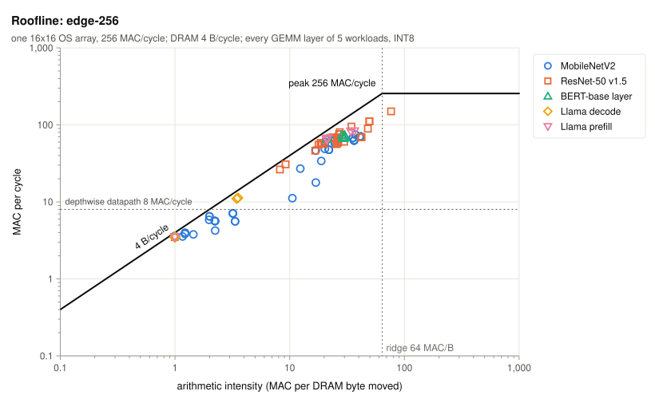
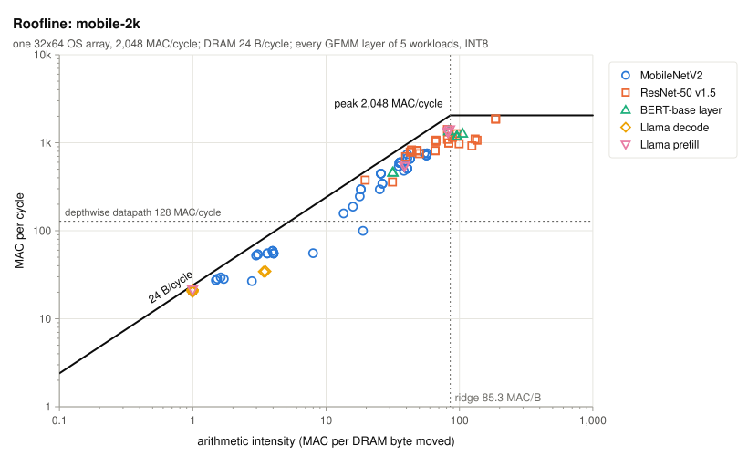
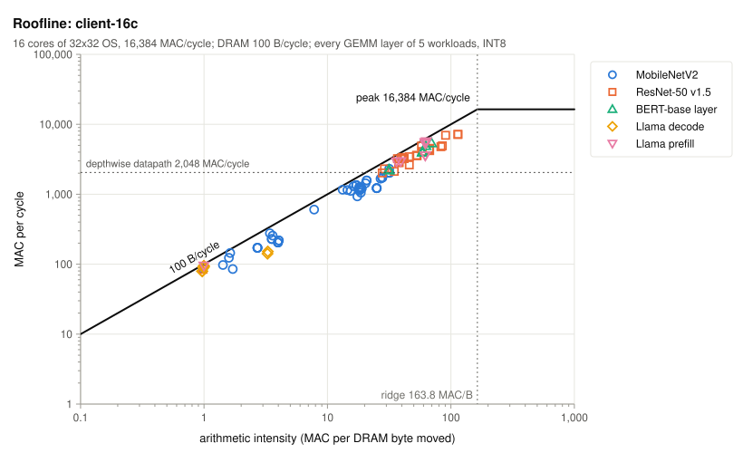
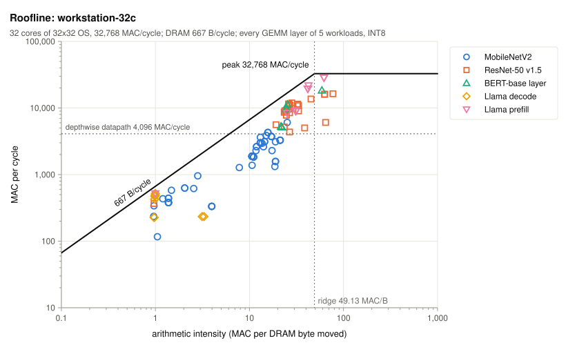

## S3. AXI outstanding transactions

Read bandwidth of a weight-streaming INT4 GEMV against outstanding reads at two latencies.

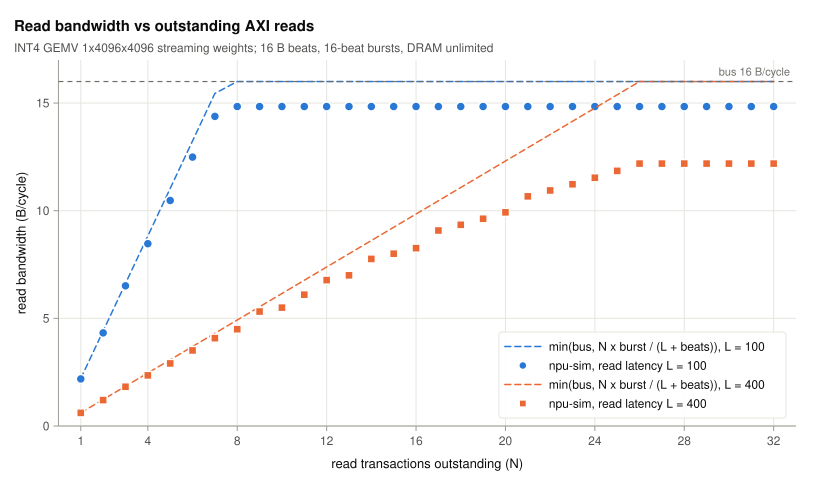

<!-- generated:s3-outstanding -->
| Outstanding N | L=100 npu-sim (B/cycle) | L=100 formula (B/cycle) | L=400 npu-sim (B/cycle) | L=400 formula (B/cycle) |
|---|---:|---:|---:|---:|
| 1 | 2.19 | 2.21 | 0.61 | 0.62 |
| 2 | 4.33 | 4.41 | 1.20 | 1.23 |
| 4 | 8.47 | 8.83 | 2.35 | 2.46 |
| 8 | 14.84 | 16.00 | 4.50 | 4.92 |
| 16 | 14.84 | 16.00 | 8.26 | 9.85 |
| 24 | 14.84 | 16.00 | 11.53 | 14.77 |
| 32 | 14.84 | 16.00 | 12.19 | 16.00 |
<!-- end:s3-outstanding -->

## S4. Multi-core scaling

Speedup over one core for m and n partitions at the client and workstation DRAM rates.

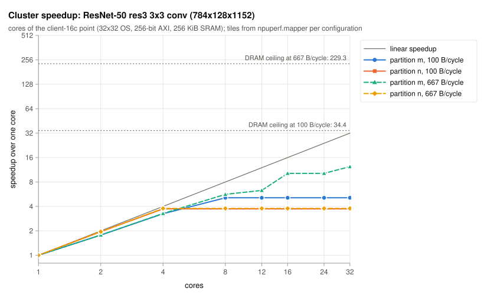
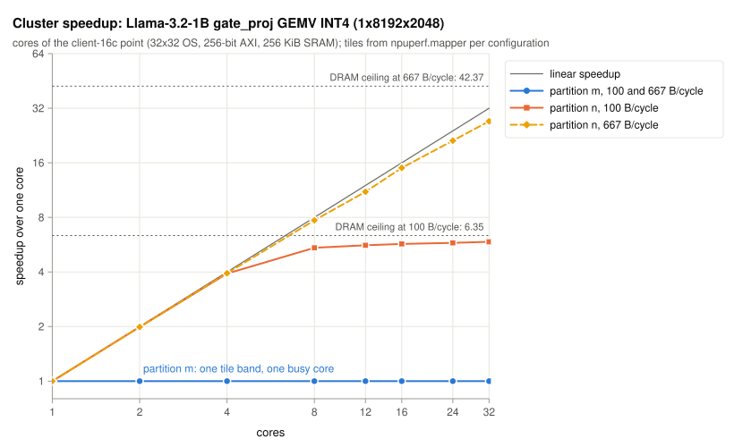

<!-- generated:s4-scaling -->
| Layer | Partition | DRAM B/cycle | 2 cores | 4 cores | 8 cores | 16 cores | 32 cores | DRAM ceiling |
|---|---|---:|---:|---:|---:|---:|---:|---:|
| ResNet-50 res3 3x3 conv | m | 100 | 1.80 | 3.30 | 5.03 | 5.03 | 5.03 | 34.93 |
| ResNet-50 res3 3x3 conv | n | 100 | 1.98 | 3.79 | 3.79 | 3.79 | 3.79 | 34.93 |
| ResNet-50 res3 3x3 conv | m | 667 | 1.80 | 3.32 | 5.72 | 10.37 | 12.04 | 232.91 |
| ResNet-50 res3 3x3 conv | n | 667 | 1.98 | 3.84 | 3.84 | 3.84 | 3.84 | 232.91 |
| Llama-3.2-1B gate_proj GEMV INT4 | m | 100 | 1.00 | 1.00 | 1.00 | 1.00 | 1.00 | 6.35 |
| Llama-3.2-1B gate_proj GEMV INT4 | n | 100 | 1.99 | 3.92 | 4.31 | 5.33 | 5.63 | 6.35 |
| Llama-3.2-1B gate_proj GEMV INT4 | m | 667 | 1.00 | 1.00 | 1.00 | 1.00 | 1.00 | 42.37 |
| Llama-3.2-1B gate_proj GEMV INT4 | n | 667 | 1.99 | 3.94 | 7.71 | 15.00 | 26.99 | 42.37 |
<!-- end:s4-scaling -->

## S5. Dataflow

Output- and weight-stationary utilisation of every MobileNetV2 and ResNet-50 layer that runs
on the array, one core of `client-16c`, with the S1 lowering. Layers counts every layer, a
repeated block once per repeat; the figure draws one mark per distinct shape. Utilisations are
MAC-weighted. Depthwise layers run on the depthwise datapath, which has no dataflow, and are
not in the table.

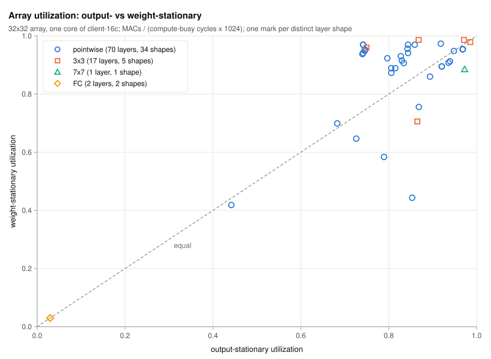

<!-- generated:s5-dataflow -->
| Layer type | Layers | Distinct shapes | MACs (M) | OS array utilisation | WS array utilisation | OS end-to-end | WS end-to-end |
|---|---:|---:|---:|---:|---:|---:|---:|
| pointwise | 70 | 34 | 2,387 | 86.6% | 93.4% | 75.4% | 79.9% |
| 3x3 | 17 | 5 | 1,861 | 88.8% | 97.7% | 81.5% | 87.5% |
| 7x7 | 1 | 1 | 118 | 97.3% | 88.5% | 88.1% | 84.2% |
| FC | 2 | 2 | 3.33 | 3.0% | 3.0% | 2.4% | 2.4% |
<!-- end:s5-dataflow -->

## S6. Analytic model vs SystemC

`npuperf.analytic` against npu-sim on seeded random configurations and on the distinct S1
layer runs of each design point. The random dense set draws read latencies up to 300 cycles,
at most 16 outstanding reads, DRAM up to 64 B/cycle and up to 8 cores; the random conv set
draws convolutions on their input footprint, a third of them depthwise on the depthwise
datapath and half with an activation cache, at Vela's SRAM and DRAM latencies. The design
points sit outside the dense set, with 500-cycle reads, 64 outstanding reads, and 100 and
667 B/cycle shared by 16 and 32 cores on the clusters.

`analyze()` times every request alone on the memory system and charges the shared DRAM only
as an aggregate byte bound, so it misses the queueing of channels and cores on one DRAM
timeline. On the design points the estimate falls below npu-sim on most layers and on every
cluster layer. `schedule()` replays that queueing request by request and matches npu-sim on
every run. `npuperf.mapper` ranks its candidates by the `analyze()` estimate and replays the
four best with `schedule()`, keeping the fewest cycles; `tests/mapper_tests.py` holds its pick
for ResNet-50 res3 3x3 on `mobile-2k`, caches off, within 10% of the fastest mapping of a
48-point npu-sim search.

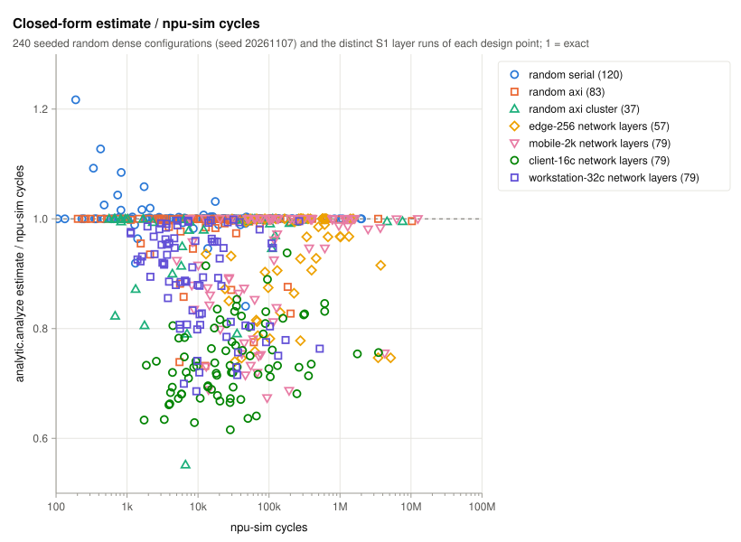

<!-- generated:s6-analytic -->
| Configurations | Count | Median error | p95 error | Max error | Estimate below npu-sim | Bound class agrees | schedule() exact | Traffic and compute exact |
|---|---:|---:|---:|---:|---:|---:|---:|---:|
| random serial | 120 | 0.0% | 5.9% | 21.7% | 11/120 | 120/120 | 120/120 | 120/120 |
| random axi | 83 | 0.0% | 14.2% | 26.8% | 40/83 | 82/83 | 83/83 | 83/83 |
| random axi cluster | 37 | 0.5% | 20.9% | 44.8% | 28/37 | 36/37 | 37/37 | 37/37 |
| random conv | 80 | 0.1% | 18.7% | 29.1% | 49/80 | 80/80 | 80/80 | 80/80 |
| `edge-256` network layers | 82 | 0.1% | 27.9% | 35.0% | 44/82 | 82/82 | 82/82 | 82/82 |
| `mobile-2k` network layers | 82 | 5.1% | 28.1% | 32.7% | 54/82 | 77/82 | 82/82 | 82/82 |
| `client-16c` network layers | 82 | 23.8% | 34.3% | 39.5% | 82/82 | 80/82 | 82/82 | 82/82 |
| `workstation-32c` network layers | 82 | 7.9% | 26.1% | 30.0% | 82/82 | 74/82 | 82/82 | 82/82 |
<!-- end:s6-analytic -->

## S7. Weight compression for LLM decode

Decode tokens/s with dense INT8, dense INT4 and 4-bit palette weights over decoder throughput.
A palette run is functional, its weights read from a generated input file,
and the study holds each call to 18 MiB of host storage, so every weight GEMM runs as pieces.
All three formats run the same pieces; the dense columns therefore differ from S1's decode
rows, which run each layer whole. The figure divides by dense INT4.

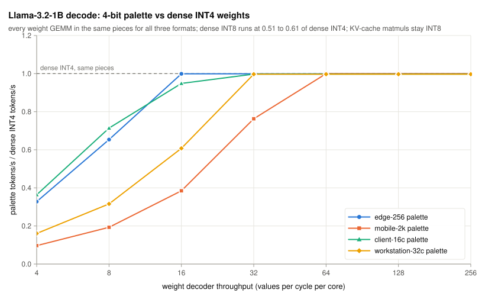

<!-- generated:s7-compression -->
| Design point | Dense INT8 | Dense INT4 | Palette, 4/cycle | Palette, 8/cycle | Palette, 16/cycle | Palette, 32/cycle | Palette, 64/cycle | Palette, 128/cycle | Palette, 256/cycle |
|---|---:|---:|---:|---:|---:|---:|---:|---:|---:|
| `edge-256` | 2.83 | 5.70 | 3.22 | 5.46 | 5.69 | 5.69 | 5.69 | 5.69 | 5.69 |
| `mobile-2k` | 17.1 | 33.4 | 3.23 | 6.45 | 12.9 | 25.5 | 33.4 | 33.4 | 33.4 |
| `client-16c` | 70.5 | 157 | 61.0 | 120 | 155 | 156 | 156 | 156 | 156 |
| `workstation-32c` | 441 | 721 | 117 | 230 | 443 | 716 | 716 | 716 | 716 |
<!-- end:s7-compression -->

## S8. Mapping search Pareto front

Cycles against reserved SRAM for every tile and slot choice of ResNet-50 res3 3x3 on its input
footprint, where tile_k is 0 or whole kernel rows (3 x 128 = 384 B).

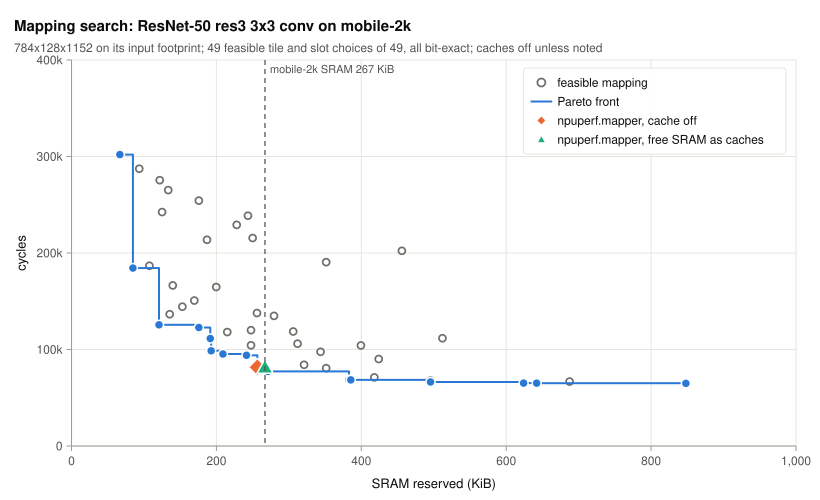

<!-- generated:s8-pareto -->
| Tile (m x n x k) | Slots | Weight cache (KiB) | Activation cache (KiB) | SRAM (KiB) | Cycles | Row |
|---|---:|---:|---:|---:|---:|---|
| 32x64x384 | 1 | 0 | 0 | 66.75 | 301,998 | Pareto front |
| 64x64x384 | 1 | 0 | 0 | 84.75 | 184,398 | Pareto front |
| 128x64x384 | 1 | 0 | 0 | 120.8 | 125,598 | Pareto front |
| 128x64x768 | 1 | 0 | 0 | 175.8 | 122,798 | Pareto front |
| 256x64x1152 | 1 | 0 | 0 | 191.5 | 111,394 | Pareto front |
| 256x64x384 | 1 | 0 | 0 | 192.8 | 98,658 | Pareto front |
| 128x128x384 | 1 | 0 | 0 | 209.0 | 95,330 | Pareto front |
| 128x64x384 | 2 | 0 | 0 | 241.5 | 93,984 | Pareto front |
| 112x64x1152 | 2 | 0 | 0 | 256.5 | 81,641 | Pareto front |
| 128x64x1152 | 2 | 0 | 0 | 271.0 | 77,337 | Pareto front |
| 256x64x1152 | 2 | 0 | 0 | 383.0 | 68,663 | Pareto front |
| 256x64x384 | 2 | 0 | 0 | 385.5 | 68,511 | Pareto front |
| 128x128x1152 | 2 | 0 | 0 | 495.5 | 66,354 | Pareto front |
| 128x128x768 | 2 | 0 | 0 | 624.0 | 65,194 | Pareto front |
| 256x128x384 | 2 | 0 | 0 | 642.0 | 65,100 | Pareto front |
| 256x128x768 | 2 | 0 | 0 | 848.0 | 64,890 | Pareto front |
| 112x64x1152 | 2 | 0 | 0 | 256.5 | 81,641 | fastest within 267 KiB |
| 112x64x1152 | 2 | 0 | 0 | 256.5 | 81,641 | npuperf.mapper, caches off |
| 112x64x1152 | 2 | 10.50 | 0 | 267.0 | 81,641 | npuperf.mapper, free SRAM as caches |
<!-- end:s8-pareto -->

## S9. Depthwise datapath rate

No public figure gives a depthwise datapath's rate, so this study sizes it. MobileNetV2 runs on
each point with the rate swept over powers of two from 1 MAC/cycle per core to the core's
array MACs, tiles from the mapper at every rate; the first row runs the depthwise layers as
grouped GEMMs on the array on their im2col operand instead, the lowering the studies used
before the datapath existed. The rule: each point takes the smallest swept rate at which
MobileNetV2 runs within 5% of its latency at the array-wide rate. The configs set the picked
rate, and the study stops when one disagrees. Cells give latency in ms and, in brackets, the
depthwise layers' share of cycles.

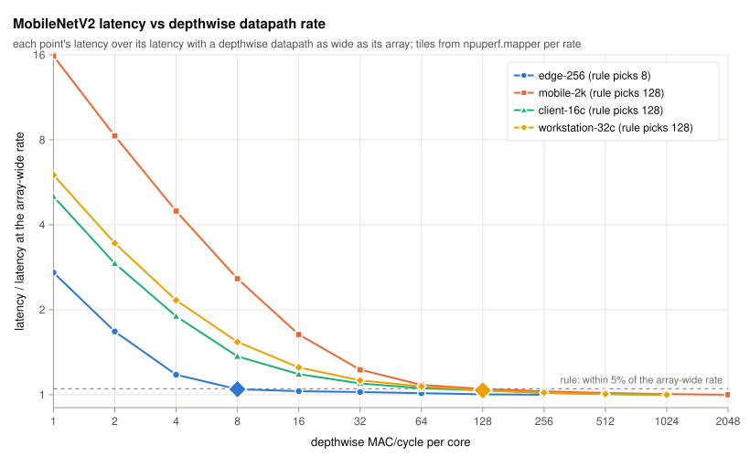

<!-- generated:s9-depthwise -->
| Depthwise MAC/cycle per core | `edge-256` | `mobile-2k` | `client-16c` | `workstation-32c` |
|---|---:|---:|---:|---:|
| none: grouped GEMM on the array, im2col | 109 (94%) | 22.2 (96%) | 1.88 (90%) | 0.721 (88%) |
| 1 | 27.1 (77%) | 21.6 (96%) | 1.34 (86%) | 0.712 (87%) |
| 2 | 16.8 (62%) | 11.3 (92%) | 0.776 (76%) | 0.408 (78%) |
| 4 | 11.8 (46%) | 6.11 (85%) | 0.504 (63%) | 0.256 (65%) |
| 8 | 10.5 (39%) | 3.52 (74%) | 0.363 (48%) | 0.182 (51%) |
| 16 | 10.3 (38%) | 2.23 (59%) | 0.314 (40%) | 0.148 (40%) |
| 32 | 10.2 (38%) | 1.68 (46%) | 0.291 (36%) | 0.133 (33%) |
| 64 | 10.1 (37%) | 1.48 (39%) | 0.280 (33%) | 0.127 (30%) |
| 128 | 10.0 (37%) | 1.43 (37%) | 0.276 (32%) | 0.123 (28%) |
| 256 | 10.0 (36%) | 1.40 (35%) | 0.270 (31%) | 0.121 (26%) |
| 512 |  | 1.39 (34%) | 0.267 (30%) | 0.119 (25%) |
| 1,024 |  | 1.37 (34%) | 0.266 (30%) | 0.119 (25%) |
| 2,048 |  | 1.37 (34%) |  |  |
<!-- end:s9-depthwise -->

<!-- generated:s9-choice -->
| Design point | Rule's rate (MAC/cycle per core) | MobileNetV2 latency (ms) | Depthwise share of cycles | Array-wide rate | Latency at the array-wide rate (ms) | Latency without the datapath (ms) | Speedup over no datapath |
|---|---:|---:|---:|---:|---:|---:|---:|
| `edge-256` | 8 | 10.5 | 39.3% | 256 | 10.0 | 109 | 10.4x |
| `mobile-2k` | 128 | 1.43 | 36.6% | 2,048 | 1.37 | 22.2 | 15.5x |
| `client-16c` | 128 | 0.276 | 32.0% | 1,024 | 0.266 | 1.88 | 6.8x |
| `workstation-32c` | 128 | 0.123 | 27.5% | 1,024 | 0.119 | 0.721 | 5.9x |
<!-- end:s9-choice -->

## S10. Per-core SRAM of the cluster core

Apple publishes no Neural Engine SRAM size, so this study sizes the SRAM of the core that
`client-16c` and `workstation-32c` share. ResNet-50 and MobileNetV2 run on both points with the
per-core SRAM swept over powers of two from 64 KiB to 4 MiB, tiles and cache split from the
mapper at every size. The rule: on each point, the smallest size at which both networks reach
90% of their highest MAC utilisation in the sweep; the points share one core design, so both
take the larger of the two picks. The configs set it, and the study stops when one disagrees.
Cells give MAC utilisation and, in brackets, latency.

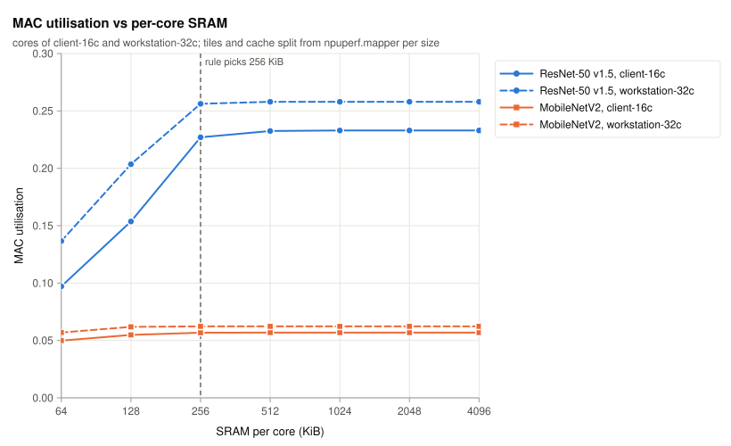

<!-- generated:s10-sram -->
| SRAM per core (KiB) | `client-16c` ResNet-50 v1.5 | `client-16c` MobileNetV2 | `workstation-32c` ResNet-50 v1.5 | `workstation-32c` MobileNetV2 |
|---|---:|---:|---:|---:|
| 64 | 9.6% (2.16 ms) | 4.9% (0.311 ms) | 13.6% (0.762 ms) | 5.7% (0.134 ms) |
| 128 | 14.6% (1.42 ms) | 5.4% (0.283 ms) | 20.2% (0.516 ms) | 6.2% (0.124 ms) |
| 256 | 22.1% (0.940 ms) | 5.6% (0.276 ms) | 25.1% (0.414 ms) | 6.2% (0.123 ms) |
| 512 | 22.4% (0.930 ms) | 5.6% (0.275 ms) | 25.1% (0.414 ms) | 6.2% (0.123 ms) |
| 1,024 | 22.2% (0.936 ms) | 5.6% (0.275 ms) | 25.1% (0.415 ms) | 6.2% (0.123 ms) |
| 2,048 | 22.2% (0.936 ms) | 5.6% (0.275 ms) | 25.1% (0.415 ms) | 6.2% (0.123 ms) |
| 4,096 | 22.2% (0.936 ms) | 5.6% (0.275 ms) | 25.1% (0.415 ms) | 6.2% (0.123 ms) |
<!-- end:s10-sram -->

<!-- generated:s10-choice -->
| Design point | ResNet-50 v1.5 pick (KiB) | MobileNetV2 pick (KiB) | Point's pick (KiB) |
|---|---:|---:|---:|
| `client-16c` | 256 | 128 | 256 |
| `workstation-32c` | 256 | 64 | 256 |
<!-- end:s10-choice -->

[corstone]: https://gitlab.arm.com/artificial-intelligence/ethos-u/ethos-u-core-platform/-/blob/26.08/targets/corstone-300/platform.ld
