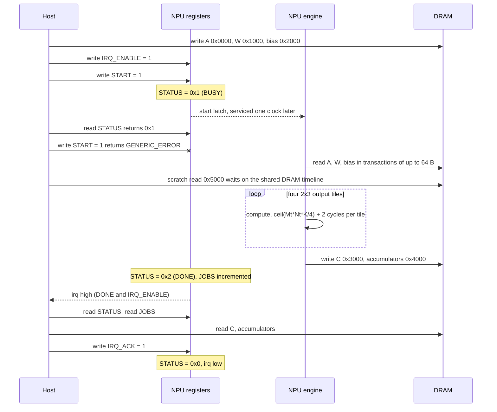

# SoC integration

Three SystemC executables place the NPU model in a system context: a TLM-2.0 coprocessor with a
register interface and an interrupt, a multicore platform with QoS dispatch, DVFS and power
gating, and a transformer decoder engine with a DRAM-resident KV cache. A Python tool adds an
energy estimate to any `npu-sim` result. Model scope for all four is stated once, in
[methodology.md](methodology.md#model-fidelity).

| Executable | Source | Models | CTest |
|---|---|---|---|
| `npu-tlm-demo` | `src/tlm_platform.cpp`, `include/npu/tlm_platform.hpp` | Host, NPU coprocessor and DRAM on TLM-2.0 sockets; MMIO programming, DMA, completion interrupt | `soc.tlm` |
| `npu-mobile-demo` | `src/mobile_platform.cpp` | 1 to 8 NPU cores; priority dispatch, shared DRAM channel, per-core OPP and power gating, energy account | `soc.multicore` |
| `npu-transformer-demo` | `src/transformer.cpp` | Decoder layers; batched prefill, per-token decode, DRAM-resident KV cache, TTFT and TPOT | `soc.transformer` |
| `python3 -m npuperf.energy` | `npuperf/energy.py` | MAC, DRAM and static energy of one `npu-sim` result | `tools.energy` |

Each SystemC executable prints one JSON object on stdout and diagnostics on stderr, accepts
`--help` in any argument position, and exits 2 on an invalid argument, a failed self-check or a
numerical mismatch. Commands below assume the `release` preset, which builds into `build/release/`.

## 1 TLM-2.0 coprocessor platform

`npu-tlm-demo` is a programmer's model of a fixed-function INT8 GEMM coprocessor. A host thread
stages operands in DRAM, programs memory-mapped registers and waits for an interrupt; the engine
fetches the operands by DMA, computes, stores the results and raises the interrupt. The engine
persists across jobs.

### 1.1 Topology

| Module | Ports | Processes |
|---|---|---|
| `host` (`Host`) | initiator sockets `mmio`, `memory`; `sc_out<bool> reset_n`; `sc_in<bool> clock`, `irq` | `SC_THREAD run` |
| `npu` (`Engine`) | target socket `registers`; initiator socket `dma`; `sc_in<bool> clock`, `reset_n`; `sc_out<bool> irq` | `SC_THREAD run` on `clock.pos()`, asynchronous reset on `reset_n` low; `SC_METHOD observe` |
| `dram` (`Dram`) | target sockets `host_socket`, `dma_socket` | none: `b_transport` and `transport_dbg` callbacks |

Bindings are point to point: `host.mmio` to `npu.registers`, `host.memory` to
`dram.host_socket`, `npu.dma` to `dram.dma_socket`. The host socket used selects the address
space. The clock is an `sc_clock` with a 5 ns period (200 MHz) and the kernel time resolution is
1 ps. Every cycle count in this section is simulation time divided by 5 ns.

### 1.2 Memory map

The register block occupies offsets `0x00` to `0x1F` of the `npu.registers` target (section
1.3). DRAM is 64 KiB, byte addressable, zero at elaboration, and outside the engine reset domain.

| DRAM address | Size | Content | Written by | Read by |
|---|---|---|---|---|
| `0x0000` | 21 B | A[3][7], int8, row-major | host | engine DMA |
| `0x1000` | 35 B | W[7][5], int8, row-major | host | engine DMA |
| `0x2000` | 20 B | bias[5], int32, little-endian | host | engine DMA |
| `0x3000` | 15 B | C[3][5], int8, row-major | engine DMA | host |
| `0x4000` | 60 B | accumulators[3][5], int32, little-endian | engine DMA | host |
| `0x5000` | 4 B | scratch; read by the host during each job to contend with the DMA | none | host |

The addresses are the `*_address` constants in `include/npu/tlm_platform.hpp`.

### 1.3 Register summary

All registers are 32 bits wide, little-endian, at 4-byte aligned offsets. The table is the
`register_map` array in `include/npu/tlm_platform.hpp`; `Engine::mmio` decodes against it.

| Offset | Name | Type | Reset | Description |
|---|---|---|---|---|
| `0x00` | `M` | RO | `0x00000003` | Output rows |
| `0x04` | `N` | RO | `0x00000005` | Output columns |
| `0x08` | `K` | RO | `0x00000007` | Reduction depth |
| `0x0C` | `START` | WO | – | Write `0x1` to start a job |
| `0x10` | `STATUS` | RO | `0x00000000` | Job state |
| `0x14` | `IRQ_ENABLE` | RW | `0x00000000` | Completion interrupt enable |
| `0x18` | `IRQ_ACK` | WO | – | Write `0x1` to clear `STATUS.DONE` |
| `0x1C` | `JOBS` | RO | `0x00000000` | Jobs completed since reset release |

### 1.4 Register descriptions

#### 1.4.1 M, N and K

| Bits | Name | Function |
|---|---|---|
| [31:0] | `VALUE` | Fixed GEMM geometry: `gemm_m` = 3, `gemm_n` = 5, `gemm_k` = 7 |

#### 1.4.2 START

| Bits | Name | Function |
|---|---|---|
| [31:0] | `START` | Write `0x00000001` to latch a job. A different value, or a write while `STATUS.BUSY` or `STATUS.DONE` is 1, returns `TLM_GENERIC_ERROR_RESPONSE` and changes no state |

An accepted write sets `STATUS.BUSY` within the access and sets a level-sensitive start latch.
The engine begins the job one clock after the write.

#### 1.4.3 STATUS

| Bits | Name | Function |
|---|---|---|
| [31:2] | – | Reserved, read as zero |
| [1] | `DONE` | 1: the last job's outputs are in DRAM. Set at job completion; cleared by `IRQ_ACK` and by reset |
| [0] | `BUSY` | 1: a job is latched or running. Set by `START`; cleared at job completion and by reset |

`BUSY` and `DONE` are never 1 at the same time.

#### 1.4.4 IRQ_ENABLE

| Bits | Name | Function |
|---|---|---|
| [31:1] | – | Reserved. A write with any of these bits set returns `TLM_GENERIC_ERROR_RESPONSE` |
| [0] | `EN` | 1: `irq` follows `STATUS.DONE` |

#### 1.4.5 IRQ_ACK

| Bits | Name | Function |
|---|---|---|
| [31:0] | `ACK` | Write `0x00000001` to clear `STATUS.DONE`. A different value, or a write while `STATUS.BUSY` is 1, returns `TLM_GENERIC_ERROR_RESPONSE`. Writing `0x1` with `DONE` at 0 is accepted and has no effect |

#### 1.4.6 JOBS

| Bits | Name | Function |
|---|---|---|
| [31:0] | `COUNT` | Incremented at each job completion; cleared by reset |

### 1.5 Operating states

| State | `STATUS` | Accepted writes | Transition |
|---|---|---|---|
| IDLE | `0x0` | `START`, `IRQ_ENABLE`, `IRQ_ACK` | `START` = 1: to RUNNING |
| RUNNING | `0x1` | `IRQ_ENABLE` | last output store completes: to COMPLETE |
| COMPLETE | `0x2` | `IRQ_ENABLE`, `IRQ_ACK` | `IRQ_ACK` = 1: to IDLE |

Reset returns every state to IDLE. Because `START` is refused in COMPLETE, the next job cannot
start until the previous completion is acknowledged.

### 1.6 Interrupt

`irq` is a level-sensitive, active-high `sc_out<bool>`:

$$
\mathrm{irq} = \mathrm{STATUS.DONE} \wedge \mathrm{IRQ\_ENABLE.EN}
$$

`Engine::observe` is the only driver of `irq` and of the traced `busy`, `done` and `jobs`
signals. It runs one delta cycle after every accepted register write, after job completion and
after reset, so `irq` changes at the simulation time of its cause. Setting `EN` while `DONE` is
pending asserts `irq` on that write; `IRQ_ACK` deasserts it. Job completion is the only interrupt
source.

The default run (`--jobs 2`) traces the following edges. Job 0 runs with `EN` = 1; job 1 runs
masked and is polled.

| Cycle | Event |
|---|---|
| 25 | Job 0 `START`; `BUSY` rises |
| 93 | Job 0 completes; `BUSY` falls, `DONE` and `irq` rise, `JOBS` = 1 |
| 106 | `IRQ_ACK`; `DONE` and `irq` fall |
| 125 | Job 1 `START` with `EN` = 0 |
| 193 | Job 1 completes; `DONE` rises, `irq` stays low |
| 194 | Host polls `DONE` = 1, writes `EN` = 1; `irq` rises |
| 208 | `IRQ_ACK`; `DONE` and `irq` fall |

### 1.7 Reset

`reset_n` is active low. The host holds it low for three clock edges and releases it at cycle 2.
The engine thread is registered with `async_reset_signal_is(reset_n, false)`; while `reset_n` is
low the thread stays in its reset body, which clears `BUSY`, `DONE`, `IRQ_ENABLE.EN`, the start
latch and `JOBS`, and cancels a pending start event.

- A register access while `reset_n` is low returns `TLM_GENERIC_ERROR_RESPONSE` (section 1.10).
- DRAM keeps its contents through reset and accepts host accesses while the engine is in reset.
- A `START` written in the reset-release timestep, before the engine thread reaches its first
  clock edge, is held by the start latch and serviced at that edge. The job then starts one clock
  after the write, as for any `START`.

`--start-at-reset-release` exercises the last case: the host stages job 0 while the engine is in
reset, releases reset at cycle 18 and writes `START` in the same timestep. Job 0 then takes 70
cycles, the same as in the default run.

### 1.8 Programming sequence

1. Release `reset_n` and wait for one clock edge.
2. Read `M`, `N` and `K` (optional).
3. Write A, W and bias to DRAM at the addresses of section 1.2.
4. Write `IRQ_ENABLE` = 1 for interrupt-driven completion, or 0 to poll.
5. Write `START` = 1. `STATUS` reads `0x1`.
6. Wait for `irq`, or poll `STATUS` until `DONE` = 1.
7. Read C and the accumulators from DRAM.
8. Write `IRQ_ACK` = 1. `STATUS` reads `0x0` and `irq` is low.
9. Repeat from step 3.

DRAM writes take effect when `b_transport` is called (section 1.11), so software must leave the
input regions unchanged while `STATUS.BUSY` is 1. The host in `src/tlm_platform.cpp` follows this
sequence, checks the response status of every access, and compares every accumulator and output
of each job against `npu::reference`.

### 1.9 Job lifecycle



Cycle timeline of job 0 in the default run, relative to the `START` write at cycle 25. DRAM
intervals are half-open, `[begin, end)`.

| Cycle | Host | Engine | DRAM occupancy |
|---|---|---|---|
| 0 | `START` = 1 (1 cycle) | | |
| 1 | read `STATUS` = `0x1` | start latch serviced; read A, 21 B | A `[1, 6)` |
| 2 | `START` = 1 refused (0 cycles); scratch read of 4 B issued | | |
| 6 | | wait | scratch `[6, 10)` |
| 10 | | read W, 35 B | W `[10, 16)` |
| 16 | | read bias, 20 B | bias `[16, 21)` |
| 21 | | tiles 2x3, 2x2, 1x3, 1x2: 13, 9, 8 and 6 cycles | |
| 57 | | store C, 15 B | C `[57, 61)` |
| 61 | | store accumulators, 60 B | accumulators `[61, 68)` |
| 68 | `irq` rises | `BUSY` = 0, `DONE` = 1, `JOBS` = 1 | |
| 70 | read `STATUS`, `JOBS` done; `elapsed_cycles` = 70 | | |

`elapsed_cycles` spans the `START` write to the end of the host's `STATUS` and `JOBS` readback.
Job 1 reports 72 because its completion is polled and `EN` is written before the readback.

### 1.10 Error responses

The register target applies these checks in order and returns the first failure.

| Order | Condition | Response |
|---|---|---|
| 1 | Command other than read or write | `TLM_COMMAND_ERROR_RESPONSE` |
| 2 | Byte-enable pointer present | `TLM_BYTE_ENABLE_ERROR_RESPONSE` |
| 3 | Null data pointer, data length other than 4, or streaming width below 4 | `TLM_BURST_ERROR_RESPONSE` |
| 4 | Offset not 4-byte aligned, or not in the register summary | `TLM_ADDRESS_ERROR_RESPONSE` |
| 5 | `reset_n` low | `TLM_GENERIC_ERROR_RESPONSE` |
| 6 | Read of a WO register, or write of an RO register | `TLM_COMMAND_ERROR_RESPONSE` |
| 7 | Value or state rule of `START`, `IRQ_ENABLE` or `IRQ_ACK` violated (section 1.4) | `TLM_GENERIC_ERROR_RESPONSE` |

The DRAM target applies these checks on both sockets.

| Order | Condition | Response |
|---|---|---|
| 1 | Command other than read or write | `TLM_COMMAND_ERROR_RESPONSE` |
| 2 | Byte-enable pointer present | `TLM_BYTE_ENABLE_ERROR_RESPONSE` |
| 3 | Null data pointer, data length 0 or above 64, or streaming width below the data length | `TLM_BURST_ERROR_RESPONSE` |
| 4 | Address at or above 65536, or address plus length above 65536 | `TLM_ADDRESS_ERROR_RESPONSE` |

A rejected access changes no state, adds no delay, reserves no DRAM time and increments its
target's error counter. Every target refuses DMI: `get_direct_mem_ptr` returns false and every
response clears the DMI hint. Both DRAM sockets implement `transport_dbg` for reads of any length
within DRAM; a debug read takes zero time and stays out of the traffic and error counters, and a
debug write returns `TLM_COMMAND_ERROR_RESPONSE`. The register target has no debug interface.
The engine has no error status: a DMA access that returns an error ends the simulation.

Once per run the host issues 11 invalid accesses, six to the registers and five to DRAM, and in
every job one `START` while `BUSY`. The run fails unless the targets' error counters sum to the
host's count, reported as `expected_protocol_errors` (13 for two jobs).

### 1.11 Timing model

| Aspect | Model |
|---|---|
| Coding style | Loosely timed: blocking `b_transport` with timing annotation |
| Synchronization | Every initiator waits its annotated delay before its next transaction; no quantum keeper |
| Data effects | Applied when `b_transport` is called; the delay covers the access time |
| Register access | One clock when accepted; zero when rejected |
| `START` to first DMA | One clock |
| DRAM transaction | $3 + \lceil L/16 \rceil$ clocks for $L$ bytes, $1 \le L \le 64$ |
| DRAM sharing | One reservation timeline for both sockets, granted in call order |
| Engine DMA | Transfers split into transactions of at most 64 B, one outstanding; sustained rate 64 B per 7 clocks |
| Compute | Tiles in `make_tiles` order, back to back, after all loads and before all stores |
| Watchdog | `sc_start(1 ms)`; a lost `START` or interrupt fails the run |

A DRAM transaction arriving at $t_a$ (simulation time plus the incoming delay) is served at

$$
t_b = \max(t_a,\ t_{\mathrm{free}}), \qquad t_{\mathrm{free}} \leftarrow t_b + \left(3 + \left\lceil \tfrac{L}{16} \right\rceil\right) T, \qquad T = 5\ \mathrm{ns}
$$

and returns the delay $t_{\mathrm{free}} - t_{\mathrm{now}}$. `memory_arbitration_wait_cycles`
accumulates $(t_b - t_a)/T$ over all transactions. Without contention one job costs

$$
1 + \underbrace{(5 + 6 + 5)}_{\mathrm{loads}} + \underbrace{(13 + 9 + 8 + 6)}_{\mathrm{tiles}} + \underbrace{(4 + 7)}_{\mathrm{stores}} = 64\ \mathrm{cycles},
$$

and the host's scratch read delays the weight load by 4 cycles, giving the 68 `BUSY` cycles of
section 1.9.

### 1.12 Engine datapath

The engine calls the `npu-sim` kernel (`npu::compute_tile`, `npu::tile_compute_cycles` in
`src/core.cpp`) with this configuration, set in `sc_main`.

| Parameter | Value |
|---|---|
| GEMM | $C = A W + \mathrm{bias}$, $M = 3$, $N = 5$, $K = 7$ |
| Tile | 2 x 3 outputs, one reduction panel of 7 |
| Datapath | Vector mode, 4 MACs per cycle, 2 pipeline cycles per panel |
| Requantization | `native`, multiplier 1, shift 4, round half to even, zero points A = -3, W = 2, output = 0 |
| Outputs | int8 C and int32 accumulators, both stored to DRAM |

Tile cycles are $\lceil M_t N_t K / 4 \rceil + 2$. Requantization is defined in
[numerics.md](numerics.md).

### 1.13 Interface and report

| Flag | Range | Default | Function |
|---|---|---|---|
| `--jobs` | 1..100 | 2 | Jobs submitted to the persistent engine |
| `--seed` | 0..4294967295 | 1 | Input pattern |
| `--start-at-reset-release` | | off | Stage job 0 in reset; write `START` in the reset-release timestep |
| `--dump-output` | | off | Add every accumulator and output to each job |
| `--vcd BASENAME` | | none | Trace `clock`, `reset_n`, `irq`, `npu_busy`, `npu_done`, `completed_jobs` |

`build/release/npu-tlm-demo` reports:

| Field | Value | Definition |
|---|---|---|
| `reset_release_cycle` | 2 | Cycle at which `reset_n` rises |
| `first_start_cycle` | 25 | Cycle of the first `START` write |
| `simulation_cycles` | 210 | End of simulation |
| `compute_cycles` | 72 | Tile cycles, all jobs |
| `mmio_transactions` | 79 | Accepted register accesses |
| `host_memory_transactions` | 12 | Host DRAM transactions |
| `dma_transactions` | 10 | Engine DRAM transactions |
| `dma_read_bytes`, `dma_write_bytes` | 152, 150 | Engine DRAM bytes; 76 and 75 per job |
| `memory_arbitration_wait_cycles` | 16 | Cycles spent waiting for the DRAM timeline |
| `debug_reads` | 2 | Zero-time debug reads |
| `expected_protocol_errors` | 13 | Rejected accesses, equal to the targets' error counters |
| `interrupts_observed` | 2 | Completions observed through `irq` |
| `jobs[].elapsed_cycles` | 70, 72 | Section 1.9 |
| `jobs[].output_hash` | | FNV-1a 64 over the accumulators, then the outputs |

## 2 Multicore QoS and DVFS platform

`npu-mobile-demo` runs a stream of independent INT8 GEMM jobs on several NPU cores. It models
priority dispatch, a shared DRAM channel, per-core weight residency, per-core operating points,
power gating and an energy account. Every job's arithmetic executes and is compared element by
element with `npu::reference`.

### 2.1 Topology

| Module | Process | Function |
|---|---|---|
| `mobile` (`Platform`) | `SC_THREAD release` | Moves jobs to the ready list at their release time |
| `mobile` (`Platform`) | `SC_THREAD schedule` | Orders the ready list and assigns jobs to free cores |
| `core_<i>` (`Core`), 1 to 8 | `SC_THREAD run` | Power state, OPP, weight cache, DRAM transfers, compute |
| `dram` (`SharedBus`) | `SC_THREAD run` | Single DRAM channel with a round-robin arbiter |

A core runs one job at a time to completion. It owns an LRU weight cache in its SRAM, an OPP and
a power-gated compute domain.

### 2.2 Workload

Job $i$ of `--jobs` is defined by

$$
\mathrm{model}_i = i \bmod \mathrm{models}, \qquad
\mathrm{priority}_i = \mathrm{priorities}[\,i \bmod |\mathrm{priorities}|\,], \qquad
\mathrm{release}_i = \left\lfloor \tfrac{i}{\mathrm{batch}} \right\rfloor \cdot \mathrm{arrival},
$$

with absolute deadline $\mathrm{release}_i + \mathrm{deadline}$ when `--deadline-ns` is nonzero,
and none otherwise. Activations differ per job; weights and bias belong to the model. Each job is
one $m \times n \times k$ GEMM computed as a single tile with the requantization of section 1.12.

$$
B_{\mathrm{read}} = mk + [\mathrm{miss}]\,(kn + 4n), \qquad B_{\mathrm{write}} = 5mn, \qquad
C = \left\lceil \tfrac{mnk}{P} \right\rceil + c_{\mathrm{pipe}}, \qquad
t_{\mathrm{compute}} = \tfrac{1000\,C}{f_{\mathrm{MHz}}}\ \mathrm{ns}
$$

The write carries an int8 output and an int32 accumulator per element. $P$ is
`--macs-per-cycle` and $c_{\mathrm{pipe}}$ is `--pipeline-cycles`. Time resolution is 1 ps.

### 2.3 Scheduling

The release thread appends every job of a release timestamp to the ready list and notifies the
scheduler. The scheduler waits for that notification plus one delta cycle, so it sees every
release and completion of the timestamp, then:

1. orders the ready list by priority (higher first), absolute deadline (earlier first; jobs
   without a deadline last), then job id;
2. assigns the head of the list to each free core in core-index order.

Dispatch is non-preemptive. Cache residency and power state do not influence the choice of core.
`dispatch_order` records assignment order. In the default run, priorities `0,2,1` over six jobs
released together give the dispatch order `[1, 4, 2, 5, 0, 3]`.

### 2.4 DRAM arbitration

`SharedBus` serves one transfer at a time. A transfer of $B$ bytes holds the channel for

$$
t_{\mathrm{bus}} = L_{\mathrm{bus}} + \left\lceil \tfrac{B}{r} \right\rceil\ \mathrm{ns},
$$

with $L_{\mathrm{bus}}$ = `--bus-latency-ns` and $r$ = `--bus-bytes-per-ns`. Each job issues one
read and one write.

| Rule | Behavior |
|---|---|
| Outstanding requests | At most one per core; a core blocks until its transfer completes |
| Decision point | One delta after the channel frees, or one delta after a request reaches an idle channel |
| Eligibility | Requests raised in a delta before the decision delta |
| Grant order | Round-robin by core id, starting after the last grantee |

Restricting eligibility to earlier deltas makes the grant independent of the evaluation order of
processes within a delta, which IEEE 1666 leaves unspecified. `bus_transactions` records each
transfer's `requested_ns`, `requested_delta`, `begin_ns`, `begin_delta` and `end_ns`. In the
default run both cores wake at 12 ns and request in delta 0; the decision in delta 1 grants core
0 the interval `[12, 34)` ns and core 1 `[34, 56)` ns.

### 2.5 Weight residency

Each core keeps an LRU cache of weight and bias sets keyed by model id. An entry is $kn + 4n$
bytes and the capacity is `--cache-bytes`. A hit moves the entry to most recently used and skips
the weight read; a miss evicts least recently used entries until the new one fits. A set larger
than the capacity is never inserted and is fetched by every job. The cache keeps its contents
while the compute domain is gated (`compute_gate_retains_sram` in the report). A configuration
is admitted only if

$$
mk + 5mn + \max(kn + 4n,\ \mathrm{cache}) \le \mathrm{SRAM}.
$$

### 2.6 Operating points and governors

`--opps` lists 1 to 16 `MHz:mV` pairs. Frequencies increase strictly within 1..2000 MHz and
voltages do not decrease, within 100..2000 mV. The default table is:

| Index | MHz | mV |
|---|---|---|
| 0 | 100 | 700 |
| 1 | 200 | 800 |
| 2 | 400 | 900 |

Each core holds its own OPP, initialized to `--opp` (default 1). A change costs one `--switch-ns`
interval before the read. The governor picks the OPP of each job at dispatch:

| Governor | OPP of a job |
|---|---|
| `fixed` | `--opp` |
| `deadline` | `--opp` for a job without a deadline; otherwise the lowest index $j$ that satisfies the inequality below, or the highest index if none does |

$$
t_{\mathrm{bus}}(B_{\mathrm{read}}) + t_{\mathrm{bus}}(B_{\mathrm{write}})
+ \tfrac{1000\,C}{f_j} + [\mathrm{gated}]\,t_{\mathrm{wake}} + [\,j \ne j_{\mathrm{cur}}\,]\,t_{\mathrm{switch}}
\le d - t_{\mathrm{now}}
$$

The estimate uses unloaded bus times. It excludes queueing on the channel and the jobs still in
the ready list, and `deadline_misses` counts every job that finishes after its deadline.

### 2.7 Power states

Each core is in one of seven states, traced as `core<i>_state`.

| Code | State | Entered | Left | Energy term |
|---|---|---|---|---|
| 6 | Gated | At start; after `--gate-after-ns` idle | Dispatch: to Waking | Gated |
| 1 | Waking | Dispatch to a gated core | After `--wakeup-ns` | Active, plus one wake-up |
| 2 | OPP switch | Selected OPP differs from the current one | After `--switch-ns` | Active, plus one switch |
| 3 | Read | Read request issued; includes queueing | Transfer complete | Active |
| 4 | Compute | Read complete | After $t_{\mathrm{compute}}$ | Active, plus compute |
| 5 | Write | Compute complete | Transfer complete | Active |
| 0 | Idle | Write complete | Dispatch; or gate timer: to Gated | Retention |

A core's time divides into three intervals that sum to `simulation_ns`. Active time runs from
dispatch to the end of the write. Idle time after a job counts as retention for its first
`--gate-after-ns` and as gated for the rest. Idle time before a core's first job counts as gated.

### 2.8 Energy model

Energy is reported when at least one coefficient flag is given; otherwise `energy` is `null`.
Every coefficient defaults to 0. Over all jobs $j$ and cores:

$$
\begin{aligned}
E_{\mathrm{compute}} &= \sum_j mnk\; e_{\mathrm{MAC}} \left(\frac{V_j}{V_{\mathrm{ref}}}\right)^2 \\
E_{\mathrm{DRAM}} &= (B_{\mathrm{read}} + B_{\mathrm{write}})\; e_{\mathrm{byte}} \\
E_{\mathrm{active}} &= t_{\mathrm{active}}\, P_{\mathrm{leak}}, \quad
E_{\mathrm{ret}} = t_{\mathrm{ret}}\, P_{\mathrm{ret}}, \quad
E_{\mathrm{gated}} = t_{\mathrm{gated}}\, P_{\mathrm{gated}} \\
E_{\mathrm{trans}} &= N_{\mathrm{wake}}\, E_{\mathrm{wake}} + N_{\mathrm{switch}}\, E_{\mathrm{switch}} \\
E_{\mathrm{total}} &= E_{\mathrm{compute}} + E_{\mathrm{DRAM}} + E_{\mathrm{active}} + E_{\mathrm{ret}} + E_{\mathrm{gated}} + E_{\mathrm{trans}}
\end{aligned}
$$

Times are in ns and powers in mW, so each product is in pJ. $V_j$ is the voltage of the OPP that
ran job $j$ and $V_{\mathrm{ref}}$ is `--reference-mv`. The supply voltage scales the compute term
only; $P_{\mathrm{leak}}$ is one constant for every OPP. Coefficient provenance is in section 4.2.

The coefficients 2, 3, 5, 7, 11, 13 and 17 below are the unit fixture of
`tests/mobile_platform_tests.py`:

```sh
build/release/npu-mobile-demo --cores 1 --jobs 3 --batch-size 1 --arrival-ns 1000 \
  --mac-pj 2 --dram-byte-pj 3 --leakage-mw 5 --retention-mw 7 --gated-mw 11 \
  --wakeup-pj 13 --switch-pj 17
```

| Term | Count | pJ |
|---|---|---|
| Compute | 3 jobs x 512 MACs at $V = V_{\mathrm{ref}}$ = 800 mV | 3072 |
| DRAM | 352 B read + 480 B written | 2496 |
| Active | 676 ns | 3380 |
| Retention | 200 ns | 1400 |
| Gated | 1346 ns | 14806 |
| Transitions | 3 wake-ups, 0 switches | 39 |
| Total | `simulation_ns` = 2222 | 25193 |

Each job arrives after the core has gated, so each pays a wake-up. Job 0 misses the weight cache
and reads 224 B; jobs 1 and 2 hit it and read their 64 B of activations.

### 2.9 Measured behavior

Core scaling, eight compute-bound jobs of $8 \times 8 \times 64$ at 1 MAC per cycle (4100 cycles,
20.5 µs per job at 200 MHz):

```sh
build/release/npu-mobile-demo --cores C --jobs 8 --m 8 --n 8 --k 64 --macs-per-cycle 1
```

| Cores | `simulation_ns` | Speedup | `bus_busy_ns` | `bus_wait_ns` | Cache hits / misses |
|---|---|---|---|---|---|
| 1 | 164,590 | 1.00 | 578 | 0 | 7 / 1 |
| 2 | 82,392 | 2.00 | 612 | 74 | 6 / 2 |
| 4 | 41,404 | 3.98 | 680 | 444 | 4 / 4 |
| 8 | 21,132 | 7.79 | 816 | 2072 | 0 / 8 |

Each additional core misses the weight cache once, so bus time grows with the core count, and
cores that start or finish together queue on the channel.

Governor comparison, 12 jobs released in batches of three every 1000 ns with priorities
`0,3,1` on the default two cores and OPP table. `--mac-pj 1` makes `compute_pj` the
voltage-weighted MAC count $\sum_j mnk\,(V_j/V_{\mathrm{ref}})^2$.

```sh
build/release/npu-mobile-demo --jobs 12 --batch-size 3 --arrival-ns 1000 --priorities 0,3,1 \
  --opp 1 --mac-pj 1 --governor G --deadline-ns D
```

| D (ns) | Governor | Jobs at OPP 0 / 1 / 2 | OPP switches | Deadline misses | Max response (ns) | `compute_pj` |
|---|---|---|---|---|---|---|
| 1000 | fixed | 0 / 12 / 0 | 0 | 0 | 450 | 6144 |
| 1000 | deadline | 12 / 0 / 0 | 2 | 0 | 810 | 4704 |
| 450 | fixed | 0 / 12 / 0 | 0 | 0 | 450 | 6144 |
| 450 | deadline | 8 / 0 / 4 | 9 | 4 | 562 | 5728 |
| 300 | fixed | 0 / 12 / 0 | 0 | 4 | 450 | 6144 |
| 300 | deadline | 0 / 8 / 4 | 7 | 4 | 374 | 6688 |

With a 1000 ns deadline the governor runs every job at 700 mV and cuts compute energy by the
factor $(700/800)^2 = 0.766$. With 450 ns it misses the four priority-0 jobs (0, 3, 6 and 9)
that the fixed governor meets: the first two jobs of each batch take the slowest OPP that meets
their own deadline and keep both cores busy. In the first batch the third job is dispatched at
420 ns with 30 ns left and misses at the top OPP. With 300 ns both governors miss the same four
jobs.

### 2.10 Interface and report

| Flag | Range | Default | Function |
|---|---|---|---|
| `--cores` | 1..8 | 2 | Cores |
| `--jobs` | 1..128 | 6 | Jobs |
| `--models` | 1..jobs | 1 | Weight sets; job $i$ uses set $i \bmod$ models |
| `--m`, `--n` | 1..64 | 4, 8 | Output rows, columns |
| `--k` | 1..256 | 16 | Reduction depth |
| `--seed` | 0..4294967295 | 1 | Input pattern |
| `--arrival-ns` | 0..1000000 | 0 | Spacing of release batches |
| `--batch-size` | 1..128 | 6 | Jobs per release |
| `--priorities` | list of 0..255 | `0,2,1` | Priority of job $i$ is entry $i \bmod$ length |
| `--deadline-ns` | 0..10000000 | 0 | Relative deadline; 0 is none |
| `--governor` | `fixed`, `deadline` | `fixed` | Section 2.6 |
| `--opps`, `--opp` | section 2.6 | default table, 1 | OPP table and initial index |
| `--bus-bytes-per-ns` | 1..4096 | 16 | DRAM channel rate |
| `--bus-latency-ns` | 0..1000000 | 8 | Per-transfer channel latency |
| `--macs-per-cycle` | 1..1048576 | 16 | Core MAC rate |
| `--pipeline-cycles` | 0..1000000 | 4 | Per-job pipeline cycles |
| `--sram-bytes` | 0..16777216 | 65536 | Per-core SRAM |
| `--cache-bytes` | 0..sram | 4096 | Per-core weight cache |
| `--gate-after-ns` | 0..10000000 | 100 | Idle time before gating |
| `--wakeup-ns`, `--switch-ns` | 0..1000000 | 12, 8 | Transition times |
| `--reference-mv` | 100..2000 | 800 | $V_{\mathrm{ref}}$ |
| `--mac-pj`, `--dram-byte-pj`, `--leakage-mw`, `--retention-mw`, `--gated-mw`, `--wakeup-pj`, `--switch-pj` | 0..1e9, finite | 0 | Section 2.8 |
| `--inject-output-fault` | job id | off | Flip bit 0 of that job's first output; the run reports the mismatch and exits 2 |
| `--dump-output`, `--vcd BASENAME` | | off | Per-job outputs; waveform |

The VCD holds `dram_busy`, `dram_owner` (core id plus 1, 0 when idle), `completed_jobs`,
`ready_jobs`, and per core `core<i>_state`, `core<i>_job` (job id plus 1), `core<i>_frequency_mhz`
and `core<i>_voltage_mv`, with delta-cycle tracing at a 1 ps timescale. The JSON report holds the
aggregate counters, the effective `configuration`, `energy`, `opps`, `dispatch_order`,
`core_stats` (jobs, active, retention and gated ns, peak cache bytes), `bus_transactions` and
`jobs` (release, dispatch, compute begin and end, finish, response time, OPP, cache hit, wake-up,
numerical match and output hash of each job).

## 3 Transformer engine

`npu-transformer-demo` runs decoder layers in floating point on a persistent SystemC engine. The
prompt runs as one batched request and each generated token as its own request; weights and the
KV cache live in DRAM and every byte they move is charged to the DMA.

### 3.1 Structure

| Module | Process | Function |
|---|---|---|
| `decoder` (`Engine`) | `SC_THREAD run` | Reads requests from an `sc_fifo<Request*>` of depth 1; executes them; holds the KV cache across requests |
| `host` (`Driver`) | `SC_THREAD run` | Submits the prefill request, then one request per decode token; waits on each request's completion event |

A request carries hidden-state rows or a cache reset. Inputs and outputs are rows of the residual
stream: the engine runs the decoder layers, and token embedding, the final norm, the LM head and
sampling are outside it. Weights are deterministic fixtures (`weight` and `fixture_input` in
`src/transformer.cpp`).

### 3.2 Operators

Per layer, for a request of $S$ rows whose first row is at position $p_0$, with model width $d$,
$H$ query heads, $H_{kv}$ KV heads, head width $d_h = d/H$, KV width $d_{kv} = H_{kv} d_h$,
feed-forward width $f$ and visible keys $v_r = p_0 + r + 1$ for row $r$:

| Step | Operator | Unit | Work |
|---|---|---|---|
| 1 | RMSNorm, $\varepsilon = 10^{-5}$ | vector | $S(5d + 2)$ ops; $\gamma$: $d$ values by DMA |
| 2 | Q, K and V projections, no bias | tensor | $S d (d + 2 d_{kv})$ MACs |
| 3 | RoPE on Q and K, adjacent pairs, base 10000 | vector | $5S(d + d_{kv})$ ops |
| 4 | KV exchange: store new K and V rows, load past rows | DMA | section 3.4 |
| 5 | Causal grouped-query attention, scale $1/\sqrt{d_h}$, max-subtracted softmax | tensor, vector | $\sum_r 2 d\, v_r$ MACs; $\sum_r H (6 v_r + 1)$ ops |
| 6 | O projection and residual add | tensor, vector | $S d^2$ MACs; $S d$ ops |
| 7 | RMSNorm | vector | $S(5d + 2)$ ops; $\gamma$ by DMA |
| 8 | Gate and up projections, $\mathrm{SiLU}(g) \odot u$, down projection | tensor, vector | $3 S d f$ MACs; $5 S f$ ops |
| 9 | Residual add | vector | $S d$ ops |

Query head $h$ reads KV head $\lfloor h / (H / H_{kv}) \rfloor$. $H_{kv} = H$ gives multi-head
attention and $H_{kv} = 1$ multi-query attention. Vector operation counts are cost units
assigned per operator in `Model::rms`, `Model::rope`, `Model::attend`, `Model::residual` and
`Model::block`.

### 3.3 Batched prefill and per-token decode

Every projection of a request is one GEMM with $M = S$ rows. Each layer's weights therefore cross
the DMA once per request: once for the whole prompt, and once per decode token. With
$W_\ell = 2d^2 + 2 d\, d_{kv} + 3 d f$ weights per layer, $L$ layers and storage width $b$ bytes,
one request moves

$$
B_{\mathrm{weights}} = L\,(W_\ell + 2d)\,b, \qquad
B_{\mathrm{in}} = B_{\mathrm{out}} = S\, d\, b,
$$

where $2d$ counts the two RMSNorm scale vectors. Matrices are packed in DRAM by column panel. A
matrix of reduction depth $D$ and $N$ columns streams in panels of
$w = \min\!\left(N, \lfloor B_w / (D b) \rfloor\right)$ columns through the weight buffer
$B_w$ (section 3.5); each panel is one DMA stage followed by one tensor stage of $S D w$ MACs.

### 3.4 KV cache

DRAM holds K and V rows for every layer and position up to the context capacity $T_{\max}$:

$$
B_{\mathrm{KV,capacity}} = 2 L\, T_{\max}\, d_{kv}\, b, \qquad
B_{\mathrm{KV,live}} = 2 L\, T\, d_{kv}\, b .
$$

Per layer, a request stores its $S$ new K and V rows ($2 S d_{kv} b$ bytes, two DMA writes) and
loads the $p_0$ rows of earlier requests ($2 p_0 d_{kv} b$ bytes, two DMA reads, skipped when
$p_0 = 0$). The request's own rows stay on chip for its attention. Each KV row is loaded once per
request and shared by the query heads of its group. A decode token at position $p$ therefore loads
$2 L p\, d_{kv} b$ bytes of KV cache.

### 3.5 SRAM reservation

With $S_{\max}$ = `--prefill`, the largest request the driver submits:

$$
\begin{aligned}
B_{\mathrm{act}} &= S_{\max}\, b \max(3d + 2 d_{kv},\ 2d + 2f) && \text{live rows at the peak of each half-layer} \\
B_{\mathrm{score}} &= 8 H\, T_{\max} && \text{FP32 scores and probabilities, one query row} \\
B_{\mathrm{kv}} &= 2 T_{\max}\, d_{kv}\, b && \text{one layer's past K and V rows} \\
B_w &= \min\!\left(d \max(d, f)\, b,\ B_{\mathrm{SRAM}} - B_{\mathrm{act}} - B_{\mathrm{score}} - B_{\mathrm{kv}}\right) && \text{weight panels}
\end{aligned}
$$

A configuration is admitted when $B_{\mathrm{act}} + B_{\mathrm{score}} + B_{\mathrm{kv}} + \max(d, f)\,b \le B_{\mathrm{SRAM}}$,
so the weight buffer holds at least one column. `reserved_sram_bytes` reports the sum of the four
buffers; the defaults reserve 576 + 1024 + 1024 + 1024 = 3648 bytes.

### 3.6 Timing

DMA, tensor and vector stages execute one after another; one cycle is 1 ns of SystemC time.

$$
c_{\mathrm{DMA}} = c_0 + \left\lceil \tfrac{B}{r_{\mathrm{dma}}} \right\rceil, \qquad
c_{\mathrm{tensor}} = \left\lceil \tfrac{\mathrm{MACs}}{r_t} \right\rceil, \qquad
c_{\mathrm{vector}} = \left\lceil \tfrac{\mathrm{ops}}{r_v} \right\rceil
$$

per stage, with $c_0$ = `--dma-startup`, $r_{\mathrm{dma}}$ = `--dma-bytes-per-cycle`,
$r_t$ = `--tensor-macs-per-cycle` and $r_v$ = `--vector-ops-per-cycle`. A request's latency is the
sum of its stages, and `workload_cycles` = `dma_cycles` + `tensor_cycles` + `vector_cycles`. The
tensor rate is in MACs per cycle at every storage precision.

### 3.7 TTFT and TPOT

| Field | Definition |
|---|---|
| `ttft_cycles`, `prefill_cycles` | Latency of the prefill request: input DMA, every layer for all $S$ rows, output DMA |
| `tpot_cycles` | Latency of each decode request, in order |
| `tpot_mean_cycles` | `decode_cycles` / `decode_tokens` |
| `workload_cycles` | `prefill_cycles` + `decode_cycles`; excludes the `--verify-lifecycle` checks, which `simulation_cycles` includes |

Prompt-length sweep, two layers with $d = 256$, $H = 8$, $H_{kv} = 2$, $f = 1024$, fp16, at the
default rates (64 MACs, 16 vector ops and 32 DMA bytes per cycle) and 1 MiB SRAM:

```sh
build/release/npu-transformer-demo --dim 256 --heads 8 --kv-heads 2 --ff-dim 1024 --layers 2 \
  --context 256 --prefill S --decode 8
```

| S | `ttft_cycles` | TTFT / S | `tpot_mean_cycles` | `weight_read_bytes` | `kv_dram_read_bytes` |
|---|---|---|---|---|---|
| 1 | 149,892 | 149,892.0 | 150,071 | 34,228,224 | 18,432 |
| 8 | 367,444 | 45,930.5 | 150,337 | 34,228,224 | 47,104 |
| 32 | 1,121,536 | 35,048.0 | 151,249 | 34,228,224 | 145,408 |
| 128 | 4,264,636 | 33,317.5 | 154,909 | 34,228,224 | 538,624 |

Weight traffic is the same in every row: nine requests, each streaming 3,803,136 bytes. The cost
per prompt token falls by a factor of 4.5 as the prompt grows and the weight stream amortizes;
TPOT grows with the KV cache that each decode token loads.

One decoder layer at the dimensions of Llama 3.2 1B ($d = 2048$, $H = 32$, $H_{kv} = 8$,
$f = 8192$, from `workloads/llama3.2_1b_decode_kv129.json`), 16-token prompt, 8 decode tokens,
8 MiB SRAM, default rates:

```sh
build/release/npu-transformer-demo --dim 2048 --heads 32 --kv-heads 8 --ff-dim 8192 --layers 1 \
  --context 64 --prefill 16 --decode 8 --sram-bytes 8388608
```

| Request | DMA cycles | Tensor cycles | Vector cycles | Total |
|---|---|---|---|---|
| Prefill, $S = 16$ (TTFT) | 3,806,518 | 15,213,056 | 80,004 | 19,099,578 |
| Decode, mean of 8 (TPOT) | 3,802,970 | 951,584 | 5,146 | 4,759,700 |

Prefill is tensor-bound (80 % of TTFT) and decode is DMA-bound (80 % of TPOT): both requests stream
the same 121,643,008 weight bytes, and prefill spends 16 times the projection MACs. TPOT rises by 140 cycles
per token, from 4,759,210 to 4,760,190: each step loads 2048 more KV bytes (64 DMA cycles) and
attends over one more key (64 tensor and 12 vector cycles).

Storage precision, same command with `--precision`:

| Precision | `ttft_cycles` | `tpot_mean_cycles` | `weight_read_bytes` | `dma_cycles` | `tensor_cycles` |
|---|---|---|---|---|---|
| fp32 | 22,906,076 | 8,562,646 | 2,189,574,144 | 68,460,344 | 22,825,728 |
| fp16 | 19,099,578 | 4,759,700 | 1,094,787,072 | 34,230,278 | 22,825,728 |
| bf16 | 19,099,578 | 4,759,700 | 1,094,787,072 | 34,230,278 | 22,825,728 |

### 3.8 Request validation and atomicity

The engine validates a whole request before any timing or cache change: it must be non-empty,
fit the remaining context ($S \le T_{\max} - p_0$) and the SRAM batch reservation
($S \le S_{\max}$), and hold rows of width $d$ with finite values. A request that fails later, on
a non-finite RMSNorm reduction or output, truncates the KV cache back to $p_0$ and publishes no
output; its DMA, tensor and vector work stays in the counters. `tokens_completed` counts committed
rows; `tokens_executed` counts rows whose forward pass finished.

`--verify-lifecycle` then exercises, on the live engine: an overflowing request and an empty
request (both rejected with no change of time or cache), a cache reset, a wrong-width row and a
NaN row (rejected), a request whose second row overflows inside the first layer (rejected after
`rejected_work_cycles` of work, 18 at the defaults), and a replay of the workload's own
prefill and decode partition on the reset cache, which must reproduce every output and every
layer's KV cache. The default lifecycle run reports `rejected_requests` 5, `cache_resets` 1,
`workload_cycles` 1185 and `simulation_cycles` 2388.

### 3.9 Numerics

Activations, weights, projections, rotated Q and K, cached K and V, attention outputs and residual
rows are stored in fp32, fp16 or bf16 (`--precision`, default fp16). Dot products accumulate in
binary32 with separate multiply and add operations (no FMA contraction). RMSNorm and softmax
intermediates stay in binary32. Conversions round to nearest, ties to even, in software.
`--round-f32-bits WORDS` applies the storage rounding to a list of binary32 bit patterns and
exits. [numerics.md](numerics.md) defines the floating-point path.

Every run replays the workload one row at a time without timing and requires bit-identical
outputs (`partition_match`); a mismatch exits 2. `tests/transformer_tests.py` checks every output
against an independent Python oracle that computes full Q, K and V tensors with a causal mask.

### 3.10 Limits

| Parameter | Flag | Range | Default |
|---|---|---|---|
| $d$ | `--dim` | 2..2048, a multiple of $H$ with $d/H$ even | 16 |
| $H$ | `--heads` | 1..64 | 4 |
| $H_{kv}$ | `--kv-heads` | 1..64, divides $H$ | 2 |
| $f$ | `--ff-dim` | 1..8192 | 32 |
| $L$ | `--layers` | 1..16 | 1 |
| $T_{\max}$ | `--context` | 1..4096 | 32 |
| $S_{\max}$ | `--prefill` | 1..4096 | 3 |
| decode tokens | `--decode` | 0..4096; prefill + decode $\le T_{\max}$ | 3 |
| $b$ | `--precision` | `fp32`, `fp16`, `bf16` | `fp16` |
| $r_t$, $r_v$, $r_{\mathrm{dma}}$ | `--tensor-macs-per-cycle`, `--vector-ops-per-cycle`, `--dma-bytes-per-cycle` | 1..4096 | 64, 16, 32 |
| $c_0$ | `--dma-startup` | 0..1000 | 2 |
| $B_{\mathrm{SRAM}}$ | `--sram-bytes` | 1..67108864, admission of section 3.5 | 1048576 |

Two host limits apply. Weights are held in binary32, and $4 L W_\ell$ must not exceed 256 MiB.
The arithmetic runs twice (three times with `--verify-lifecycle`), and that multiple of
$L\,(T W_\ell + d\,T(T+1))$ with $T$ = prefill + decode must not exceed $4 \times 10^9$ MACs. At
Llama 3.2 1B layer dimensions ($W_\ell$ = 60,817,408) these admit one layer and up to 32 tokens.

### 3.11 Outputs

The JSON report holds the configuration, token and request counts, `partition_match`,
`lifecycle_verified`, the cycle fields of section 3.7, `tensor_macs`, `vector_ops`, the per-unit
cycle counts, DMA transactions and bytes, `weight_read_bytes`, `kv_dram_read_bytes`,
`kv_dram_write_bytes`, `kv_live_bytes`, `kv_dram_capacity_bytes` and the four SRAM buffer sizes
with their sum and budget. `--dump-output` adds every output row. `--vcd BASENAME` traces
`decoder_stage` (0 idle, 1 DMA, 2 tensor, 3 vector), `decoder_busy`, `tokens_completed`,
`tokens_executed` and `kv_tokens`. `--progress-jsonl PATH` writes one flushed record per
`stage_complete`, `batch_executed` and `request_commit` event with the cycle count, token counts,
cache occupancy and cumulative work and traffic counters. A VCD path that resolves to the progress
file is refused before either file is opened.

## 4 Energy estimate for npu-sim results

### 4.1 Model

`npuperf/energy.py` (also `scripts/energy_report.py`) reads one `npu-sim` JSON result and
computes

$$
E = N_{\mathrm{exec}}\, e_{\mathrm{MAC}} + (B_{\mathrm{read}} + B_{\mathrm{write}})\, e_{\mathrm{byte}} + t_{\mathrm{ns}}\, P_{\mathrm{static}},
\qquad \bar P = E / t_{\mathrm{ns}},
$$

with $N_{\mathrm{exec}}$ = `executed_macs` (the MACs left after sparse skipping; `macs` when the
field is absent), $B$ the result's DRAM byte counts and $t_{\mathrm{ns}}$ = `modeled_latency_ns`.

```sh
python3 -m npuperf.energy --result RESULT.json --mac-pj E_MAC --dram-byte-pj E_BYTE \
  [--static-mw P_STATIC] [--output FILE [--force]]
```

The tool accepts result schema versions 1 and 2, requires `numerical_match` true or
`numerics` = `"skipped"` (a `--timing-only` run), and requires `modeled_latency_ns` to equal
`cycles` x 1000 / `frequency_mhz` to a relative tolerance of $10^{-12}$. The report gives each
component in pJ and as a share of the total, the total in pJ and nJ, the average power in mW, the
source counts, the coefficients, and the `scope` lists of `npuperf/energy.py`: included `mac`,
`dram_read`, `dram_write` and `static`; excluded `sram`, `register_file`, `clock_tree`,
`interconnect`, `dma_control`, `weight_decode` and `host`.

### 4.2 Coefficient provenance

The repository ships no energy coefficients. Every coefficient is an input of the run, every
report echoes the values it used, and the multicore report sets `silicon_calibrated` to false.
Both tools follow the action-count method: a count of each event multiplied by a per-event cost,
as in [Accelergy energy reference tables](https://timeloop.csail.mit.edu/v4/parsing_and_intermediate_files/energy-and-area-reference-tables).

| Coefficient | Flag | Unit | Multiplies | Default | Calibrated from |
|---|---|---|---|---|---|
| $e_{\mathrm{MAC}}$ | `--mac-pj` | pJ per MAC at $V_{\mathrm{ref}}$ | Executed MACs | required (energy tool); 0 (multicore) | Gate-level power of the MAC datapath at $V_{\mathrm{ref}}$, divided by MAC count |
| $e_{\mathrm{byte}}$ | `--dram-byte-pj` | pJ per byte | DRAM bytes read and written | required; 0 | DRAM device and PHY energy per byte of the target memory |
| $P_{\mathrm{static}}$ | `--static-mw` (energy tool) | mW | Modeled latency | 0 | Leakage of the NPU domain at the run's voltage and temperature |
| $P_{\mathrm{leak}}$ | `--leakage-mw` | mW | Active ns | 0 | Leakage of a powered core |
| $P_{\mathrm{ret}}$ | `--retention-mw` | mW | Retention ns | 0 | Leakage of an idle, clock-gated core |
| $P_{\mathrm{gated}}$ | `--gated-mw` | mW | Gated ns | 0 | Leakage with the compute domain off and SRAM in retention |
| $E_{\mathrm{wake}}$ | `--wakeup-pj` | pJ per event | Wake-ups | 0 | Rail charge and state restore of one power-up |
| $E_{\mathrm{switch}}$ | `--switch-pj` | pJ per event | OPP switches | 0 | Regulator and PLL energy of one OPP change |
| $V_{\mathrm{ref}}$ | `--reference-mv` | mV | Normalizes $e_{\mathrm{MAC}}$ | 800 | Voltage at which $e_{\mathrm{MAC}}$ was characterized |

Coefficients that already include another term, such as a per-MAC cost that contains local SRAM
reads, must not be combined with a separate charge for that term.

## 5 Verification

| CTest | Script | Checks |
|---|---|---|
| `soc.tlm` | `tests/tlm_platform_tests.py` | Full outputs against an independent integer oracle, traffic counts, persistent engine across seeds and jobs, `START` in the reset-release timestep, VCD signals, CLI errors |
| `soc.multicore` | `tests/mobile_platform_tests.py` | Full outputs, exact bus durations and byte counts, round-robin grants including a request raised as the channel frees, non-preemptive priority dispatch, LRU traffic, OPP period and voltage scaling, deadline governor and misses, gating intervals and energy units, idle accounting of unused cores, VCD signals |
| `soc.transformer` | `tests/transformer_tests.py` | Independent float oracle for every precision and head grouping, stacked layers, prefill partitions and causal independence, closed-form work, traffic and SRAM, weights streamed once per layer per request, per-token KV reads, panel streaming at the largest dimensions, atomic rejection, VCD and progress events, exhaustive fp16 round trip |
| `tools.energy` | `tests/energy_tests.py` | Hand-calculated units, executed versus logical MACs, latency and frequency agreement, schema versions, malformed input |
