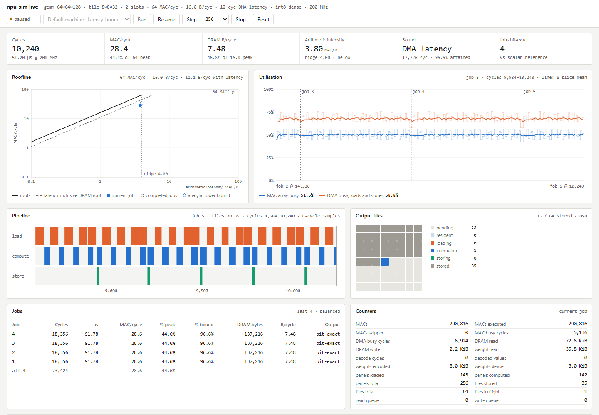

# Usage

This document describes how to build the model, run `npu-sim`, read and write its file
formats, drive the live dashboard, and use the Python tools in `npuperf/`. The mechanisms
behind the reported counters are specified in [architecture](architecture.md), arithmetic and
weight formats in [numerics](numerics.md), and the scope of the model in the "Model fidelity"
section of [methodology](methodology.md).

| Section | Content |
|---|---|
| [1 Build](#1-build) | Prerequisites, CMake presets, cache options, executables, tests, install |
| [2 Launcher](#2-launcher) | `run.py`: build, check and open the dashboard in one command |
| [3 npu-sim command line](#3-npu-sim-command-line) | Conventions, option reference, limits |
| [4 Configuration files](#4-configuration-files) | `--config` schema, shipped design points, precedence |
| [5 Result JSON](#5-result-json) | Schema version 2: top level, `memory`, `cluster`, `cores` |
| [6 Traces and waveforms](#6-traces-and-waveforms) | Stage trace CSV, VCD, progress JSONL |
| [7 Live stdio protocol](#7-live-stdio-protocol) | `--live-stdio` commands and snapshot fields |
| [8 Live dashboard](#8-live-dashboard) | Profiles, controller, HTTP API |
| [9 Python tools](#9-python-tools) | `npuperf` conventions, sweep, autotune, roofline, reproduce, energy |
| [10 Graph runtime](#10-graph-runtime) | Graph JSON schema, operators, execution, report |
| [11 Graph optimizer](#11-graph-optimizer) | ReLU fusion pass |
| [12 ONNX importer](#12-onnx-importer) | Supported subset, quantization and layout mapping |
| [13 File formats](#13-file-formats) | `NPU1`, `NPUQ1`, workload tables, format index |

## 1 Build

### 1.1 Prerequisites

| Component | Minimum | Source of the requirement |
|---|---|---|
| C++ compiler | C++17 | `CMakeLists.txt` (`CMAKE_CXX_STANDARD 17`) |
| CMake | 3.24; 3.25 for presets and `cmake --workflow` | `CMakeLists.txt`, `CMakePresets.json` |
| Ninja | any | generator of every configure preset |
| Python | 3.10 | `cmake/NpuTesting.cmake`, `run.py`; standard library only |
| SystemC | 3.0.2 | fetched at configure time; URL and SHA-256 in `cmake/SystemCSource.cmake` |

CI builds and runs the full test suite with GCC and Clang on Linux x64, GCC on Linux Arm64,
Clang on macOS Arm64 and MSVC on Windows x64 (`.github/workflows/ci.yml`).

| Host | Toolchain installation |
|---|---|
| Ubuntu, Debian, WSL | `sudo apt-get install build-essential cmake ninja-build python3` |
| macOS | `xcode-select --install` for the compiler; CMake and Ninja from their releases or a package manager (`brew install cmake ninja`) |
| Windows | Visual Studio Build Tools, workload "Desktop development with C++" (MSVC, Windows SDK, C++ CMake tools); Python from python.org |

The first configure downloads SystemC from `codeload.github.com` and verifies its hash. Two
cache settings avoid the download:

| Setting | Effect |
|---|---|
| `-DFETCHCONTENT_SOURCE_DIR_SYSTEMC=<dir>` | Builds SystemC from an extracted 3.0.2 source tree |
| `-DNPU_FETCH_SYSTEMC=OFF -DCMAKE_PREFIX_PATH=<prefix>` | Links an installed SystemC package; `cmake -DNPU_SYSTEMC_PREFIX=<prefix> -P cmake/BuildSystemC.cmake` builds one with the same pin and patches |

Under MSVC the fetched source receives the upstream integer-stream fix in
`cmake/PatchSystemCMsvc.cmake`; the build checks the hashes of the original and patched files.

### 1.2 Presets

```sh
cmake --workflow --preset release      # configure, build and test in build/release
```

The workflow preset is shorthand for the three steps:

```sh
cmake --preset release
cmake --build --preset release
ctest --preset release
```

| Preset | Build type | Settings | Hosts |
|---|---|---|---|
| `release` | Release | | all |
| `debug` | Debug | | all |
| `asan-ubsan` | Debug | `NPU_SANITIZERS=address;undefined` on the project and the fetched SystemC; test timeouts x3 | Linux, macOS |
| `coverage` | Debug | `NPU_COVERAGE=ON` (gcov line coverage of project code) | Linux, macOS |
| `ci-gcc` | Release | `gcc`/`g++`, warnings as errors | Linux, macOS |
| `ci-clang` | Release | `clang`/`clang++`, warnings as errors | Linux, macOS |
| `ci-msvc` | Release | `cl`, warnings as errors, test timeouts x3 | Windows |

Each preset builds into `build/<preset>/`. On Windows the presets run Ninja with `cl` and
therefore need the MSVC environment: run them from a Developer PowerShell or Developer
Command Prompt. Outside that environment the Visual Studio generator finds the compiler
itself:

```powershell
cmake -S . -B build
cmake --build build --config Release
ctest --test-dir build -C Release
```

The Visual Studio generator places executables in `build/Release/`, a location that `run.py`
and `npuperf` search (section 9.1).

### 1.3 Cache options

| Option | Default | Effect |
|---|---|---|
| `NPU_FETCH_SYSTEMC` | `ON` | Fetch and build the pinned SystemC; `OFF` uses `find_package(SystemCLanguage 3.0.2)` |
| `NPU_SANITIZERS` | empty | Any of `address;undefined;leak` (GCC and Clang); applied to project code and a fetched SystemC |
| `NPU_WARNINGS_AS_ERRORS` | `OFF` | Treat warnings in project code as errors |
| `NPU_COVERAGE` | `OFF` | Instrument project code for gcov |
| `NPU_ENABLE_ONNX_TESTS` | `OFF` | Register `onnx.ort-differential`; needs `requirements-onnx.txt` installed for the configured Python |
| `NPU_TEST_TIMEOUT_SCALE` | `1` | Positive integer multiplier on every test timeout; also read from the environment variable of that name |
| `BUILD_TESTING` | `ON` | CTest default; `run.py` configures with `OFF` |

### 1.4 Executables

| Executable | Sources | Content |
|---|---|---|
| `npu-sim` | `src/main.cpp`, `src/model.cpp`, `src/memory.cpp` | Tiled GEMM accelerator model; sections 3 to 7 |
| `npu-tlm-demo` | `src/tlm_platform.cpp` | TLM-2.0 host and accelerator platform |
| `npu-transformer-demo` | `src/transformer.cpp` | Transformer layer with prefill, decode and KV cache |
| `npu-mobile-demo` | `src/mobile_platform.cpp` | Multi-core platform with a shared bus and operating points |

All four link `npu_core` (`src/core.cpp`, `src/conv.cpp`, `src/json.cpp`, `src/options.cpp`).

### 1.5 Tests

Test names are `<area>.<what>`. The area is a CTest label; C++ executables add the label
`unit` and Python suites `python` (`cmake/NpuTesting.cmake`).

| Area | Coverage |
|---|---|
| `core` | Arithmetic, weight codec and option table (C++ unit tests) |
| `sim` | `npu-sim` against independent oracles: GEMM, quantization, memory hierarchy, compression, observability, config files, memory model, cluster, design points, convolution traffic |
| `graph` | Graph runtime and fusion |
| `soc` | TLM, transformer and multi-core platforms |
| `live` | Live stdio protocol and dashboard |
| `tools` | Launcher, energy, autotune, `npuperf`, analytic model, mapper, studies |
| `docs` | Generated option tables of this document |
| `build`, `ci` | Install layout, CI SystemC cache, sanitizer probe |
| `examples` | `scripts/*.py` end to end on the bundled examples |
| `onnx` | ONNX Runtime differential suite, when `NPU_ENABLE_ONNX_TESTS=ON` |

```sh
ctest --preset release -L sim                 # one area
ctest --preset release -R cluster             # by name
python3 tests/cluster_tests.py --binary build/release/npu-sim   # one suite, outside CTest
```

CTest passes every test the tool paths as `NPU_SIM`, `NPU_TLM_DEMO`, `NPU_TRANSFORMER_DEMO`
and `NPU_MOBILE_DEMO`, and puts the source root on `PYTHONPATH`.

### 1.6 Install

```sh
cmake --install build/release --component npu --prefix <dir>
```

The `npu` component installs the four executables to `<dir>/bin`. A fetched SystemC installs
its library, headers and documentation as the separate components `lib`, `dev` and `doc`.

## 2 Launcher

`run.py` builds `npu-sim`, checks it and serves the live dashboard (section 8).

```sh
python3 run.py          # Linux, macOS, WSL
py -3 run.py            # Windows
```

| Step | Action |
|---|---|
| 1 | Bind `127.0.0.1:<port>`; a port in use fails before any build |
| 2 | Configure `build-live/` with `-DCMAKE_BUILD_TYPE=Release -DBUILD_TESTING=OFF` and the platform's default generator, then build the `npu-sim` target with `--parallel <jobs>` |
| 3 | Run `npu-sim --m 4 --n 4 --k 8` and require `"numerical_match": true` |
| 4 | Start the selected profile, print the URL and open the default browser |

A later run reuses `build-live/` and recompiles changed sources only. Ctrl+C in the terminal
stops the server and its simulator child.

| Option | Default | Effect |
|---|---|---|
| `--build-dir DIR` | `build-live` | CMake build directory |
| `--jobs N` | `2` | Parallel build jobs, 1..128 |
| `--port N` | `8765` | Dashboard port on `127.0.0.1`; `0` picks a free port and prints it |
| `--profile NAME` | `balanced` | Initial workload: `balanced`, `compute-bound`, `memory-bound`, `palette-weights` |
| `--no-browser` | | Print the URL only |
| `--build-only` | | Build and check, then exit |
| `--skip-build` | | Use the executable already in `--build-dir`; excludes `--build-only` |

Errors print one line, `run.py: <message>`, on stderr. Exit status 1 is a failed step (build,
port, startup check); 2 is a rejected argument or a missing executable.

## 3 npu-sim command line

### 3.1 Conventions

| Aspect | Behavior |
|---|---|
| Output | A batch run prints one JSON result object (section 5) on stdout |
| Diagnostics | One line, `npu-sim: <message>`, on stderr |
| Exit status | 0 on success; 2 on any error: argument, validation, I/O, stall or numerical mismatch |
| Order | Flags and `--config` files apply left to right; a later assignment replaces an earlier one |
| `--help`, `--version` | Answer before the other arguments are parsed |
| Values | Integers in decimal without `+`, whitespace or trailing characters; only signed fields take `-`. `--frequency-mhz` takes a decimal with optional fraction and exponent |
| Tensors | Synthesized from `--seed` unless `--input` names an `NPU1` file (section 13.1) |
| Time | One cycle is 1 ns of SystemC time; `modeled_latency_ns` converts cycles at `arch.frequency_mhz` |

`--version` prints `npu-sim <version> (<git describe>)`; the describe string is captured at
configure time and reads `unknown` when git is unavailable.

[Architecture](architecture.md) section 2.2 lists the cross-parameter rules of the
configuration, the command-line ones included. The parser also rejects these combinations of
inputs, outputs and session modes (`src/main.cpp`):

| Combination | Rule |
|---|---|
| `--live-stdio` with `--trace` or `--dump-output` | A live session reports through snapshots |
| `--timing-only` with `--input`, `--dump-output` or compressed weights | A timing-only run has no tensors |
| `--input` with `shape.conv` | The convolution's NHWC input tensor is generated |
| `--quantization-file` with per-channel config keys | One source for the per-channel vectors |
| `--input` with `--m`, `--n` or `--k` on the command line | The `NPU1` header gives the shape; a config file may restate it when it agrees |
| Two output paths that name one file, or an output path equal to an input | Outputs never overwrite inputs or each other |

### 3.2 Run-control options

Run-control flags select inputs, outputs and the session mode; results do not echo them. An
empty Value cell marks a switch. The table is generated from
`npu-sim --help` by `tools/gen_cli_reference.py` and checked by the `docs.cli-reference` test.

<!-- generated:npu-sim-run-options -->
| Flag | Value | Default | Description |
|---|---|---|---|
| `--config` | `FILE.json` |  | load config-file keys; later flags and files override them |
| `--input` | `PATH` |  | NPU1 tensor file: M N K, then activations (M x G\*K), weights (G blocks of K x N) and bias (G\*N); G is `--groups` |
| `--quantization-file` | `PATH` |  | NPUQ1 file: G\*N, then weight_zero multiplier shift per output channel; signed shifts |
| `--vcd` | `PATH.vcd` |  | write SystemC waveforms |
| `--progress-jsonl` | `PATH` |  | write a snapshot after every slice of simulated cycles |
| `--slice-cycles` | `N` | `1024` | progress slice length |
| `--live-stdio` |  |  | read advance N, snapshot and stop on stdin; answer in JSON lines |
| `--dump-output` |  |  | include accumulators and outputs in the result |
| `--describe-config` |  |  | print the effective configuration as JSON and exit |
| `--version` |  |  | print the version and exit |
| `--help` |  |  | print this text and exit |
<!-- end:npu-sim-run-options -->

### 3.3 Configuration options

Every configuration field is one row of the option table in `src/options.cpp`. The table
drives command-line parsing, `--help`, config-file loading and the `config` object echoed in
every result. Rows without a flag are set from a config file only; an empty Value cell marks a
switch. Descriptions are the `--help` text.

<!-- generated:npu-sim-config-options -->
| Flag | Config key | Value | Default | Description |
|---|---|---|---|---|
|  | `name` |  |  | configuration name |
|  | `description` |  |  | free-text description |
| `--m` | `shape.m` | `N` | `16` | output rows M |
| `--n` | `shape.n` | `N` | `16` | output channels N per group |
| `--k` | `shape.k` | `N` | `32` | reduction depth K per group |
| `--groups` | `shape.groups` | `N` | `1` | independent GEMMs G sharing M; depthwise convolution is G channels, N 1, K kh\*kw |
| `--seed` | `shape.seed` | `N` | `1` | synthetic-tensor seed; the low 32 bits are used |
| `--conv-input-h` | `shape.conv.input_h` | `N` | `0` | implicit convolution: NHWC input height; with -w and -c set, the activation operand is the input's im2col view (M = output pixels, K = kernel_h\*kernel_w\*input_c/groups) and panel loads read the input footprint; 0 is a plain GEMM operand |
| `--conv-input-w` | `shape.conv.input_w` | `N` | `0` | implicit convolution: input width |
| `--conv-input-c` | `shape.conv.input_c` | `N` | `0` | implicit convolution: input channels, a multiple of `--groups` |
| `--conv-kernel-h` | `shape.conv.kernel_h` | `N` | `1` | implicit convolution: kernel height |
| `--conv-kernel-w` | `shape.conv.kernel_w` | `N` | `1` | implicit convolution: kernel width |
| `--conv-stride-h` | `shape.conv.stride_h` | `N` | `1` | implicit convolution: vertical stride |
| `--conv-stride-w` | `shape.conv.stride_w` | `N` | `1` | implicit convolution: horizontal stride |
| `--conv-dilation-h` | `shape.conv.dilation_h` | `N` | `1` | implicit convolution: vertical dilation |
| `--conv-dilation-w` | `shape.conv.dilation_w` | `N` | `1` | implicit convolution: horizontal dilation |
| `--conv-pad-top` | `shape.conv.pad_top` | `N` | `0` | implicit convolution: zero-point rows above the input |
| `--conv-pad-left` | `shape.conv.pad_left` | `N` | `0` | implicit convolution: zero-point columns left of the input |
| `--conv-pad-bottom` | `shape.conv.pad_bottom` | `N` | `0` | implicit convolution: zero-point rows below the input |
| `--conv-pad-right` | `shape.conv.pad_right` | `N` | `0` | implicit convolution: zero-point columns right of the input |
| `--macs-per-cycle` | `arch.compute.macs_per_cycle` | `N` | `64` | vector-datapath MACs per cycle; unused when an array is configured |
| `--array-rows` | `arch.compute.array_rows` | `N` | `0` | systolic array rows; 0 with `--array-cols` 0 selects the vector datapath |
| `--array-cols` | `arch.compute.array_cols` | `N` | `0` | systolic array columns |
| `--dataflow` | `arch.compute.dataflow` | `os\|ws` | `os` | array dataflow, needs `--array-rows`/`--array-cols`: os holds an output block in the PEs and streams K; ws holds a weight block and streams the tile's rows |
| `--pipeline-cycles` | `arch.compute.pipeline_cycles` | `N` | `4` | fixed cycles charged per reduction panel on top of MAC and decode time |
| `--weight-decode-values-per-cycle` | `arch.compute.weight_decode_values_per_cycle` | `N` | `16` | compressed-weight decoder throughput in values per cycle |
| `--depthwise-macs-per-cycle` | `arch.compute.depthwise_macs_per_cycle` | `N` | `0` | depthwise-datapath MACs per cycle for depthwise problems (groups > 1, N 1): tiles span tile_n consecutive groups and a panel takes ceil(M_t\*C_t\*K_p / rate) + pipeline cycles; 0 runs them as grouped GEMMs on the MAC datapath |
| `--memory-model` | `arch.memory.model` | `serial\|axi` | `serial` | serial: one DMA server alternating reads and writes, one transfer at a time; axi: independent read and write channels with outstanding bursts and a shared DRAM rate |
| `--memory-bytes-per-cycle` | `arch.memory.bytes_per_cycle` | `N` | `16` | serial model: DMA bytes transferred per cycle |
| `--memory-latency` | `arch.memory.latency` | `N` | `12` | serial model: cycles charged once per DMA burst |
| `--dma-burst-bytes` | `arch.memory.burst_bytes` | `N` | `0` | serial model: maximum burst size; 0 issues each transfer as one burst |
| `--dram-bytes-per-cycle` | `arch.memory.dram_bytes_per_cycle` | `N` | `0` | axi model: DRAM data rate shared by the read and write channels; 0 is unlimited |
| `--axi-data-bytes` | `arch.memory.axi.data_bytes` | `8\|16\|32\|64` | `16` | axi model: bytes per beat; each channel moves one beat per cycle |
| `--axi-burst-beats` | `arch.memory.axi.max_burst_beats` | `N` | `16` | axi model: longest INCR burst in beats, 1..256; bursts also split at 4 KiB boundaries |
| `--axi-read-outstanding` | `arch.memory.axi.read_outstanding` | `N` | `4` | axi model: read bursts in flight, 1..64 |
| `--axi-write-outstanding` | `arch.memory.axi.write_outstanding` | `N` | `4` | axi model: write bursts in flight, 1..64 |
| `--axi-read-latency` | `arch.memory.axi.read_latency` | `N` | `12` | axi model: cycles from AR issue to the first R beat |
| `--axi-write-latency` | `arch.memory.axi.write_latency` | `N` | `12` | axi model: cycles from the last W beat to the B response |
| `--sram-bytes` | `arch.sram_bytes` | `N` | `262144` | SRAM capacity for tile slots plus the weight and activation caches |
| `--weight-cache-bytes` | `arch.weight_cache_bytes` | `N` | `0` | LRU weight-panel cache capacity; 0 disables it |
| `--activation-cache-bytes` | `arch.activation_cache_bytes` | `N` | `0` | LRU activation-panel cache capacity, keyed by group or channel tile, row tile and reduction panel, so column tiles of a row tile reuse its panels; 0 disables it |
| `--frequency-mhz` | `arch.frequency_mhz` | `X` | `200` | clock used to convert cycles to modeled time |
| `--cores` | `arch.cores` | `N` | `1` | core pipelines, 1..64, each with its own slots, SRAM, weight cache and AXI port; all share one DRAM timeline, so more than one needs `--memory-model` axi |
| `--tile-m` | `mapping.tile_m` | `N` | `8` | output tile rows |
| `--tile-n` | `mapping.tile_n` | `N` | `8` | output tile columns |
| `--tile-k` | `mapping.tile_k` | `N` | `0` | reduction panel depth; 0 uses one panel of depth K |
| `--buffer-slots` | `mapping.buffer_slots` | `N` | `2` | tiles in flight across load, compute and store |
| `--panel-buffers` | `mapping.panel_buffers` | `1\|2` | `2` | reduction-panel buffers per slot; with 2 the DMA loads panel b+1 while compute reads panel b |
| `--partition` | `mapping.partition` | `m\|n\|auto` | `auto` | cluster work split: m gives each core a band of output-row tiles and n a band of output-column tiles; whole groups go to cores when groups >= cores; auto takes the smaller predicted makespan bound, then fewer predicted DRAM bytes, then n |
| `--weight-bits` | `weights.bits` | `4\|8` | `8` | signed weight precision |
| `--weight-encoding` | `weights.encoding` | `dense\|palette\|sparse` | `dense` | lossless weight storage format |
| `--palette-bits` | `weights.palette_bits` | `1\|2\|4\|8` | `4` | palette index width |
| `--sparse-block` | `weights.sparse_block` | `N` | `8` | zero-skipping bitmap block length |
| `--input-zero` | `quant.input_zero` | `N` | `-3` | INT8 activation zero point |
| `--weight-zero` | `quant.weight_zero` | `N` | `2` | weight zero point |
| `--output-zero` | `quant.output_zero` | `N` | `0` | INT8 output zero point |
| `--multiplier` | `quant.multiplier` | `N` | `1` | rescale multiplier in 0..2147483647; scale = multiplier / 2^shift |
| `--shift` | `quant.shift` | `N` | `7` | rescale right shift: 0..31 native, 2..62 tosa modes |
| `--relu` | `quant.relu` |  | `false` | clamp outputs below the output zero point |
| `--rescale` | `quant.rescale` | `native\|tosa-single\|tosa-double` | `native` | native rounds the magnitude of acc\*multiplier per `--rounding`; tosa-single and tosa-double are TOSA 1.0.2 RESCALE apply_scale_32 (TFLite single rounding and gemmlowp double rounding with tosa shift = 31 - TFLite shift) |
| `--rounding` | `quant.rounding` | `away\|even` | `away` | native rescale tie rounding: away from zero or to even |
|  | `quant.weight_zero_points` |  |  | per-channel weight zero points, one per output channel (G\*N); `--quantization-file` sets all three per-channel vectors |
|  | `quant.multipliers` |  |  | per-channel multipliers, one per output channel (G\*N) |
|  | `quant.shifts` |  |  | per-channel signed shifts, one per output channel (G\*N) |
| `--timing` | `sim.timing` | `event\|cycle` | `event` | event jumps across stage waits; cycle waits one cycle at a time |
| `--timing-only` | `sim.timing_only` |  | `false` | time the schedule without tensors, numerics or the reference (dense weights; up to 1e13 MACs; results report numerics "skipped") |
| `--trace` | `sim.trace_path` | `PATH` |  | stage trace CSV written after a batch run |
<!-- end:npu-sim-config-options -->

### 3.4 Limits

| Quantity | Accepted range | Defined in |
|---|---|---|
| `shape.m`, `shape.n`, `shape.k`, `shape.groups` | 1..1,048,576 | `include/npu/core.hpp` (`max_dimension`) |
| G·N and G·K | at most 1,048,576 | `src/core.cpp` |
| MACs per bit-exact run | at most 4,000,000,000 | `max_functional_macs` |
| MACs per `--timing-only` run | at most 10,000,000,000,000 | `max_timing_only_macs` |
| Simulator host storage estimate | at most 256 MiB | `max_host_bytes` |
| `mapping.tile_m`, `mapping.tile_n` | 1..1,048,576 | `src/core.cpp` |
| `mapping.tile_k` | 0 (one panel of depth K) or 1..1,048,576 | `src/core.cpp` |
| `mapping.buffer_slots` | 1..64 | `src/core.cpp` |
| `mapping.panel_buffers` | 1 or 2 | `src/core.cpp` |
| `arch.compute.array_rows`, `array_cols` | both 0 (vector datapath) or both 1..256 | `src/core.cpp` |
| Rates: `macs_per_cycle`, `memory.bytes_per_cycle`, `weight_decode_values_per_cycle` | 1..1,000,000,000 | `src/core.cpp` |
| Latencies, `pipeline_cycles`, `burst_bytes`, `weight_cache_bytes`, `activation_cache_bytes`, `dram_bytes_per_cycle`, `depthwise_macs_per_cycle` | at most 1,000,000,000 | `src/core.cpp` |
| `shape.conv` input extents, kernel, stride, dilation | 1..1,048,576 each, all three input extents set together; `input_c` a multiple of `groups`; M = output height·width, K = kernel_h·kernel_w·input_c/groups | `src/conv.cpp` |
| `shape.conv` padding | 0..1,048,576 per side; the kernel's reach fits the padded input | `src/conv.cpp` |
| `arch.memory.axi.data_bytes` | 8, 16, 32 or 64 | `src/core.cpp` |
| `arch.memory.axi.max_burst_beats` | 1..256 | `src/core.cpp` |
| `read_outstanding`, `write_outstanding` | 1..64 | `src/core.cpp` |
| `arch.cores` | 1..64; above 1 requires `--memory-model axi` | `src/core.cpp` |
| `arch.frequency_mhz` | 0.000001..1,000,000,000 | `src/core.cpp` |
| `weights.bits` | 4 or 8; INT4 weight zero points in -8..7 | `src/core.cpp` |
| `weights.palette_bits` | 1, 2, 4 or 8 | `src/core.cpp` |
| `weights.sparse_block` | 1..4096; sparse encoding runs on the vector datapath only | `src/core.cpp` |
| `quant.multiplier` | 0..2,147,483,647 | `src/core.cpp` |
| `quant.shift` | 0..31 for `native`; 2..62 for `tosa-single` and `tosa-double` | `src/core.cpp` |
| SRAM | `arch.sram_bytes` at least the reservation of the slots, panel buffers, weight cache and activation cache (`scratchpad_bytes`) | `src/core.cpp` |
| Config file | at most 64 MiB; JSON nesting at most 64 levels | `include/npu/options.hpp`, `include/npu/json.hpp` |
| `--slice-cycles`, live `advance N` | 1..10,000,000 | `src/main.cpp` |
| Live command line | at most 256 characters | `src/main.cpp` |

## 4 Configuration files

### 4.1 Schema

A config file holds one JSON object. Each nesting level is one segment of an option-table path
(section 3.3), and each leaf is one option. Two leaves sit at the top level: `name` and
`description`, free-text strings echoed in every result. `configs/example.json` uses most groups:

```json
{
  "name": "example-16x16-os",
  "description": "16x16 output-stationary array, 512 KiB SRAM, 32 B/cycle DMA with 256 B bursts, 1 GHz",
  "shape": {"m": 64, "n": 64, "k": 128, "seed": 7},
  "arch": {
    "compute": {"array_rows": 16, "array_cols": 16, "dataflow": "os", "pipeline_cycles": 4},
    "memory": {"model": "serial", "bytes_per_cycle": 32, "latency": 40, "burst_bytes": 256},
    "sram_bytes": 524288,
    "weight_cache_bytes": 65536,
    "frequency_mhz": 1000,
    "cores": 1
  },
  "mapping": {"tile_m": 32, "tile_n": 32, "tile_k": 64, "buffer_slots": 2, "panel_buffers": 2,
              "partition": "auto"},
  "weights": {"bits": 8, "encoding": "dense"},
  "quant": {
    "input_zero": 0,
    "weight_zero": 0,
    "output_zero": 0,
    "multiplier": 1,
    "shift": 8,
    "rounding": "even"
  },
  "sim": {"timing": "event"}
}
```

| Rule | Behavior |
|---|---|
| Omitted keys | Keep their defaults (section 3.3) or the value an earlier file or flag set |
| Unknown keys | Error, reported as `<file>:<line>:<column>: unknown config key "<path>"` |
| Dotted keys | Rejected; nest one object per path segment |
| Duplicate members | Rejected by the parser (`src/json.cpp`) |
| Integers | JSON integers within the field's type; `arch.cores` expects an unsigned 64-bit integer, for example |
| Enumerations | JSON strings from the closed set (`"os"`, `"axi"`, `"tosa-double"`, ...) |
| Switches | JSON `true` or `false` |
| Per-channel vectors | JSON arrays of signed 32-bit integers, one entry per output channel (G·N) |

### 4.2 Precedence and the echoed config

Files and flags apply in command-line order:

```sh
npu-sim --config configs/mobile-2k.json --tile-k 128 --describe-config   # tile_k 128
npu-sim --tile-k 128 --config configs/mobile-2k.json --describe-config   # tile_k 256, from the file
```

`--describe-config` prints the effective configuration in the same nested form and exits. The
`config` object of every result is a complete config file: saving it and passing it to
`--config` reproduces the run, cycles and output hash included. The echo carries
`sim.trace_path`, so a rerun writes the trace again.

### 4.3 Shipped configurations

| File | Array | Cores | Memory model | Tiles (M x N x K) |
|---|---|---|---|---|
| `configs/edge-256.json` | 16x16 OS | 1 | AXI | 32 x 32 x 128 |
| `configs/mobile-2k.json` | 32x64 OS | 1 | AXI | 64 x 64 x 256 |
| `configs/client-16c.json` | 32x32 OS | 16 | AXI | 64 x 64 x 256 |
| `configs/workstation-32c.json` | 32x32 OS | 32 | AXI | 64 x 64 x 256 |
| `configs/example.json` | 16x16 OS | 1 | serial | 32 x 32 x 64 |

The first four are design points sized from public data; [design points](design-points.md)
derives every field and cites the sources, and `python3 -m npuperf.designs` prints their
headline table. A design-point file sets the architecture and mapping only, so a run supplies
the layer shape:

```sh
npu-sim --config configs/mobile-2k.json --m 1 --n 2048 --k 2048 --timing-only
```

### 4.4 Convolution geometry, depthwise datapath and activation cache

Three configuration groups extend the GEMM description for convolution layers. Their
mechanisms are specified in [architecture](architecture.md) sections 3.5, 4.4 and 4.8.

| Config key | Behavior |
|---|---|
| `shape.conv` | Convolution geometry: input extents, kernel, stride, dilation and padding. The activation operand is the im2col view of an NHWC input tensor, and each panel load reads the tile's input footprint, halo included; padding is not read. M and K must equal the geometry's output pixels and kernel_h·kernel_w·input_c/groups; `mapping.tile_k` is 0 or a multiple of kernel_w·input_c/groups |
| `arch.compute.depthwise_macs_per_cycle` | Depthwise datapath, used when the rate is above 0, `shape.groups` above 1 and `shape.n` 1. Tiles span `tile_n` channels; dense weights only |
| `arch.activation_cache_bytes` | Per-core LRU activation-panel cache with the policy of the weight cache; the capacity counts in `scratchpad_bytes` |

A reduction panel on the depthwise datapath takes the cycles of architecture equation 3.5. A 3x3
depthwise layer of 96 channels with stride 2 on a 56 x 56 input, read from its input
footprint on the depthwise datapath of the `mobile-2k` design point:

```sh
npu-sim --config configs/mobile-2k.json --m 784 --n 1 --k 9 --groups 96 \
    --conv-input-h 56 --conv-input-w 56 --conv-input-c 96 --conv-kernel-h 3 --conv-kernel-w 3 \
    --conv-stride-h 2 --conv-stride-w 2 --conv-pad-bottom 1 --conv-pad-right 1 \
    --tile-m 64 --tile-n 64 --tile-k 0
```

The run is bit-exact, takes 66,541 cycles and reads 365,280 activation bytes of the
301,056-byte input: input rows that two row tiles both need are read by each.

## 5 Result JSON

A batch run prints one object with `"schema_version": 2` (`src/main.cpp`). Version 2 nests
`config` by option-table path and adds `memory`, `cluster` and `cores`. `npuperf.sim` reads
versions 1 and 2; version 1 carried a flat `config` whose keys are the flag names
(`npuperf/sim.py`, `CONFIG_PATHS`).

### 5.1 Top level

| Field | Type | Definition |
|---|---|---|
| `schema_version` | integer | 2 |
| `config` | object | Effective configuration, complete (section 4.2) |
| `cycles` | integer | Makespan in cycles; for a cluster, the last core's completion |
| `macs` | integer | Logical MACs of the workload, M·N·K·G |
| `executed_macs`, `skipped_macs` | integer | MACs the datapath executed and those sparse zero-skipping removed; they sum to `macs` |
| `reduction_blocks` | integer | Reduction panels per tile, ⌈K / tile_k⌉; 1 when `tile_k` is 0 |
| `read_bytes`, `write_bytes` | integer | DRAM payload bytes read and written, re-reads included |
| `weight_read_bytes` | integer | Weight bytes read from DRAM, re-reads included |
| `dense_weight_storage_bytes`, `encoded_weight_storage_bytes` | integer | Weight storage in dense form and in the configured encoding |
| `weight_decode_cycles`, `decoded_weight_values` | integer | Compressed-weight decoder work |
| `weight_cache_hits`, `weight_cache_misses` | integer | Weight-panel cache lookups |
| `weight_bytes_saved` | integer | DRAM weight bytes the cache hits avoided |
| `peak_cached_weight_bytes` | integer | Largest weight-cache occupancy of any core |
| `activation_read_bytes` | integer | Activation bytes read from DRAM after activation-cache hits |
| `activation_cache_hits`, `activation_cache_misses` | integer | Activation-panel cache lookups |
| `activation_bytes_saved` | integer | DRAM activation bytes the cache hits avoided |
| `peak_cached_activation_bytes` | integer | Largest activation-cache occupancy of any core |
| `depthwise_macs` | integer | MACs run on the depthwise datapath |
| `depthwise_peak_macs_per_cycle` | integer | `depthwise_macs_per_cycle` times cores |
| `depthwise_mac_utilization` | number | `depthwise_macs / (depthwise_peak_macs_per_cycle · cycles)`; 0 when the rate is 0 |
| `compute_busy_cycles` | integer | Panel durations $C_p$ (architecture equation 3.1) summed over computed panels and cores |
| `dma_busy_cycles` | integer | Serial: request service durations; AXI: cycles with a request in flight on either channel of a port; summed over cores |
| `peak_inflight_tiles` | integer | Most tiles holding slots at once in any core |
| `slot_wait_cycles` | integer | Cycles the loader waited for a free slot |
| `panel_wait_cycles` | integer | Cycles the loader waited for a panel buffer of the slot it holds |
| `dma_requests`, `dma_bursts` | integer | Memory requests and the bursts they split into |
| `effective_macs_per_cycle` | integer | Cluster peak of the engine the job runs on: array rows·columns, `macs_per_cycle`, or on the depthwise datapath `depthwise_macs_per_cycle`, times cores |
| `peak_memory_bytes_per_cycle` | integer | Serial: `bytes_per_cycle`. AXI: min(2·`data_bytes`·cores, `dram_bytes_per_cycle`), or the bus term when the DRAM rate is 0 |
| `scratchpad_bytes` | integer | SRAM reservation per core: slots, panel buffers and both caches (`scratchpad_bytes` in `src/core.cpp`) |
| `numerics` | string | `bit-exact`, or `skipped` for `--timing-only` |
| `output_hash` | integer or null | FNV-1a 64 over the INT32 accumulators (little-endian) and then the INT8 outputs (`output_hash` in `src/core.cpp`); null when numerics are skipped |
| `numerical_match` | true or null | true after the comparison with the scalar reference; null when skipped |
| `simulation_wall_seconds` | number | Host time spent in the SystemC kernel |
| `compute_utilization` | number | `compute_busy_cycles / (cycles · cores)` |
| `memory_utilization` | number | `dma_busy_cycles / (cycles · cores)` |
| `mac_utilization` | number | `executed_macs / (effective_macs_per_cycle · cycles)` |
| `dma_payload_utilization` | number | `(read_bytes + write_bytes) / (peak_memory_bytes_per_cycle · cycles)` |
| `arithmetic_intensity_macs_per_byte` | number | `macs / (read_bytes + write_bytes)` |
| `resource_lower_bound_cycles` | integer | Largest per-core `compute_busy_cycles` or `dma_busy_cycles`; under AXI with a DRAM rate, at least ⌈DRAM bytes / `dram_bytes_per_cycle`⌉ |
| `modeled_latency_ns` | number | `cycles · 1000 / frequency_mhz` |
| `memory` | object | Section 5.2 |
| `cluster` | object | Section 5.3 |
| `cores` | array | Section 5.4 |
| `accumulators`, `outputs` | array | INT32 accumulators and INT8 outputs, row-major M x G·N; with `--dump-output` only |

`output_hash` is an unsigned 64-bit integer; a JSON parser that maps numbers to doubles loses
its low bits. Snapshots (section 7) carry the same hash as a decimal string.

### 5.2 `memory`

| Field | Definition |
|---|---|
| `model` | `serial` or `axi` |
| `peak_bytes_per_cycle` | As `peak_memory_bytes_per_cycle` |
| `read`, `write` | Channel objects, below; under the serial model they split the one DMA server's traffic by direction |
| `dram` | AXI only: `bytes_per_cycle` (the configured rate), `bytes` (beats times `data_bytes` over every port) and `utilization` = `bytes / (bytes_per_cycle · cycles)`, 0 when the rate is unlimited |

| Channel field | Definition |
|---|---|
| `requests`, `bursts`, `beats` | Requests issued, bursts after splitting, data beats |
| `payload_bytes` | Bytes requested |
| `busy_cycles` | Cycles the data channel moves beats; under AXI, from each burst's first beat to its last, DRAM throttling included |
| `mean_latency_cycles`, `max_latency_cycles` | Request arrival to completion |
| `burst_efficiency` | `payload_bytes / (beats · beat bytes)`; beat bytes are `bytes_per_cycle` (serial) or `axi.data_bytes` |
| `achieved_bytes_per_cycle` | `payload_bytes / cycles` |
| `peak_outstanding` | Most bursts in flight at once |

### 5.3 `cluster`

| Field | Definition |
|---|---|
| `cores` | Core count |
| `partition` | The split in effect, `m` or `n`; `auto` resolves to one of them |
| `split` | Unit of distribution: `groups` (whole groups per core), `rows` or `columns` (bands of tiles) |
| `units` | Number of units distributed |
| `makespan_cycles` | Equal to `cycles` |
| `imbalance` | Largest core MAC count times cores, over total MACs; 1 is balanced |
| `dram_bound_cycles` | ⌈DRAM bytes / `dram_bytes_per_cycle`⌉ under AXI with a rate; 0 otherwise |
| `predicted` | For `m` and `n`: `read_bytes`, `write_bytes` and `bound_cycles` predicted before the run; `auto` chooses from these |

### 5.4 `cores`

One object per core, in core order:

| Field | Definition |
|---|---|
| `core`, `first_unit`, `units`, `tiles` | Core index, its first distribution unit, unit count and tile count |
| `cycles` | The core's completion cycle |
| `macs`, `executed_macs` | The core's share of the work |
| `compute_busy_cycles`, `dma_busy_cycles`, `compute_utilization`, `memory_utilization` | The core's resources; utilizations over the cluster `cycles` |
| `slot_wait_cycles`, `panel_wait_cycles`, `peak_inflight_tiles` | The core's pipeline |
| `read_bytes`, `write_bytes`, `weight_read_bytes`, `weight_cache_hits`, `weight_cache_misses`, `activation_read_bytes`, `activation_cache_hits`, `activation_cache_misses` | The core's traffic and caches |
| `depthwise_macs` | The core's MACs on the depthwise datapath |
| `memory` | The core's `read` and `write` channel objects; under AXI also `dram_bytes` |

## 6 Traces and waveforms

### 6.1 Stage trace CSV

`--trace PATH` writes one row per pipeline stage span after a batch run (`write_trace` in
`src/model.cpp`). Rows are ordered by start cycle, then stage, tile and block.

| Column | Content |
|---|---|
| `stage` | `load` (activation, weight and, for the first panel, per-channel parameter read), `compute` (one reduction panel), `store` (output tile write) |
| `tile_id` | Global tile index: group-major, then tile row, then tile column; on the depthwise datapath tile row, then channel tile |
| `start_cycle`, `end_cycle` | Span in cycles: a load or store from the cycle the serial server starts the request, or the cycle the AXI port receives it, to its completion |
| `bytes` | Request payload bytes; 0 for `compute` |
| `block_id` | Reduction panel index within the tile; a store carries the final panel |
| `core` | Core that ran the span |

The first rows of `npu-sim --m 16 --n 16 --k 32 --trace t.csv`:

```text
stage,tile_id,start_cycle,end_cycle,bytes,block_id,core
load,0,0,46,544,0,0
compute,0,46,82,0,0,0
load,1,46,92,544,0,0
compute,1,92,128,0,0,0
store,0,92,108,64,0,0
```

`npuperf.trace` reads the file (`read_trace`) and draws a Gantt chart of the DMA and the MAC
datapath (`gantt`).

### 6.2 VCD

`--vcd PATH.vcd` records SystemC signals of every core from time zero. The VCD time unit is
1 ps and one cycle is 1 ns, so cycle c appears at time 1000·c; delta cycles are traced, so
updates within one cycle appear at 1 ps offsets. One core traces under scope `SystemC.npu`;
a cluster traces each core under `SystemC.npu.core<i>` (`Core::trace_signals` in
`src/model.cpp`).

| Signals | Width | Content |
|---|---|---|
| `done`, `dma_busy`, `compute_busy`, `dma_read`, `dma_write` | 1 | Completion and resource state |
| `cycles` | 64 | Core cycle counter |
| `inflight_tiles`, `loaded_tiles`, `computed_tiles` | 64 | Pipeline occupancy and progress |
| `read_queue_depth`, `write_queue_depth` | 64 | Requests waiting for the memory port |
| `read_bytes`, `write_bytes`, `macs`, `executed_macs`, `skipped_macs` | 64 | Traffic and work counters |
| `dma_tile_id`, `dma_block_id`, `compute_tile_id`, `compute_block_id` | 64 | Tile and panel each resource serves |
| `dma_busy_cycles`, `compute_busy_cycles`, `dma_requests`, `dma_bursts`, `weight_decode_cycles` | 64 | Busy and request counters |

### 6.3 Progress JSONL

`--progress-jsonl PATH` writes one snapshot (section 7.2) per line: one at time zero, then one
after every `--slice-cycles` cycles until completion. The last line has `"completed": true`.
With `--live-stdio`, the file receives a copy of every snapshot the session emits. Stdout
still carries one result object in a batch run.

## 7 Live stdio protocol

### 7.1 Commands

`npu-sim --live-stdio [configuration flags]` elaborates the model, emits one snapshot line on
stdout, and then reads one command per line on stdin (`live_commands` in `src/main.cpp`).

| Command | Reply |
|---|---|
| `advance N` | Advance simulated time by N cycles, 1..10,000,000, then one snapshot. After completion `cycles` stays at the completion cycle |
| `snapshot` | One snapshot of the current state |
| `stop` | One snapshot with `"type": "stopped"`; the process exits with status 0 |
| any other line | `{"type":"error","error":"expected advance N, snapshot, or stop"}`; the session continues |

An `advance` outside 1..10,000,000 replies `{"type":"error","error":"advance requires cycles in
1..10000000"}`, and a line longer than 256 characters replies an error and is discarded. End
of input exits with status 0 and no reply. Each reply is one JSON object on one line. Two
conditions end the process with status 2 and a diagnostic on stderr: a completed output that
differs from the scalar reference, and an `advance` during which time cannot progress before
completion.

```text
$ printf 'advance 100\nsnapshot\nstop\n' | npu-sim --live-stdio --m 16 --n 16 --k 32
{"schema_version":2,"type":"snapshot","simulation":true,"config":{...},"cycles":0,...}
{"schema_version":2,"type":"snapshot",...,"cycles":100,"completed":false,...}
{"schema_version":2,"type":"snapshot",...,"cycles":100,...}
{"schema_version":2,"type":"stopped",...,"cycles":100,...}
```

`npuperf.sim.LiveSession` drives the protocol from Python: `advance(n)`, `snapshot()` and
`close()`, which sends `stop` and terminates the child if it does not exit.

### 7.2 Snapshot fields

A snapshot is the state of the model at the current cycle (`PipelineView` in
`include/npu/model.hpp`); its counters follow the commit rules of
[architecture](architecture.md) section 8.3.

| Field | Definition |
|---|---|
| `schema_version`, `type`, `simulation` | 2; `snapshot` or `stopped`; true |
| `config` | Effective configuration, as in a result |
| `cycles`, `completed`, `modeled_latency_ns` | Current cycle, completion flag, cycles at the model clock |
| `validated`, `numerics`, `numerical_match` | `validated` and `numerical_match` turn true once a completed bit-exact output matches the reference; `numerical_match` is null before |
| `macs`, `executed_macs`, `skipped_macs`, `read_bytes`, `write_bytes`, `weight_read_bytes` | Counters as in a result |
| `weight_decode_cycles`, `decoded_weight_values`, `encoded_weight_storage_bytes`, `dense_weight_storage_bytes` | Counters as in a result |
| `compute_busy_cycles`, `dma_busy_cycles`, `compute_utilization`, `memory_utilization` | Busy cycles and their mean over cores |
| `inflight_tiles`, `read_queue_depth`, `write_queue_depth` | Pipeline occupancy now |
| `dma_busy`, `dma_read`, `dma_write`, `compute_busy` | Resource state now. `dma_busy` is set while either channel has a request in flight; `dma_read` gives the direction of `dma_tile_id`, the read when both are busy |
| `dma_tile_id`, `dma_block_id`, `compute_tile_id`, `compute_block_id` | Tile and panel each resource serves; meaningful while its busy flag is set; from the lowest-numbered busy core |
| `tiles_total`, `tiles_completed`, `panels_total`, `panels_completed`, `loaded_panels` | Progress |
| `active_stages` | Subset of `load`, `store`, `compute` active now |
| `memory` | As in a result, with three more fields per channel: `active`, `outstanding` and `queued` |
| `cluster` | `cores`, `partition`, `split`, `units` |
| `cores` | Per core: `core`, `completed`, `cycles`, `tiles_total`, `tiles_completed`, `panels_total`, `panels_completed`, `loaded_panels`, the resource state and counters above, and `memory` with live channel fields |
| `output_hash` | Decimal string once validated; null before and in timing-only runs |
| `input_preview`, `output_preview` | First 16 activations; first 16 outputs once completed, else `[]` |

## 8 Live dashboard



### 8.1 Launch

`run.py` (section 2) builds and launches the dashboard. With an existing build:

```sh
python3 -m npuperf.live --binary build/release/npu-sim --autostart --open-browser
```

| Option | Default | Effect |
|---|---|---|
| `--binary`, `--build-dir` | discovery order of section 9.1 | `npu-sim` executable or build directory |
| `--port N` | `8765` | Loopback port; `0` picks a free one |
| `--profile NAME` | `balanced` | Profile started by `--autostart` |
| `--autostart` | | Start running at once |
| `--open-browser` | | Open the URL in the default browser |

The server binds `127.0.0.1` and serves the page from `web/` (`index.html`, `app.js`,
`style.css`). The page polls `GET /api/state` every 250 ms (1.5 s while hidden).


### 8.2 Profiles

Every profile runs a 64 x 64 x 128 GEMM in 8 x 8 x 32 tiles with two buffer slots
(`PROFILE_ARGS` in `npuperf/live.py`). The bound column is the class `npuperf.analytic`
assigns, as `GET /api/profiles` reports it.

| Key | Label | Flags beyond the defaults | Analytic bound |
|---|---|---|---|
| `balanced` | Default machine | none | latency |
| `compute-bound` | 4 MAC/cycle | `--macs-per-cycle 4 --memory-bytes-per-cycle 128` | compute |
| `memory-bound` | 4 B/cycle | `--macs-per-cycle 256 --memory-bytes-per-cycle 4 --memory-latency 24` | bandwidth |
| `palette-weights` | 2-bit palette weights | `--weight-encoding palette --palette-bits 2 --input-zero 0 --weight-zero 0 --shift 4`, tensors from an `NPU1` file | null (compressed panel sizes depend on the weight values) |

The `palette-weights` tensors come from a file the controller writes per job: activations
in -8..8, weights from {-3, -1, 1, 3}, bias in -31..31, drawn from the job seed.

### 8.3 Controller

| Parameter | Value | Source |
|---|---|---|
| Scheduler tick | 25 ms of host time | `Controller.tick_seconds` |
| Cycles per tick while running | 256 | `Controller.slice_cycles` |
| Timeline sampling | stages every 8 cycles over the last 512 cycles of an advance | `TIMELINE_STRIDE`, `TIMELINE_WINDOW` |
| Timeline length | 512 stage transitions | `TIMELINE_TRANSITIONS` |
| Slice history | 200 advances | `SLICE_HISTORY` |
| Completed jobs kept | 8 | `recent_jobs` |
| Step size | 1..10,000 cycles | `MAX_STEP` |

Each inference runs in its own `npu-sim --live-stdio` child with seed n for the n-th job of
the session. When a snapshot reports completion, the controller requires `"validated": true`
and starts the next job in a new process; a validation failure moves the controller to the
`error` state. An advance longer than 512 cycles runs its first part in one command and
records a transition with `unsampled_from`, so the page never draws an unobserved interval as
a stage. The pacing makes execution observable in a browser; simulated time and counters come
from the SystemC process.

### 8.4 HTTP API

| Method and path | Response |
|---|---|
| `GET /api/state` | The last published view, below; never waits on the simulator |
| `GET /api/profiles` | Map of profile key to `label`, `description` and `bound` |
| `POST /api/control` | Applies one command; replies with the new view |
| `GET /`, `/index.html`, `/app.js`, `/style.css` | The page |

| `/api/state` field | Content |
|---|---|
| `kind`, `state`, `profile`, `error` | `"SystemC architectural simulator"`; `idle`, `running`, `paused`, `stopped` or `error`; selected profile; last error text |
| `telemetry` | Latest snapshot, unmodified (section 7.2) |
| `workload` | `m`, `n`, `k`, `groups`, `weight_bits`, `weight_encoding`, `frequency_mhz` from the snapshot config |
| `machine` | `source` (`snapshot`, or `profile` for a schema version 1 snapshot completed from the profile flags), `macs_per_cycle`, `bytes_per_cycle`, `ridge`, `memory_model`, `memory_latency`, `pipeline_cycles`, `buffer_slots`, `panel_buffers`, `cores`, `tile_m`, `tile_n`, `tile_k`, `frequency_mhz`, `analysis` |
| `machine.analysis` | Dense designs: `bound`, `resource_bound_cycles`, `lower_bound_cycles`, `estimate_cycles`, `compute_busy_cycles`, `memory_cycles`, `dram_bytes`, `arithmetic_intensity`, `effective_bytes_per_cycle`; null for compressed weights |
| `slice` | Counter deltas over the last advance: `cycles`, `compute_busy_cycles`, `dma_busy_cycles`, `compute_busy_fraction`, `dma_busy_fraction`, and the deltas of `executed_macs`, `read_bytes` and `write_bytes` |
| `slices` | The last 200 slices, each with `job` and `end_cycle` |
| `timeline` | `stride_cycles` and `transitions`: `job`, `cycle` and the tile in `load`, `compute` and `store` (null when idle) |
| `max_step`, `slice_cycles` | 10000; 256 |
| `jobs_completed`, `completed_job_cycles`, `completed_job_macs`, `completed_job_executed_macs` | Session totals over validated jobs |
| `recent_jobs` | The 8 latest completed jobs, newest first: `job`, `profile`, final `telemetry` |

The control body is a JSON object with `action` and, depending on the action, `profile` or
`cycles`:

```json
{"action": "step", "cycles": 64}
```

| Action | Precondition | Effect |
|---|---|---|
| `start` | none | Clear session counters, launch the profile (optional `profile`), run |
| `reset` | none | As `start`, but paused |
| `pause` | running | Stop issuing advances |
| `resume` | paused | Continue |
| `step` | paused | Advance `cycles` (1..10,000, default 256), launching the next job first if the last one completed |
| `stop` | none | End the simulator child; the last view remains |

| Status | Cause |
|---|---|
| 200 | Command applied |
| 400 | Invalid JSON, unknown field or action, field not allowed for the action, precondition not met, body outside 1..4096 bytes |
| 403 | `Host` header other than `127.0.0.1:<port>`, `localhost:<port>` or `[::1]:<port>`; an `Origin` that differs from the host; any `OPTIONS` request |
| 404 | Unknown path |
| 415 | Content type other than `application/json`, or a `Transfer-Encoding` header |
| 502 | The simulator child failed; the controller enters `error` |

Every response carries `Cache-Control: no-store`, `X-Content-Type-Options: nosniff`,
`Referrer-Policy: no-referrer` and a content-security policy that admits same-origin
resources only. The executable path is a startup argument; no request selects a command,
path or executable.

## 9 Python tools

### 9.1 Conventions

The tools need Python 3.10 and the standard library only (the ONNX importer excepted, section
12). Run them from the repository root as modules, or through the wrappers in `scripts/`:

```sh
python3 -m npuperf.sweep --binary build/release/npu-sim
python3 scripts/sweep.py --binary build/release/npu-sim      # same tool
```

| Aspect | Behavior (`npuperf/binary.py`, `npuperf/cli.py`) |
|---|---|
| Executable discovery | `--binary` (a file or a build directory), else `$NPU_SIM`, then `--build-dir`, `build-live/`, `build/`, then each `build/<preset>/` in name order; each directory with and without `Release/`, and with `.exe` on Windows. Relative defaults resolve against the repository root |
| Sibling executables | `$NPU_TLM_DEMO`, `$NPU_TRANSFORMER_DEMO`, `$NPU_MOBILE_DEMO`, or the directory that holds `npu-sim` |
| `--timeout` | Seconds per simulator run; 60 unless a tool states otherwise |
| `--format` | `table` (aligned text) or `json` on stdout |
| `--output-dir` | `sweep`, `autotune`, `compare_modes`: writes `<tool>.json` and `<tool>.csv`, replacing an earlier run |
| `--output` | Writes one new file; an existing file is an error unless `--force` |
| Exit status | 0 success; 1 failed run or check, timeout or I/O error; 2 rejected argument or input, missing executable, refused overwrite; 130 on Ctrl+C |
| Errors | One line, `<tool>: <message>`, on stderr |
| JSON output | Sorted keys, two-space indent, trailing newline, no NaN (`npuperf/jsonio.py`); every report carries `schema_version` |

`npuperf.sim.run(flags)` runs `npu-sim` once from a flag list or a dict
(`{"tile_m": 8, "relu": True}` becomes `--tile-m 8 --relu`) and validates the result;
`npuperf.sim.config_value(config, key)` reads a flat (version 1) or nested (version 2) config.

| Module | Script | Purpose | Writes |
|---|---|---|---|
| `npuperf.sweep` | `scripts/sweep.py` | Slots, MAC rate and bandwidth variants over fixed GEMMs | `sweep.json`, `sweep.csv` |
| `npuperf.autotune` | `scripts/autotune.py` | Exhaustive tile and slot search for one GEMM | `autotune.json`, `autotune.csv` |
| `npuperf.roofline` | | Roofline points and SVG for workload tables | SVG with `--out` |
| `npuperf.reproduce` | | Studies of [results](results.md): tables, figures, raw records | `docs/results.md`, `docs/figures/*.svg`, `results/studies/*.json` |
| `npuperf.energy` | `scripts/energy_report.py` | Energy estimate from one result | report with `--output` |
| `npuperf.designs` | | Headline table of the design points | stdout |
| `npuperf.mapper` | | Per-layer tile mapping by the analytic model | stdout |
| `npuperf.compare_modes` | `scripts/compare_modes.py` | Event against cycle timing: equal results, host time | `compare_modes.json`, `.csv` |
| `npuperf.mlp_demo` | `scripts/mlp_demo.py` | Two-layer INT8 MLP through `NPU1` files | stdout |
| `npuperf.mobile_suite` | `scripts/mobile_suite.py` | Compression, transformer and multi-core examples | `results/mobile/` |
| `npuperf.live` | `scripts/live_dashboard.py` | Live dashboard (section 8) | |
| `npuperf.graph` | `scripts/graph_runtime.py` | Graph runtime (section 10) | stdout |
| `npuperf.graph_optimize` | `scripts/graph_optimize.py` | Graph optimizer (section 11) | graph with `--output` |
| `npuperf.onnx_import` | `scripts/onnx_import.py` | ONNX importer (section 12) | graph with `--output` |

### 9.2 sweep

`npuperf.sweep` runs each variant on the shapes 16 x 16 x 32, 17 x 13 x 31 and 64 x 64 x 128
with 8 x 8 tiles, and requires every variant to reproduce the output hash of the serial
baseline.

| Variant | Buffer slots | MAC/cycle | B/cycle | Speedup baseline |
|---|---|---|---|---|
| `serial_baseline` | 1 | 64 | 16 | itself |
| `overlap` | 2 | 64 | 16 | `serial_baseline` |
| `more_compute` | 2 | 128 | 16 | `overlap` |
| `more_bandwidth` | 2 | 64 | 32 | `overlap` |
| `balanced` | 2 | 128 | 32 | `overlap` |

Each row reports cycles, the cycle ratio to its baseline and to the serial baseline, traffic,
busy cycles and the analytic bound class; the report adds the geometric mean ratio per
variant.

### 9.3 autotune

`npuperf.autotune` runs every combination of `--tile-m-options`, `--tile-n-options`,
`--tile-k-options` (0 is the full reduction) and `--slot-options` for one GEMM (`--m`, `--n`,
`--k`) on one machine (`--macs-per-cycle`, `--memory-bytes-per-cycle`, `--memory-latency`,
`--pipeline-cycles`, `--weight-bits`, `--sram-bytes`), at most 256 candidates. A candidate
whose SRAM reservation exceeds the budget by the analytic formula is skipped without a run.
Every run must produce the same output hash. `--objective latency` ranks by cycles, then SRAM;
`--objective sram` ranks by SRAM, then cycles. The report holds `best`, the cycles-SRAM Pareto
front `pareto`, and every run.

```text
$ python3 -m npuperf.autotune --binary build/release/npu-sim
54 of 54 mappings fit; best for latency: tile 8x8x0, 2 slot(s), 268 cycles, 1,728 B SRAM
```

### 9.4 roofline

```sh
python3 -m npuperf.roofline --workload resnet50_v1.5_224 \
    --set macs_per_cycle=256 --set memory_bytes_per_cycle=32 --set tile_m=16 --out roof.svg
```

| Option | Effect |
|---|---|
| `--workload NAME` | A table in `workloads/` by stem, or a JSON path; repeatable |
| `--set KEY=VALUE` | One design parameter: an `analytic.Design` field, an `npu-sim` flag name or a config path; repeatable |
| `--simulate` | Also run every layer on `npu-sim` (`--timing-only` calls, split only where a call exceeds the per-call limits) |
| `--out PATH` | Write the roofline SVG |
| `--label LAYER` | Label a layer on the plot; repeatable |

The x axis is arithmetic intensity in MACs per DRAM byte, re-reads included; the y axis is
achieved MACs per cycle. The roofs are the peak MAC rate and the peak DRAM rate; under the
serial memory model a dashed roof marks the bandwidth left after per-request latency. Every
point satisfies y ≤ min(peak, bandwidth · x), which `tests/npuperf_tests.py` checks.

### 9.5 reproduce

`npuperf.reproduce` runs the studies of `npuperf/studies.py` and regenerates the sections of
[results](results.md) between `<!-- generated:NAME -->` and `<!-- end:NAME -->`, the figures
in `docs/figures/`, and the raw records in `results/studies/<study>.json` (not committed).

| Study | Title | Quick subset |
|---|---|---|
| S1 | Network results per design point | |
| S2 | Roofline per design point | |
| S3 | AXI outstanding transactions | yes |
| S4 | Multi-core scaling | yes |
| S5 | Dataflow: output- vs weight-stationary | yes |
| S6 | Analytic model vs SystemC | yes |
| S7 | Weight compression for LLM decode | |
| S8 | Mapping search Pareto front | yes |
| S9 | Depthwise datapath rate | |
| S10 | Per-core SRAM of the cluster core | |

```sh
python3 -m npuperf.reproduce                    # every study
python3 -m npuperf.reproduce --quick            # S3, S4, S5, S6, S8
python3 -m npuperf.reproduce --quick --check    # exit 1 if a committed table differs
python3 -m npuperf.reproduce --only S3,S6 --jobs 8
```

`--jobs` defaults to the host CPU count and `--timeout` to 900 s. `--check` writes no
documents and prints a unified diff per differing table; CI runs it as the drift gate.

### 9.6 energy

`npuperf.energy` estimates energy from one result file with coefficients supplied on the
command line. [SoC integration](soc-integration.md) section 4 specifies the model, the
accepted results, the report and the provenance of each coefficient.

```sh
npu-sim --m 64 --n 64 --k 128 > result.json
python3 -m npuperf.energy --result result.json --mac-pj 0.2 --dram-byte-pj 20 --static-mw 5
```

The coefficients above are placeholders. The report's `component_pj` holds the `mac`,
`dram_read`, `dram_write` and `static` terms; `component_share`, `total_pj`, `total_nj` and
`average_power_mw` follow from them.

### 9.7 designs and mapper

`python3 -m npuperf.designs [NAME ...] [--format markdown|json]` prints the headline figures of
the design points: MAC/cycle, array, cores, clock, peak TOP/s at two operations per MAC, SRAM,
depthwise MAC/cycle, AXI width, DRAM rate and ridge point.

`python3 -m npuperf.mapper --design client-16c --m 784 --n 128 --k 1152` searches tile shapes,
slot counts and cache splits for one layer on one design point (`npuperf/mapper.py`).

| Step | Rule |
|---|---|
| Tile rows and columns | Powers of two times the array dimensions (8 on the vector and depthwise datapaths), up to the layer extent; a convolution also tries whole output rows |
| Panel depth | The full reduction, or a power of two of at least `--min-depth` bytes; under convolution geometry 0 or whole kernel rows |
| Lowering | A convolution runs on its input footprint; a 1x1 convolution also tries its plain operand |
| Caches | The SRAM the slots leave free: all of it the weight cache, or, with more than one column tile, the largest row tile's activation panels the activation cache and the rest the weight cache |
| Scoring | Per tile shape and slot count, the full reduction and the three deepest fitting panels by `analytic.analyze`: lowest estimate, then fewer DRAM bytes, then less SRAM |
| Choice | Candidates replayed with `analytic.schedule` in rank order, skipping one whose lower bound cannot beat the fewest cycles so far; the fewest replayed cycles win |

### 9.8 compare_modes, mlp_demo, mobile_suite

| Tool | Behavior |
|---|---|
| `compare_modes` | Runs 17 x 13 x 31, 64 x 64 x 128 and 128 x 128 x 256 under `--timing event` and `--timing cycle`, `--repeats` times each (default 3, order alternated), requires identical cycles, traffic, busy cycles, hash and utilizations, and reports median host time per mode |
| `mlp_demo` | Runs a 2 x 3 x 4 dense layer with ReLU and a 2 x 2 x 3 dense layer from `NPU1` files and checks the outputs `[1, 0, 5, 1, 3, 0]` and `[4, 3, -1, 3]` |
| `mobile_suite` | Runs a 17 x 13 x 31 GEMM dense and with 2-bit palette or sparse (block 4) weights against a Python integer reference, the transformer demo at FP32, FP16 and BF16, and the multi-core platform with 1 and 2 cores; writes per-case JSON and `summary.json` to `--output-dir` (default `results/mobile`) |

## 10 Graph runtime

### 10.1 Invocation

`npuperf.graph` executes a quantized INT8 graph: matrix and convolution nodes on `npu-sim`,
the other operators on the host. Each accelerated node is checked against a scalar Python
reference before the next node runs.

```sh
python3 -m npuperf.graph examples/cnn.json --binary build/release/npu-sim --format table
```

```text
layer         op               where         calls  macs  cycles  dram bytes
------------  ---------------  ------------  -----  ----  ------  ----------
conv_relu     Conv2D           npu               1    32      32          40
depthwise     DepthwiseConv2D  npu               1     8      52          26
average_pool  AveragePool2D    cpu_fallback      0     0       0           0
flatten       Flatten          cpu_fallback      0     0       0           0
classifier    Dense            npu               1     4      31          16

115 NPU cycles, 44 MACs; outputs match the reference
```

The graph `examples/cnn.json` produces logits `[21, -17]` and `examples/residual_mlp.json`
produces `[8, 1, 5]`; both files declare these values in `expected_outputs`. `--timing
event|cycle` overrides the graph's timing mode; `--format json` (the default) prints the full
report (section 10.5).

### 10.2 Graph document

| Field | Required | Content |
|---|---|---|
| `schema_version` | yes | 1 |
| `name` | no | Workload name in the report |
| `tensors` | yes | Map of tensor name to tensor object: inputs, weights, bias |
| `inputs` | no | Names of external inputs among `tensors`, unique |
| `nodes` | yes | 1..256 node objects, in any order |
| `outputs` | yes | Unique names of node outputs or initial tensors |
| `expected_outputs` | no | Map of output name to a flat INT8 array; checked after the run |
| `architecture` | no | `npu-sim` flags in snake case (`tile_m`, `macs_per_cycle`, `memory_model`, ...) applied to every call; numbers or strings |
| `io_layouts` | no | Map of output name to `{"internal": "NHWC", "external": "NCHW"}` |

The runtime sets these flags per call, so `architecture` may not: `m`, `n`, `k`, `groups`,
`input`, `dump_output`, `input_zero`, `weight_zero`, `output_zero`, `multiplier`, `shift`,
`rounding`, `rescale`, `relu`, `quantization_file`, `seed`, `trace`, `vcd`, `progress_jsonl`,
`slice_cycles`, `live_stdio`, `config`, `timing_only`, `help`, `version`, `describe_config`.
The timing mode defaults to `event`.

A tensor object has exactly five fields:

```json
{"dtype": "int8", "shape": [1, 3], "data": [2, -1, 3], "scale": 1.0, "zero_point": 0}
```

| Field | Rule |
|---|---|
| `dtype` | `int8` (activations, weights) or `int32` (bias) |
| `shape` | 1..6 dimensions, each 1..4096, at most 1,000,000 elements |
| `data` | Flat row-major integers in the dtype's range; booleans rejected |
| `scale` | Finite and positive |
| `zero_point` | In the dtype's range; 0 for `int32` |

A node object has `name` (unique), `op`, `inputs` (tensor names, in operand order), `output`
(a new tensor name with one producer) and the attributes of its operator. Accelerated nodes
take a `quant` object:

| `quant` field | Required | Rule |
|---|---|---|
| `multiplier` | yes | 0..2,147,483,647 |
| `shift` | yes | 0..31 for `native`, 2..62 for the TOSA modes |
| `output_scale`, `output_zero` | yes | Output tensor quantization; zero point in -128..127 |
| `relu` | no | Clamp at the output zero point; default false |
| `rounding` | no | `away` (default) or `even`, for `native` |
| `rescale` | no | `native` (default), `tosa-single` or `tosa-double` |
| `weight_zero_points`, `multipliers`, `shifts` | no | Per output channel; written to an `NPUQ1` file for the call |
| `weight_scales`, `bias_scales` | no | Per-channel scales replacing the tensors' scalar scales |

The runtime checks the declared scales against the integer parameters per channel: the
ratio input scale times weight scale over output scale must lie within $2^{-(\text{shift}+1)}$
of multiplier / 2^shift, and a bias scale must equal input scale times weight scale.

### 10.3 Operators

| Operator | Operands | Attributes | Executes |
|---|---|---|---|
| `Dense`, `MatMul` | activations [M, K], weights [K, N], optional bias [N] | `quant` | One `npu-sim` call |
| `Conv2D` | NHWC activations, weights [KH, KW, IC, OC], optional bias [OC] | `quant`, `strides`, `dilations`, `padding` | Host im2col, then one call with M = N·OH·OW, K = KH·KW·IC, N = OC |
| `DepthwiseConv2D` | NHWC activations, weights [KH, KW, IC, multiplier], optional bias [IC·multiplier] | `quant`, `strides`, `dilations`, `padding` | One grouped call (G = IC, K = KH·KW, N = multiplier); one call per channel on a build without `--groups` |
| `Add` | two tensors of identical shape, scale and zero point | | Host: saturate(a + b − zero point) |
| `ReLU` | one tensor | | Host: max(x, zero point) |
| `MaxPool2D` | NHWC | `kernel`, `strides`, `dilations`, `padding` | Host; padding never wins the maximum |
| `AveragePool2D` | NHWC | `kernel`, `strides`, `dilations`, `padding`, `count_include_pad` | Host: mean of (x − zero point), ties away from zero, plus zero point; padding excluded from the count unless `count_include_pad` is true |
| `Flatten` | rank 2 or more | | Host: keeps axis 0, flattens the rest |

Host operators preserve the input quantization and take no `quant` object. Depthwise output
channels are ordered input channel first, then channel multiplier.

| Attribute | Default | Rule |
|---|---|---|
| `strides`, `dilations` | `[1, 1]` | Two integers in 1..4096 |
| `padding` | `"VALID"` | `"VALID"`, `"SAME"` (output ⌈H / stride⌉; the odd padding cell goes bottom and right) or `[top, bottom, left, right]` |
| `kernel` | `[2, 2]` | Pooling window |
| `count_include_pad` | false | `AveragePool2D` only |

Convolution padding reads the activation zero point. The reference for convolutions uses
direct nested loops over NHWC, independent of the im2col lowering.

### 10.4 Execution

| Stage | Behavior |
|---|---|
| Validation | Schema, operand counts, unknown fields, missing tensors, multiple producers and cycles are errors |
| Order | Topological order of the dependency graph (Kahn's algorithm, seeded in document order) |
| Accelerated node | Reference first, then lowering, an `NPU1` file (and `NPUQ1` with per-channel parameters) in a temporary directory, one `npu-sim --dump-output` run; every accumulator and output must equal the reference |
| Host node | Python integer arithmetic; reports zero NPU cycles and bytes, and logical host bytes |
| Liveness | A tensor is released after its last consumer; graph outputs stay live |
| Golden check | `expected_outputs` compared after the last node |

Each `npu-sim` call is a separate process: layer outputs go to DRAM and the next layer reads
them back. Convolution traffic is that of the lowered matrices; host im2col and
layout work are outside the NPU cycles.

| Limit | Value |
|---|---|
| Nodes | 1..256 |
| Tensor | 1..6 dimensions of 1..4096, at most 1,000,000 elements |
| Graph file | 32 MiB |
| MACs per accelerated node | at most 100,000,000 |
| Lowered matrices | dimensions at most 4096; M·K + K·N at most 1,000,000 elements |

### 10.5 Report

| Field | Content |
|---|---|
| `schema_version`, `workload` | 1; graph `name` |
| `outputs` | Output tensors in runtime layout: `shape`, `dtype`, `scale`, `zero_point`, `data` |
| `external_outputs` | The same tensors after `io_layouts` (NHWC to NCHW) |
| `golden_outputs_checked` | Outputs compared with `expected_outputs` |
| `layers` | Per node, in execution order (below) |
| `tensor_metadata` | Descriptor of every tensor |
| `sum_npu_cycles`, `macs`, `npu_read_bytes`, `npu_write_bytes` | Sums over accelerated nodes |
| `cpu_fallback_nodes` | Names of host nodes |
| `initial_live_tensor_bytes`, `peak_live_tensor_bytes`, `peak_live_activation_bytes`, `final_live_tensor_bytes` | Logical tensor storage; a node's inputs and its new output count together |
| `peak_lowering_logical_bytes` | Largest im2col workspace |
| `released_tensors` | Tensors in release order |
| `host_elapsed_seconds` | Host wall time of the whole run |
| `layer_overlap`, `sram_residency`, `host_ops_in_npu_cycles` | false |

| Layer field | Content |
|---|---|
| `name`, `operator`, `output`, `output_shape` | Node identity |
| `execution` | `npu` or `cpu_fallback` |
| `npu_invocations`, `cycles`, `macs`, `read_bytes`, `write_bytes` | Summed over the node's calls |
| `released_tensors`, `live_tensor_bytes_after`, `live_activation_bytes_after` | Liveness after the node |
| `reference_match`, `fused_relu`, `peak_lowering_logical_bytes`, `peak_scratchpad_bytes` | Accelerated nodes |
| `invocations` | Accelerated nodes: per call `cycles`, `macs`, `read_bytes`, `write_bytes`, `compute_busy_cycles`, `dma_busy_cycles`, `output_hash`, `scratchpad_bytes` |
| `host_logical_read_bytes`, `host_logical_write_bytes` | Host nodes |

## 11 Graph optimizer

`npuperf.graph_optimize` fuses a `ReLU` into the accelerated node that produces its input
when that intermediate tensor has one consumer and is not a graph output. The fused node sets
`quant.relu`, which clamps at the output zero point after requantization; for INT8 outputs
this equals the separate `ReLU` for every rounding mode and saturation case. The pass repeats
until no rule applies, so a chain of `ReLU` nodes folds completely.

```sh
python3 -m npuperf.graph_optimize examples/mobile_fusion.json --verify \
    --binary build/release/npu-sim --output fused.json
```

| Option | Effect |
|---|---|
| `--output PATH` | Write the compiled graph; without it the report embeds the graph |
| `--force` | Overwrite `--output` |
| `--verify` | Run both graphs on `npu-sim` and require identical `outputs` and `external_outputs` |

The report lists `original_nodes`, `compiled_nodes`, `fused_nodes` and each fusion
(`producer`, `removed_node`, `removed_tensor`, `output`, `rule`). With `--verify` it adds
NPU cycles, NPU bytes, host logical bytes, peak live bytes and host nodes of both graphs. For
`examples/mobile_fusion.json` the pass removes one node; NPU cycles stay at 62, and host
logical reads and writes fall from 4 bytes each to 0.

## 12 ONNX importer

### 12.1 Installation

The importer needs `numpy` and `onnx`; the differential tests also need ONNX Runtime.
`requirements-onnx.txt` pins `onnx==1.19.1` and `onnxruntime==1.23.2`, which bring NumPy.
Install them in a virtual environment:

```sh
python3 -m venv .venv-onnx
.venv-onnx/bin/python -m pip install -r requirements-onnx.txt
.venv-onnx/bin/python -m npuperf.onnx_import model.onnx --inputs inputs.json \
    --output graph.json --run --binary build/release/npu-sim
```

The converted graph runs with the standard library alone (`python3 -m npuperf.graph
graph.json`). The tests run with `-DNPU_ENABLE_ONNX_TESTS=ON` and `ctest -L onnx`.

| Option | Effect |
|---|---|
| `model` | ONNX model file |
| `--inputs PATH` | JSON map of input name to `{"dtype": "int8", "shape": [...], "data": [...]}` in ONNX layout; optional `scale` and `zero_point` must equal the model's |
| `--output PATH` | Graph JSON to write; an existing file is an error unless `--force` |
| `--run` | Also run the graph and print the graph report; without it the tool prints a conversion summary |

### 12.2 Supported subset

| ONNX operator | Accepted form | Graph node |
|---|---|---|
| `QLinearMatMul` | Rank-2 INT8 activations, INT8 initializer weights, scalar FLOAT scales and INT8 zero points, no broadcasting | `MatMul` |
| `QLinearConv`, `group` 1 | 2-D NCHW INT8 activations, OIHW INT8 initializer weights, scalar input and output quantization, scalar or per-output-channel weight quantization, optional INT32 initializer bias | `Conv2D` with HWIO weights |
| `QLinearConv`, depthwise | `group` equal to input channels, one input channel per filter, output channels a multiple of input channels | `DepthwiseConv2D` with HWIM weights |

| Model property | Rule |
|---|---|
| Opsets | Standard domain only, versions 10..21 |
| Shapes | Static; the ONNX checker and strict shape inference run first |
| Parameters | Weights, scales, zero points and bias are initializers of type INT8, INT32 or FLOAT |
| Conv attributes | `strides`, `dilations`, `pads`, `kernel_shape` (must match the weights), `group`, `auto_pad` (`NOTSET`, `VALID`, `SAME_UPPER`, `SAME_LOWER`); `auto_pad` and `pads` are exclusive |
| Size | Model at most 32 MiB; at most 256 nodes; initializer shapes checked before decoding |
| External data | Refused; the model loads with `load_external_data=False` |
| Rejected | Other operators, custom domains, local functions, sparse initializers, unsigned or float activations, dynamic dimensions, vector `QLinearMatMul` quantization, grouped convolution other than depthwise, unused graph inputs, duplicate or mistyped attributes |

### 12.3 Quantization and layout mapping

| Aspect | Mapping |
|---|---|
| Rescale | `native` with `rounding` `even` |
| Scale ratio | Input scale times weight scale over output scale, evaluated exactly on the FLOAT32 values; it must equal multiplier / 2^shift with an INT32 multiplier and shift 0..31, else the import fails |
| Per-channel weights | `weight_zero_points`, `multipliers`, `shifts`, `weight_scales` per output channel; `bias_scales` = input scale times weight scale |
| Padding | ONNX `[top, left, bottom, right]` becomes `[top, bottom, left, right]`; `SAME_UPPER` becomes `SAME`; `SAME_LOWER` becomes a four-element list with the odd cell top and left |
| Layout | NCHW inputs transpose to NHWC on import; consecutive convolutions stay NHWC; each convolution output gets an `io_layouts` entry, so `external_outputs` restores ONNX names, shapes and NCHW order |
| Shared activations | Must keep one scale, zero point and layout across consumers |

`tests/onnx_import_tests.py` compares full output arrays with ONNX Runtime's CPU provider.
Its smallest case is a 4 x 1 `QLinearMatMul` with weight 1 and weight scale 0.5: inputs
`[1, 3, -1, -3]` give `[0, 2, 0, -2]`, ties rounding to even. Scale ratios such as 1/3, or one
that needs shift 32, are rejected.

## 13 File formats

### 13.1 NPU1 tensor file

`--input PATH` reads an `NPU1` tensor file (`input_problem` in `src/main.cpp`; writer
`npuperf/npufile.py`), whose header, token rules, tensor order and value ranges are specified in
[numerics](numerics.md) section 3.2. `examples/tiny-dense.npu` is a 1 x 2 x 3 layer:

```text
NPU1 1 2 3
10 -5 20
1 2
-3 4
5 -6
0 10
```

```sh
npu-sim --input examples/tiny-dense.npu --input-zero 0 --weight-zero 0 --output-zero 0 \
    --multiplier 1 --shift 0 --dump-output
```

The result reports `"accumulators":[125,-110]` and `"outputs":[125,-110]`; with `--relu` the
outputs are `[125,0]`.

### 13.2 NPUQ1 per-channel quantization file

`--quantization-file PATH` reads an `NPUQ1` file ([numerics](numerics.md) section 3.3): `NPUQ1 C`
with C equal to G·N, then one `weight_zero multiplier shift` line per output channel. The file
sets `quant.weight_zero_points`, `quant.multipliers` and `quant.shifts` together; a two-channel
file for `native` rescale:

```text
NPUQ1 2
0 1 0
1 3 2
```

### 13.3 Workload tables

`workloads/*.json` describe networks layer by layer (generator `tools/gen_workloads.py`;
loader and lowering `npuperf/workloads.py`): MobileNetV2 1.0 224, ResNet-50 v1.5 224, BERT-base
encoder layer at sequence length 128, and Llama-3.2-1B prefill at 128 tokens and decode at KV
length 129.

| Field | Content |
|---|---|
| `schema_version` | 1 |
| `name`, `source`, `notes`, `conventions` | Identity, source URLs, derivation notes, counting conventions |
| `layers` | Matrix layers (below) |
| `vector_ops` | Element-wise operators: `name`, `op`, `elements`, `repeat` |
| `totals` | MACs, weight and bias bytes, simulator calls, parameter-count check against the published figure |

| Layer field | Content |
|---|---|
| `name`, `op` | `conv2d`, `depthwise_conv2d`, `dense` or `matmul` |
| `in_h`, `in_w`, `in_c`, `out_c`, `out_h`, `out_w`, `kernel_h`, `kernel_w`, `stride`, `pad`, `groups` | Convolution geometry |
| `M`, `N`, `K` | Matrix shape of `dense` and `matmul` |
| `repeat` | Identical instances in the network |
| `macs`, `weight_bytes_int8`, `bias_bytes_int32` | Per instance |
| `lowered` | The `npu-sim` call: `M`, `N`, `K` per group, `G` groups, `calls` |

Convolutions lower to M = out_h·out_w, N = out_c / G, K = kernel_h·kernel_w·in_c / G and carry
their geometry as `--conv-*` flags, so a run reads the input footprint (`Gemm.conv_flags`);
`Gemm.flags(conv=False)` runs the im2col matrix instead. Depthwise layers are G = channels and
N = 1. `npuperf.workloads.split` cuts a call only when it exceeds a per-call limit of section
3.4, along groups, then N, then M; a split piece of a convolution is a plain GEMM.

### 13.4 Format index

| Format | Producer | Consumer | Reference |
|---|---|---|---|
| Config JSON | user, `--describe-config`, result `config` | `npu-sim --config` | section 4 |
| Result JSON | `npu-sim` | `npuperf.sim`, `npuperf.energy`, analysis | section 5 |
| Snapshot JSON lines | `--live-stdio`, `--progress-jsonl` | `npuperf.live`, `npuperf.sim.LiveSession` | section 7.2 |
| Stage trace CSV | `--trace` | `npuperf.trace` | section 6.1 |
| VCD | `--vcd` | waveform viewers | section 6.2 |
| `NPU1` | user, `npuperf.npufile` | `npu-sim --input` | section 13.1 |
| `NPUQ1` | user, `npuperf.npufile` | `npu-sim --quantization-file` | section 13.2 |
| Workload JSON | `tools/gen_workloads.py` | `npuperf.workloads`, `npuperf.roofline`, studies | section 13.3 |
| Graph JSON | user, `npuperf.onnx_import`, `npuperf.graph_optimize` | `npuperf.graph` | section 10.2 |
| Tool reports | `npuperf` tools | user | section 9 |
